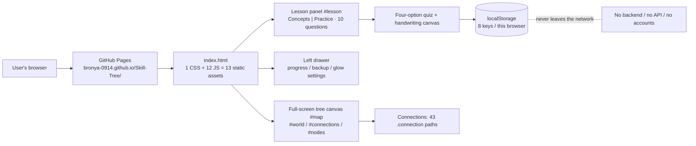
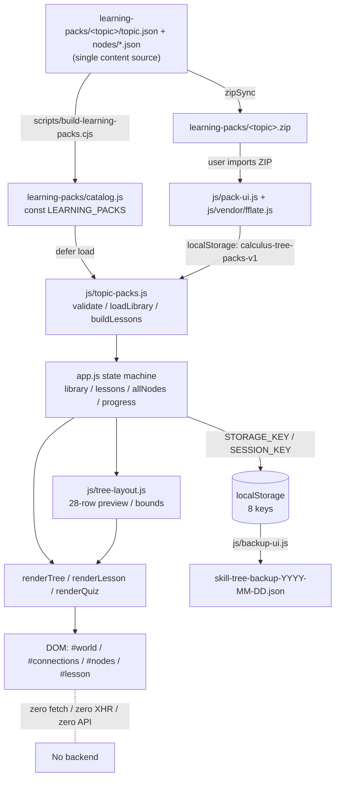
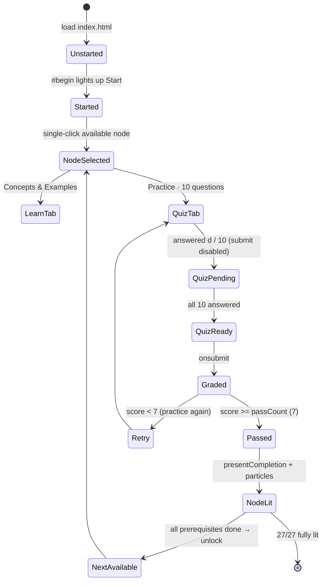

<a id="readme-top"></a>

<div align="center">

<h1 align="center">Calculus Skill Tree</h1>

<p align="center"><strong>A purely static, zero-backend learning site that turns calculus into a progressively lit skill tree: 27 lessons, 270 questions, zero accounts, zero package installs.</strong></p>

<p align="center"><a href="README.md">繁體中文</a> · English</p>

<p align="center">
  <a href="https://bronya-0914.github.io/Skill-Tree/">Live Demo</a> ·
  <a href="https://github.com/Bronya-0914/Skill-Tree">GitHub Repo</a> ·
  <a href="https://github.com/Bronya-0914/Skill-Tree/issues">Report an Issue</a> ·
  <a href="#documentation">Documentation</a>
</p>

<p align="center">
  <a href="#built-with"></a>
  <a href="#features"></a>
  <a href="#features"></a>
  <a href="#development-testing"></a>
  <a href="https://bronya-0914.github.io/Skill-Tree/"></a>
  <a href="#license"></a>
  <a href="#architecture"></a>
  <a href="#documentation"></a>
</p>

<p align="center"><sub>Badges, left to right: static · lessons · questions · tests · Pages · license · backend · docs</sub></p>

</div>

[繁體中文](README.md) · English

> **Version notice (read first):** This file describes the **local working tree** (Git HEAD `8d7b4cb`). The live demo at `https://bronya-0914.github.io/Skill-Tree/` is an **older build** (content `version: 1`, double-click to open) and does **not** match the local HEAD (content `version: 5`, single-click to open). The local Git repository has **no remote and no push history**, so this document makes **no claim of being "synced" or "deployed at the current version"**. See [Deployment / Release](#deployment).
> **Documentation status:** the 22 Markdown documents have been written to the working tree but are **not yet committed**; "working tree clean" below refers to the baseline snapshot at HEAD `8d7b4cb`. The working tree currently has uncommitted changes.

---

<details>
<summary><strong>Table of Contents (click to expand)</strong></summary>

<ol>
  <li><a href="#about">1. About the Project</a>
    <ul>
      <li><a href="#about-background">Background &amp; Motivation</a></li>
      <li><a href="#about-why-tree">Why a Skill Tree</a></li>
      <li><a href="#about-audience">Who It Is For</a></li>
      <li><a href="#about-not-for">When Not to Use It</a></li>
    </ul>
  </li>
  <li><a href="#features">2. Features</a>
    <ul>
      <li><a href="#features-core">Core Learning Loop</a></li>
      <li><a href="#features-interaction">Interaction &amp; Personalisation</a></li>
      <li><a href="#features-data">Content &amp; Data</a></li>
      <li><a href="#features-table">Feature / Mechanism Table</a></li>
    </ul>
  </li>
  <li><a href="#demo">3. Live Demo &amp; Screenshots</a>
    <ul>
      <li><a href="#demo-url">Live URL</a></li>
      <li><a href="#demo-diff">Live vs. Local HEAD</a></li>
      <li><a href="#demo-walkthrough">Walkthrough Diagram</a></li>
    </ul>
  </li>
  <li><a href="#built-with">4. Built With</a>
    <ul>
      <li><a href="#built-with-stack">Stack</a></li>
      <li><a href="#built-with-constraints">What Is Deliberately Absent</a></li>
    </ul>
  </li>
  <li><a href="#getting-started">5. Getting Started</a>
    <ul>
      <li><a href="#gs-prereq">Prerequisites</a></li>
      <li><a href="#gs-open">Three Ways to Open</a></li>
      <li><a href="#gs-steps">Step-by-step</a></li>
      <li><a href="#gs-devices">Desktop vs. Mobile</a></li>
    </ul>
  </li>
  <li><a href="#usage">6. Usage</a>
    <ul>
      <li><a href="#usage-start">Start &amp; Unlocking</a></li>
      <li><a href="#usage-quiz">Quiz &amp; Grading</a></li>
      <li><a href="#usage-workspace">Scratchpad &amp; Resizable Frame</a></li>
      <li><a href="#usage-personal">Theme, Glow, Language</a></li>
      <li><a href="#usage-data">Backup, Packs, Reset</a></li>
    </ul>
  </li>
  <li><a href="#architecture">7. Architecture</a>
    <ul>
      <li><a href="#arch-modules">Module Map</a></li>
      <li><a href="#arch-dataflow">Data Flow</a></li>
      <li><a href="#arch-state">State Machine</a></li>
      <li><a href="#arch-storage">The 8 localStorage Keys</a></li>
      <li><a href="#arch-build">Content Build Pipeline</a></li>
    </ul>
  </li>
  <li><a href="#data-privacy">8. Data &amp; Privacy</a>
    <ul>
      <li><a href="#dp-storage">Where Data Lives</a></li>
      <li><a href="#dp-answers">Answers Are Client-side</a></li>
      <li><a href="#dp-backup">Backup &amp; Overwrite Import</a></li>
      <li><a href="#dp-limits">Same-origin, No Accounts, No Tracking</a></li>
    </ul>
  </li>
  <li><a href="#deployment">9. Deployment / Release</a>
    <ul>
      <li><a href="#dep-pages">GitHub Pages &amp; Repository</a></li>
      <li><a href="#dep-hosting">Hosting Config (hosting.json)</a></li>
      <li><a href="#dep-gap">Deployment Gap</a></li>
      <li><a href="#dep-git">Local Git State</a></li>
      <li><a href="#dep-checklist">Pre-release Exclusion Checklist</a></li>
    </ul>
  </li>
  <li><a href="#development-testing">10. Development &amp; Testing</a>
    <ul>
      <li><a href="#dev-commands">Commands</a></li>
      <li><a href="#dev-tests">20/20 and the Three Test Files</a></li>
      <li><a href="#dev-rules">Generated Assets &amp; Versioning Rules</a></li>
    </ul>
  </li>
  <li><a href="#documentation">11. Documentation Index</a>
    <ul>
      <li><a href="#doc-index">Full Index</a></li>
      <li><a href="#doc-bilingual">Bilingual Mirrors &amp; Doc Consolidation</a></li>
    </ul>
  </li>
  <li><a href="#roadmap">12. Roadmap / Known Limitations</a>
    <ul>
      <li><a href="#roadmap-done">Shipped</a></li>
      <li><a href="#roadmap-limits">Known Limitations</a></li>
      <li><a href="#roadmap-not">Not Implemented</a></li>
    </ul>
  </li>
  <li><a href="#contributing">13. Contributing</a></li>
  <li><a href="#license">14. License</a></li>
  <li><a href="#acknowledgments">15. Acknowledgments</a></li>
  <li><a href="#faq">16. FAQ</a></li>
  <li><a href="#contact">17. Contact</a></li>
</ol>

</details>

---

<a id="about"></a>

## 1. About the Project

<a id="about-background"></a>

### Background & Motivation

**Calculus Skill Tree** is a single-page, purely static interactive calculus course. It breaks a subject into **27 progressive nodes**, each containing concept explanations, formulas, worked examples, and **10 four-option questions**. Read the material, answer at least **7 questions correctly**, and the node lights up and unlocks the next ones until the whole tree is lit.

The design is deliberately, almost aggressively simple and portable:

- **No server to run:** `index.html` is a self-contained entry point; open it directly in a browser.
- **Nothing to install:** no `package.json`, no `npm install`, no bundler, no frameworks, no CDN dependencies.
- **No login:** no accounts, no database, and zero `fetch` / `XMLHttpRequest` / API calls.
- **Works offline, travels with you:** content, code, styles, and progress all live in the browser.

The built-in course is the **CIS221 complete calculus route** (`topic.json` with `version: 5`), covering algebra and functions, differentiation, multivariable calculus, integration, and numerical methods. The source content is written in Traditional Chinese; the site ships a complete English message catalog for instant switching.

<a id="about-why-tree"></a>

### Why a Skill Tree

| Decision | Rationale |
|---|---|
| **Prerequisites made visible** | Each node declares `parents`; `js/tree-layout.js` lays them out as "bus + branch" connections so learners see exactly what must be finished first. A node can have several prerequisites, and **all of them must be completed**. |
| **Small, verifiable units** | One lesson is about 15 minutes, 10 questions, with a pass mark of 7. Progress is far more granular than chapter-based material. |
| **Progress is state** | Lit nodes, connections, and the progress bar are all driven by the same `progress` object, so visuals and data never diverge. |
| **Extensible to other subjects** | Content and code are separate: the site imports structured learning-pack ZIP files rather than a hard-coded course. New subjects attach to `start` and coexist with existing ones. |
| **Zero-cost sharing** | Drop the folder on any static host. Share content by exporting a ZIP; move house by exporting a JSON backup. |

<a id="about-audience"></a>

### Who It Is For

- Students taking calculus who want to **self-review in prerequisite order** (the 27-lesson route matches a CIS221-level course).
- Self-learners who want a practice environment with **no registration, no network requirement, and no tracking**.
- Teachers or content authors who need to turn existing notes into **validatable, importable, bilingual JSON learning packs**.
- Developers studying **pure front-end state machines, SVG connection geometry, in-browser ZIP read/write, and localStorage backup design**.
- Anyone needing a showcase project that can be **statically hosted with no back-end operations**.

<a id="about-not-for"></a>

### When Not to Use It

- **High-stakes exams that require secret answers:** answers and explanations ship with `learning-packs/catalog.js`, `nodes/*.json`, and the ZIP; anyone can read them in devtools.
- **Cross-device or cross-browser sync:** all state lives in one origin's `localStorage` and never syncs automatically.
- **Accounts, gradebooks, teacher dashboards, server-side grading:** there is **no back end**, and these are not implemented (see [Not Implemented](#roadmap-not)).
- **Redistribution that requires a clear license:** the project currently has **no LICENSE**; clarify this first (see [License](#license)).
- **Publishing the `references/` book full text:** that directory is local-only OCR reference material with copyright concerns and must be excluded before release (see [Pre-release Exclusion Checklist](#dep-checklist)).

<p align="right">(<a href="#readme-top">back to top</a>)</p>

---

<a id="features"></a>

## 2. Features

<a id="features-core"></a>

### Core Learning Loop

1. **Light up Start:** on first load only the `Start` node is visible; the start button sets `progress.started = true` and the full tree expands.
2. **Prerequisite unlocking:** node state is `isCompleted(id) || node.parents.every(isCompleted)`, producing three states: `lit` (completed), `available`, `locked`.
3. **Concept / Practice tabs:** each node has "Concepts & Examples" and "Practice · N questions". `content[]` supports five block types (`heading`, `paragraph`, `formula`, `example`, `tip`); `\n` inside formulas becomes `<br>` with each line centred.
4. **Submit only when complete:** `#quiz-submit` stays `disabled` (greyed out) until all 10 questions are answered; `onsubmit` adds a second guard.
5. **Instant grading and feedback:** correct options and explanations turn green, wrong ones red. The pass threshold reads `lesson.passCount` (currently 7 everywhere) instead of a hard-coded number.
6. **Light-up effects and unlocking:** `presentCompletion()` closes the panel, pans to the node, plays a particle effect, and unlocks the next batch; a "Next lesson" shortcut is offered.

<a id="features-interaction"></a>

### Interaction & Personalisation

- **Zoom and pan the tree:** wheel zoom, drag to pan, two-finger pinch, clamped to `0.03`–`2.2`; the toolbar offers zoom in/out and Fit (`#fit` centres on the computed bounds).
- **Draggable, resizable answer frame:** on desktop `#lesson` can be dragged by its title bar and resized with eight `.frame-resize` handles; entering a quiz for the first time auto-enlarges the workspace.
- **Handwriting scratchpad:** the Practice tab's `#quiz-scratch` hosts `<canvas id="scratch-canvas">` with pen/eraser, undo, and clear; strokes persist in `calculus-tree-scratch-v1`.
- **Dark / light theme:** an inline script in `index.html` reads `skill-tree-theme` before paint to avoid a white flash; `html.dark` overrides the whole CSS variable set.
- **Glow colour:** 8 preset swatches, an HSV picker, and HEX input write `--glow-rgb` / `--lit` variables that drive the glow of **Start, lit nodes, and connections**; synced across tabs via the `storage` event.
- **Chinese / English switch:** `js/i18n.js` translates text nodes and `aria-label` / `title` / `placeholder` / `content` attributes in place, **without rebuilding the DOM, changing progress, or touching imported packs**; originals are kept in a `WeakMap` for an exact switch back.
- **Mobile bottom sheet:** at `max-width:760px` the lesson card becomes a bottom sheet exposing a 46px handle, with quiz mode at `86vh`; the toolbar switches to a two-column grid.
- **Single-click open/close:** a single click on a node opens it, a single click on the map background closes it; double clicks only handle the first click.
- **Accessibility and reduced motion:** `prefers-reduced-motion` disables all animation and transitions and short-circuits light-up effects; there is a skip link and keyboard-steppable HSV controls.

<a id="features-data"></a>

### Content & Data

- **Learning-pack ZIP import / export:** `js/pack-ui.js` supports file selection or drag-and-drop, previews name, version, and prerequisites before confirmation, and can export a topic as `<topic.id>-v<version>.zip` (**content only, no personal progress**).
- **8-key JSON backup:** `js/backup-ui.js` exports/imports all site state as `skill-tree-backup-YYYY-MM-DD.json`; import is **overwrite-based**, rolls back on failure, and reloads on success.
- **Strict validation:** `js/topic-packs.js` runs in both the browser and Node and checks `schemaVersion`, `id` namespacing, acyclic prerequisites, question/option limits, and ZIP CRC32 / encryption / path traversal.
- **Version merging:** `loadLibrary()` lets a user version replace a built-in one when it is `>=`; `prepare()` rejects older versions and rejects "content changed but `version` not bumped".

<a id="features-table"></a>

### Feature / Mechanism Table

| Feature | User action | Under the hood |
|---|---|---|
| Start learning | Press the start button | `renderWelcome()` sets `progress.started`, writes `calculus-tree-progress-v1`, `renderTree()` switches from drawing only Start to all nodes |
| Unlocking | Watch a node turn from grey to clickable | `isAvailable()` checks `parents.every(isCompleted)`; `app.js` applies `locked` / `available` / `lit` classes |
| Connections | See buses and arrows | `renderTree()` emits **43 `.connection` paths** (16 buses + 27 entry lines), 8 `.tree-junction`, 8 `.prerequisite-join`, and **0 relay nodes** |
| Answering | Pick options, submit | `#quiz-form.onchange` writes `attempt.answers` → `saveSession()` → `updateQuizSubmit()`; `onsubmit` compares against `question[2]` |
| Pass threshold | Green feedback, node lights up | `score >= lesson.passCount` (7), push `progress.completed`, `presentCompletion()` + `unlock-effects.js` |
| Answer frame | Drag the title bar, pull a corner | `js/workspace.js` eight-direction resize, state in `calculus-tree-lesson-frame-v1` |
| Scratchpad | Draw on the canvas | `mountScratchpad()`, strokes in `calculus-tree-scratch-v1` (`MAX_STROKES=300`, `MAX_POINTS=30000`) |
| Glow | Pick a swatch / adjust HSV | `js/glow-settings.js` writes CSS variables and `calculus-tree-glow-v1` |
| Language | Press Chinese / EN | `js/i18n.js` + `js/i18n-messages.js` (1,831 keys, 46 parameterised templates), stored in `skill-tree-language` |
| Theme | Press the sun / moon | `index.html` inline script toggles `html.dark` and writes `skill-tree-theme` |
| Backup | Export / import JSON | `SkillTreeBackup` reads/writes the 8 `localStorage` keys; `importPayload()` overwrites and can roll back |
| Learning pack | Drop a ZIP, confirm | `js/vendor/fflate.js` decompresses → `TopicPacks.readZip()` → `prepare()` → `calculus-tree-packs-v1` |
| Reset | Confirm the dialog | Remove `SESSION_KEY`, clear `attempts` and `progress`, `selectedId='start'` |

<p align="right">(<a href="#readme-top">back to top</a>)</p>

---

<a id="demo"></a>

## 3. Live Demo & Screenshots

<a id="demo-url"></a>

### Live URL

| Item | Value |
|---|---|
| Live demo | **<a href="https://bronya-0914.github.io/Skill-Tree/">https://bronya-0914.github.io/Skill-Tree/</a>** |
| Page title | 微積分漫遊 · Calculus Skill Tree |
| Status | Verified `GET /` returns **200** with content served normally |
| GitHub repository | <a href="https://github.com/Bronya-0914/Skill-Tree">https://github.com/Bronya-0914/Skill-Tree</a> (public, default branch `main`, has_pages=true, 0 stars, no description, no license) |
| Report an issue | <a href="https://github.com/Bronya-0914/Skill-Tree/issues">GitHub Issues</a> |

<a id="demo-diff"></a>

### Live vs. Local HEAD

**The live site is older and is not the local HEAD.** This is the single most important fact about the project's current state:

| Comparison | Live GitHub Pages | Local working tree (HEAD `8d7b4cb`) |
|---|---|---|
| `topic.json` version | `version: 1` | **`version: 5`** |
| Node open/close | **Double-click** (`selectNode(id,{open})`, `dblclick`, `backgroundDoubleClick`) | **Single-click** (node opens, background closes) |
| `app.js` lines | 459 | 435 |
| First node content | 6 content blocks | 11 content blocks (book-rewrite edition) |
| `app.js` / `styles.css` / `catalog.js` SHA-256 | All differ from local | Current versions |
| 13 static asset paths | **Identical, item for item** | Identical |
| `README.md`, `js/hosting.json` | 200 | Local files |
| `DESIGN-v2.md`, `BOOK-REFERENCE.md`, `references/3000-solved-problems/*` | **404** (not public) | Local files |

The difference means the deployment has not been refreshed, not that anything is broken. See [Deployment / Release](#deployment).

<a id="demo-walkthrough"></a>

### Walkthrough Diagram

The project ships **no screenshot files**, so no invented image links are used. The actual layout is described with the Mermaid diagram and the ASCII sketch below.



ASCII sketch (desktop layout):

```text
┌──────────────────────────────────────────────────────────────┐
│ [≡]  ∫  Calculus Skill Tree                 [ZH / EN] [Reset] │
├───────────┬──────────────────────────────────┬───────────────┤
│ Drawer    │  Skill tree (zoomable / pannable) │  Lesson panel │
│ 3 / 27    │   Start ─┬─ 01 Functions ─┬─ 07  │ [Concept][Quiz]│
│ Backup    │          ├─ 02 Graphs ───┤  Power│  Concepts      │
│ Glow ×8   │          └─ 03 Trig ────┴─ 08    │  ── or ──      │
│ 8 + HSV   │   43 bus / branch connections     │  10 questions  │
│ About     │                                  │  + scratchpad  │
├───────────┴──────────────────────────────────┴───────────────┤
│ [−] 100% [+] [Fit] [theme]                   zoom tools (BR)  │
└──────────────────────────────────────────────────────────────┘
```

<p align="right">(<a href="#readme-top">back to top</a>)</p>

---

<a id="built-with"></a>

## 4. Built With

<a id="built-with-stack"></a>

### Stack

| Technology | Role | Notes |
|---|---|---|
| **HTML5** | Sole entry `index.html` | 155 lines, **53 static DOM IDs**; 13 assets loaded with `defer` in `<head>` |
| **CSS3** | `styles.css` | 690 lines; CSS-variable theming, glass surfaces, `@keyframes` light-up effects, `@media` mobile bottom sheet, `prefers-reduced-motion` |
| **Vanilla JavaScript (ES2020+)** | `app.js` + `js/*.js` | **No framework, no transpile, no bundler**; shared via globals and `module.exports` |
| **SVG** | `#connections` | `viewBox` changed from `0 0 760 950` to **`0 0 3069 1998`**; connections, arrow marker, prerequisite labels |
| **Canvas 2D** | Handwriting scratchpad | `<canvas id="scratch-canvas">`, strokes stored as an array |
| **localStorage** | All persistent state | **8 keys**, **5** of them carry `schemaVersion:1` |
| **fflate** | ZIP compression / decompression | `js/vendor/fflate.js` (UMD minified, 33,044 B), `window.fflate` in the browser; used by pack import/export and `scripts/build-learning-packs.cjs` |
| **GitHub Pages** | Static hosting | `https://bronya-0914.github.io/Skill-Tree/` |
| **Node.js** | **Build and tests only** | `node --test`, `node --check`, `node scripts/build-learning-packs.cjs`; **the running site does not need Node** |

The 13 static assets in `index.html`, in `defer` order:

```text
styles.css
learning-packs/catalog.js        (generated: content)
js/vendor/fflate.js             (ZIP)
js/topic-packs.js               (data layer / validation / ZIP I/O)
js/workspace.js                 (answer frame + scratchpad)
js/tree-layout.js               (connection geometry)
js/unlock-effects.js            (light-up effects)
app.js                          (state machine / DOM templates / zoom & pan)
js/backup-ui.js                 (backup)
js/pack-ui.js                   (learning packs)
js/glow-settings.js             (glow)
js/i18n-messages.js             (English message catalog)
js/i18n.js                      (language engine)
```

<a id="built-with-constraints"></a>

### What Is Deliberately Absent

> **No frameworks, no package installation, no backend.**

- No `package.json`, `node_modules`, npm scripts, `npm install`, or CDN scripts.
- No React / Vue / Svelte / jQuery / TypeScript / Webpack / Vite.
- Searching the whole project for `fetch(`, `XMLHttpRequest`, `/api/`, `firebase`, `supabase`, `cloudservice` returns **zero hits**: no backend, no API, no database, no accounts, no server-side grading.
- No tracking scripts, analytics, cookies, or third-party network requests.
- No `LICENSE`, `.gitignore`, `CNAME`, `.nojekyll`, `_config.yml`, `.github/workflows`, or `404.html` (see [Pre-release Exclusion Checklist](#dep-checklist)).

<p align="right">(<a href="#readme-top">back to top</a>)</p>

---

<a id="getting-started"></a>

## 5. Getting Started

<a id="gs-prereq"></a>

### Prerequisites

| Purpose | Requirement | Notes |
|---|---|---|
| **Use the site** | A modern browser | ES2020, `localStorage`, SVG, Canvas, `<dialog>`, `ResizeObserver`. Latest Chrome / Edge / Firefox / Safari recommended. |
| **Use the site** | No network, no login, no install | Just open the file or the live URL. |
| **Local HTTP preview (optional)** | Python 3 (or any static server) | Only to pin an origin and make `localStorage` testing predictable; the site itself does not need it. |
| **Build content / run tests (optional)** | Node.js | **Only for** `node --test`, `node --check`, `scripts/build-learning-packs.cjs`; the running site does not depend on it. |

<a id="gs-open"></a>

### Three Ways to Open

**(A) Open the file directly (simplest)**

Open this folder's `index.html` in a browser. No login, no package install, no server.

**(B) Open the live demo**

Visit <a href="https://bronya-0914.github.io/Skill-Tree/">https://bronya-0914.github.io/Skill-Tree/</a>. Note that it is an **older build** (see [Deployment Gap](#dep-gap)).

**(C) Local HTTP server (optional)**

Run from the repository root, then open `http://localhost:8000/`:

```bash
# Python 3 (no packages to install)
python -m http.server 8000

# Or the Python 3 alias
python3 -m http.server 8000
```

Notes:

- This is a **local preview option**, not a requirement. The project has no `package.json`, so there is **no** `npm install` / `npm start`.
- An HTTP server pins the origin (`http://localhost:8000`), so `localStorage` data is less likely to be lost to `file://` browser quirks.
- Changing the port, hostname, or protocol, switching to `file://`, or using another browser all count as a different origin / storage area: progress will not carry over (see [Data & Privacy](#data-privacy)).

<a id="gs-steps"></a>

### Step-by-step

1. **Open the site:** use (A), (B), or (C) above. On first load you see only the `Start` node and an empty-state hint.
2. **Light up Start:** press the start button; `progress.started` is written to `localStorage`, the 27-node tree expands, and the first available lesson is focused automatically.
3. **Select an available node:** single-click an `available` node to open the lesson panel. `locked` nodes cannot be selected; if a node has several prerequisites, **all must be completed**.
4. **Read concepts and examples:** browse `heading` / `paragraph` / `formula` / `example` / `tip` blocks; formulas scroll horizontally with each line centred.
5. **Switch to Practice and work:** open "Practice · 10 questions", use the scratchpad when needed; on desktop drag the title bar or pull a corner to resize the frame.
6. **Answer all 10 and submit:** the submit button is disabled until all 10 are answered; after submitting, correct answers turn green, wrong ones red, with per-question explanations.
7. **Pass and move on:** 7 or more correct answers pass; the node lights up, an effect plays, and downstream nodes unlock. Use "Next lesson" or "Practice again".
8. **(Optional) Personalise and migrate:** adjust theme, glow colour, and language; before switching browsers or devices, use Data backup → Export records to save JSON and import it later to restore.

<a id="gs-devices"></a>

### Desktop vs. Mobile

| Item | Desktop (`>= 761px`) | Mobile (`<= 760px`) |
|---|---|---|
| Lesson card | Floating panel on the right, draggable, eight-direction resize | Bottom sheet exposing a 46px handle; quiz mode `86vh` |
| Open / close | Single click on a node / background | `#lesson-toggle` drawer semantics; `workspace.js` inverts `checked` and sets `inert` |
| Zoom tools | Single row, bottom right | Two-column grid |
| Pack dialog | Standard `dialog` | Full-screen |
| Glass blur | `backdrop-filter` enabled | Disabled under `@media (hover:none) and (pointer:coarse)` to avoid frame drops |
| Formula size | 18px | 15px |
| Scratchpad | Side by side | Scrolls with the Practice tab |

<p align="right">(<a href="#readme-top">back to top</a>)</p>

---

<a id="usage"></a>

## 6. Usage

<a id="usage-start"></a>

### Start & Unlocking

- On first load `visible = progress.started ? allNodes : [startNode]`, so only Start is drawn and `#map-empty` is shown.
- Pressing `#begin` sets `justLitId='start'` for one light-up effect and auto-selects the first "incomplete and available" lesson.
- Node states: `completed → lit`, `available` (all prerequisites done), `locked`. The `base` / `derivative` / `integral` kinds are distinguished by a left colour bar.
- Extra prerequisites are shown as `.prerequisite-label` (currently **10 labels across 8 nodes**); clicking one jumps to that prerequisite.
- The `#progress` bar uses `max = lessons.length` (27) and `#progress-text` shows `N / 27`; the caption changes to a completion message at 27/27.

<a id="usage-quiz"></a>

### Quiz & Grading

- Each lesson's `quiz` is an array of `[prompt, options, answerIndex, explanation]`; currently **27 lessons × 10 questions = 270 questions**, 4 options each.
- `answeredCount()` counts answered items; `updateQuizSubmit()` sets `#quiz-submit.disabled = true` and adds `.quiz-pending` while `d < t`.
- `onsubmit` re-checks `attempt.submitted || answeredCount < total` so the UI cannot be bypassed.
- `score = quiz.filter((q,i) => attempt.answers[i] === q[2]).length`; `passed = score >= lesson.passCount` (**7**). On pass, `progress.scores[id]` keeps the historical maximum and `progress.completed` is appended.
- Feedback: `.option.correct` / `.feedback.correct` green; `.option.incorrect` / `.feedback.incorrect` red; explanations in `.feedback-detail`.
- After grading, "Practice again" clears that lesson's `attempts`; after passing, "Next lesson" jumps to the next incomplete available node.
- In-progress answers, the active tab, and the selected node are stored in `calculus-tree-session-v1` and restored on reload.

<a id="usage-workspace"></a>

### Scratchpad & Resizable Frame

- `js/workspace.js` exposes `mountScratchpad()`, `unmountScratchpad()`, `setQuizMode()`, `setOpen()`, and `resetFrame()`.
- On desktop `#lesson` records `left/top/width/height` in `calculus-tree-lesson-frame-v1`, with a minimum width of `min(340, innerWidth-16)` and height of `min(300, innerHeight-16)`.
- The scratchpad offers pen / eraser, stroke size, undo, and clear; strokes are `{tool, size, points}` arrays in `calculus-tree-scratch-v1`, capped at `MAX_STROKES=300` / `MAX_POINTS=30000`.
- `setOpen()` is async and awaits the transform animation (`animation.finished`); it short-circuits under `prefers-reduced-motion`.

<a id="usage-personal"></a>

### Theme, Glow, Language

| Setting | Action | Storage key | Affects |
|---|---|---|---|
| Dark / light theme | Sun / moon button, bottom right | `skill-tree-theme` (`'dark'` \| `'light'`, no schemaVersion) | The whole CSS variable set and `<meta name="theme-color">` |
| Glow colour | 8 swatches, HSV picker, HEX input, preview, reset | `calculus-tree-glow-v1` (`schemaVersion:1`) | Start, lit nodes, connections, submit-button halo; synced across tabs |
| Language | Chinese / EN controls, top right and drawer | `skill-tree-language` (`'zh-Hant'` \| `'en'`, no schemaVersion) | UI and built-in content; `html[lang="en"]` lets node titles wrap to two lines |

The 8 preset swatches: `#ffffff`, `#f2d9a8`, `#e8b264`, `#e0655f`, `#a58bd6`, `#7aa2e3`, `#4fc3b8`, `#8a8a92`. Switching language **does not rebuild the DOM, change progress, or modify imported packs**; unknown imported text keeps its original language and needs an exact catalog entry in `js/i18n-messages.js` to be translated.

<a id="usage-data"></a>

### Backup, Packs, Reset

- **Data backup:** `SkillTreeBackup.exportPayload()` packs the 8 keys as **raw strings** into `{app, schemaVersion:1, exportedAt, keys}`, saved as `skill-tree-backup-YYYY-MM-DD.json`; `importPayload()` writes them back key by key, where `null` means remove. Import is **overwrite-based**, rolls back on failure, and reloads after 500ms. Backups are **not encrypted** and include handwriting strokes.
- **Learning-pack import:** choose or drop a ZIP (5 MB cap); `fflate` decompresses, `TopicPacks.readZip()` validates, `prepare()` checks versions and changes, then a preview precedes "Confirm adding to skill tree" writing `calculus-tree-packs-v1`. New subjects normally attach to `start` and coexist with existing courses.
- **Learning-pack export:** export `<topic.id>-v<version>.zip` from the library; **content only, no personal progress**.
- **Reset progress:** `#reset` → confirm dialog → remove `SESSION_KEY`, clear `attempts`, set `progress = {started:false, completed:[], scores:{}}`, `selectedId='start'`, `activeTab='learn'`.

<p align="right">(<a href="#readme-top">back to top</a>)</p>

---

<a id="architecture"></a>

## 7. Architecture

<a id="arch-modules"></a>

### Module Map

| File | Responsibility | Public API / key constants |
|---|---|---|
| `index.html` | Sole entry, 53 static DOM IDs, asset order, anti-flash inline script | `1 CSS + 12 JS = 13` |
| `styles.css` | Theme variables, glass surfaces, node cards, connections, glow, mobile bottom sheet | `--lit` / `--glow-rgb` / `@keyframes ignite-*` |
| `app.js` | State machine, DOM templates, zoom/pan, progress, quiz flow | `STORAGE_KEY` / `PACKS_KEY` / `SESSION_KEY` / `BACKUP_KEYS` (8 keys); final init line `renderTree(); renderLesson(); fitTree();` |
| `learning-packs/catalog.js` | **Generated:** `const LEARNING_PACKS = [...]` | 170 KB / 4,515 lines, 270 `"answer"` fields |
| `js/topic-packs.js` | Validation, topological order, coordinates, version merge, ZIP I/O / CRC32 | `validate, prepare, buildLessons, loadLibrary, ordered, readZip, writeZip, escape`; `MAX_FILE=512KB` / `MAX_TOTAL=4MB` / caps of 30 topics and 300 nodes |
| `js/pack-ui.js` | Pack dialog: select/drop → preview → confirm; library export | `importSequence` guards race conditions, `escapePack` |
| `js/workspace.js` | Draggable/resizable frame + canvas scratchpad | `window.LessonWorkspace`; `SCHEMA=1` |
| `js/backup-ui.js` | 8-key backup export / overwrite import | `window.SkillTreeBackup`; `APP='calculus-skill-tree'` / `SCHEMA=1` |
| `js/glow-settings.js` | HSV picker, CSS variables, cross-tab sync | `KEY='calculus-tree-glow-v1'` / `DEFAULT='#ffffff'` |
| `js/i18n.js` | In-place translation, MutationObserver, WeakMap | `window.SkillTreeI18n`; 46 templates, `depth<=6`, Han-script detection |
| `js/i18n-messages.js` | English catalog `window.SkillTreeEnglish` | 270 KB / 1,848 lines / **1,831 keys** |
| `js/tree-layout.js` | Connection geometry, fixed preview coordinates, bounds | `preview` = **28 rows**, `nodeWidth=282` / `layerStep=168`; bounds `{minX:40, maxX:3045, maxY:1974}` → world **`3069 × 1998`** |
| `js/unlock-effects.js` | Light-up particle effects | `window.SkillTreeEffects.play()` |
| `js/vendor/fflate.js` | UMD minified ZIP library | `require()` in Node, `window.fflate` in browser; **no version string found in the file** |
| `js/hosting.json` | Hosting config | `{"static":{"directory":"."}}` |
| `scripts/build-learning-packs.cjs` | Generates `catalog.js` and ZIPs | `zipSync(files,{level:6})` then immediate `readZip()` self-check |
| `tests/*.test.cjs` | Three test files | See [Development & Testing](#development-testing) |

Current connections are "bus + branch": **43 `.connection` paths** (16 buses + 27 entry lines), 8 `.tree-junction`, 8 `.prerequisite-join`, 8 `.prerequisite-dot`, and **0 relay nodes**. The older "117 segments / 31 relay nodes" figures in design docs are obsolete: `relay`, `connectionSegments`, and `buildLaneMap` have **zero hits in code** and must not be cited as current.

<a id="arch-dataflow"></a>

### Data Flow



<a id="arch-state"></a>

### State Machine



<a id="arch-storage"></a>

### The 8 localStorage Keys

`BACKUP_KEYS` in `app.js` lists **8 keys**; `FALLBACK_KEYS` in `js/backup-ui.js` matches it, exposed to the backup module via `window.SkillTreeBackupKeys`. **5 of the 8 carry `schemaVersion:1`**.

| # | Key | Value shape | Purpose | In backup |
|---|---|---|---|---|
| 1 | `calculus-tree-progress-v1` | `{started, completed[], scores{}}`, **no schemaVersion** | Progress and best scores | Yes |
| 2 | `calculus-tree-packs-v1` | `{schemaVersion:1, packs[]}` | Imported / merged content | Yes |
| 3 | `calculus-tree-session-v1` | `{schemaVersion:1, selectedId, activeTab, attempts{}}` | In-progress answers and tab | Yes |
| 4 | `skill-tree-theme` | Raw string `'dark'` \| `'light'`, **no schemaVersion** | Dark / light theme | Yes |
| 5 | `calculus-tree-glow-v1` | `{schemaVersion:1, color:"#rrggbb"}` | Glow colour | Yes |
| 6 | `calculus-tree-lesson-frame-v1` | `{schemaVersion:1, left, top, width, height, quizInitialized}` | Frame geometry | Yes |
| 7 | `calculus-tree-scratch-v1` | `{schemaVersion:1, strokes[]}` | Handwriting strokes | Yes |
| 8 | `skill-tree-language` | Raw string `'zh-Hant'` \| `'en'`, **no schemaVersion** | Language choice | Yes |

Notes: the backup payload has its own `schemaVersion:1` (not stored in localStorage); values are kept as **raw strings**, `null` means the key does not exist; built-in default content (`catalog.js`) never enters localStorage; a topic ZIP export contains content only, never personal progress.

<a id="arch-build"></a>

### Content Build Pipeline

1. Edit `learning-packs/<topic>/topic.json` and `nodes/*.json` (`schemaVersion:1`).
2. **Any content change must bump the integer `topic.version`** and keep existing node IDs; `prepare()` rejects both older versions and "changed without a version bump".
3. Run `node scripts/build-learning-packs.cjs` from the repository root: scan subfolders containing `topic.json` → `validate()` → sort nodes with `localeCompare(..., 'zh-Hant', {numeric:true})` → `loadLibrary()` merge → for each pack `zipSync(level:6)` then immediate `readZip()` self-check → write `<topic>.zip` and `catalog.js`.
4. Run `node --test tests/*.test.cjs` to confirm `catalog.js`, the ZIP, and the 27 source JSON files match item for item.
5. **Do not hand-edit or delete `catalog.js` or `<topic>.zip`**: they are generated assets the site consumes. When adding built-in Chinese content, add matching English entries to `js/i18n-messages.js`.

Current statistics (measured with `node -e`, not transcribed from docs): `version=5`, **27 nodes**, **270 questions**, 10 four-option questions per lesson, `passCount=7`, `minutes=15`; `kind` distribution `base 6` / `derivative 15` / `integral 6`; **271 content blocks** (`heading 81`, `paragraph 81`, `formula 27`, `example 55`, `tip 27`); **365 `\n` line breaks** (`formula 116`, `example 169`, `paragraph 54`, `tip 26`).

<p align="right">(<a href="#readme-top">back to top</a>)</p>

---

<a id="data-privacy"></a>

## 8. Data & Privacy

<a id="dp-storage"></a>

### Where Data Lives

All state lives in the **current browser, current origin** `localStorage`, across 8 keys (see [the 8-key table](#arch-storage)). Nothing is ever sent to a server, because there is no server.

<a id="dp-answers"></a>

### Answers Are Client-side

`learning-packs/catalog.js` contains **270 `"answer"` fields**, sharing the same source as `nodes/*.json` and the ZIP; `renderQuiz()` compares directly against `question[2]`. Searching the project for `fetch(`, `XMLHttpRequest`, `/api/`, `firebase`, `supabase`, `cloudservice` yields **zero hits**.

> This means **answers cannot be kept secret**: anyone can read questions, options, answer indices, and explanations from devtools, view-source, or by downloading the ZIP. A pure front end plus a cloud database cannot keep answers secret either; real assessment requires server-side grading (**not implemented**).

<a id="dp-backup"></a>

### Backup & Overwrite Import

- The exported JSON holds the 8 keys as **raw strings**, plus `exportedAt` and `app='calculus-skill-tree'`; `validate()` checks `app` / `schemaVersion` / `keys` types and additionally parses the progress key.
- Import is **overwrite-based**: `importPayload()` writes each key back, removing keys whose value is `null` / `undefined`; a write failure rolls back using a `before` snapshot, and success calls `location.reload()`.
- Backups are **not encrypted** and include handwriting strokes plus any content the user imported; store the file carefully.
- A backup does **not** contain the `learning-packs/cis221-calculus.zip` file itself, but content the user imported lives in `PACKS_KEY` and is therefore included.

<a id="dp-limits"></a>

### Same-origin, No Accounts, No Tracking

- **No cross-origin / cross-browser data sharing:** switching URL, domain, browser, device, incognito mode, or clearing site data resets everything; the only migration path is a manual JSON backup export/import.
- **No accounts:** no registration, login, user identifiers, or collection of personal data.
- **No tracking:** no analytics scripts, cookies, third-party requests, or CDN dependencies.
- **No server-side grading:** scoring happens entirely in the browser and results stay local.

<p align="right">(<a href="#readme-top">back to top</a>)</p>

---

<a id="deployment"></a>

## 9. Deployment / Release

<a id="dep-pages"></a>

### GitHub Pages & Repository

| Item | Value |
|---|---|
| Live demo | `https://bronya-0914.github.io/Skill-Tree/` (`GET /` returns 200, title "微積分漫遊 · Calculus Skill Tree") |
| Repository | `https://github.com/Bronya-0914/Skill-Tree` |
| Visibility / branch | public / default branch `main` |
| GitHub Pages | `has_pages=true` |
| Metadata | 0 stars, **no description**, **no license** |
| Issues | `https://github.com/Bronya-0914/Skill-Tree/issues` |

<a id="dep-hosting"></a>

### Hosting Config (hosting.json)

`js/hosting.json` is the **only** deployment config in the project:

```json
{
  "project_id": "appgprj_6af1852c8bc88191999e930daeb549ac",
  "static": { "directory": "." }
}
```

`static.directory = "."` means **the entire repository root is the static root**. The project contains no `package.json`, `CNAME`, `404.html`, `.nojekyll`, `_config.yml`, `.github/workflows`, or `.gitignore`.

<a id="dep-gap"></a>

### Deployment Gap

**The live site is older than the local HEAD.** Live `topic.json` is `version: 1` with **double-click** open/close (`app.js` 459 lines, `selectNode(id,{open})`, `dblclick`, `backgroundDoubleClick`); local HEAD `8d7b4cb` is `version: 5` with **single-click** open/close (`app.js` 435 lines). The live first node has 6 content blocks versus 11 in the local book-rewrite edition; the SHA-256 of `app.js`, `styles.css`, and `catalog.js` all differ. The 13 asset paths match item for item, but the bytes do not.

Live `README.md` and `js/hosting.json` return 200; `DESIGN-v2.md`, `BOOK-REFERENCE.md`, and `references/3000-solved-problems/*` return **404** (the book full text is currently not public).

> This document makes **no claim of being "synced" or "deployed at the current version"**; older design docs saying "unpublished, not deployed, not shared" should likewise be corrected to "live, but lagging behind".

<a id="dep-git"></a>

### Local Git State

- `git remote -v` is **empty**: the local repository has **no remote at all**.
- `git config --list` contains no `remote.*`; the reflog shows only local commits (author `Sites <sites@users.noreply.openai.com>`), with **no push / fetch history**.
- `git branch --show-current` = `main`; `HEAD` = `8d7b4cb Checkpoint current site: i18n, tree layout, unlock effects, workspace and docs`; `git status --short` was clean at the documentation baseline (the documentation pass leaves uncommitted changes).
- `git ls-files | wc -l` = **105**, equal to the total file count, meaning all 48 `.txt` files under `references/` **are tracked by Git**.
- Therefore: **do not add a remote, do not push, do not claim sync**; this document only records the current state.

<a id="dep-checklist"></a>

### Pre-release Exclusion Checklist

Because `static.directory = "."` and there is **no `.gitignore`**, packaging or pushing directly would expose everything below. **Exclude these before release:**

| Priority | Path | Reason |
|---|---|---|
| Highest | `references/` (`3000-solved-problems/`: `book-full.txt` 892 KB, 46 chapter txt files, `chapters.json`) | Schaum's / McGraw-Hill 1988 OCR full text, **already tracked by Git** but currently 404 online; copyright concerns, local reference only |
| High | `tests/*.test.cjs`, `scripts/*.cjs`, `*.cjs` | Test and build scripts, not needed publicly |
| High | `learning-packs/<topic>/nodes/*.json`, source `topic.json`, `*.zip` | Source content and build inputs; the site only needs `catalog.js` |
| Medium | `DESIGN-v2.md`, `BOOK-REFERENCE.md`, `MULTIUSER-ARCH.md` | Design/acceptance history, bibliography notes, unimplemented architecture evaluation |
| Medium | `AI_TEACHING_GUIDE.md`, `PACK_FORMAT.md`, `I18N.md` and all `.en.md` | Development / maintenance docs; publishing is optional |
| Medium | `.git/`, generated temp files | Should never ship with a static bundle |

Recommended: add a `.gitignore` covering the above, or point `static.directory` at a clean publish folder containing only `index.html`, `styles.css`, `app.js`, `js/`, and `learning-packs/catalog.js`. Also note there is **no LICENSE** (see [License](#license)) and that `js/vendor/fflate.js` **contains no version string** (`PACK_FORMAT.md` records `fflate 0.8.3`, but that cannot be verified from the file).

<p align="right">(<a href="#readme-top">back to top</a>)</p>

---

<a id="development-testing"></a>

## 10. Development & Testing

<a id="dev-commands"></a>

### Commands

Run from the repository root (Node.js is **for build and tests only**; the running site needs none of it):

```bash
# Run all tests
node --test tests/*.test.cjs

# Syntax-check 15 files
node --check app.js js/*.js learning-packs/catalog.js scripts/*.cjs tests/*.cjs

# Rebuild generated content (rewrites catalog.js and ZIPs; run only after a version bump)
node scripts/build-learning-packs.cjs
```

> This documentation pass was read-only: `node scripts/build-learning-packs.cjs` was **not** executed (it rewrites `catalog.js` and the ZIPs), and no non-assigned file was modified.

<a id="dev-tests"></a>

### 20/20 and the Three Test Files

Measured output of `node --test tests/*.test.cjs`:

```text
# tests 20
# suites 0
# pass 20
# fail 0
# cancelled 0
# skipped 0
# todo 0
# duration_ms 234.7205
```

`node --check` also passes for **15 files** in total: `app.js`, `js/*.js` (10 files), `learning-packs/catalog.js`, `scripts/build-learning-packs.cjs`, and the 3 test files.

| Test file | Tests | Responsibility |
|---|---|---|
| `tests/topic-packs.test.cjs` | 14 | `catalog.js` vs. ZIP vs. 27 source JSONs item by item; 27 lessons / 270 questions; `loadLibrary` deduping and version priority; `readZip(writeZip())` round trip; file-name-independent topological order and `passCount===7`; `prepare()` idempotence / `retained===26` / older-version rejection / change-without-bump rejection; missing prerequisites, cycles, duplicate IDs, invalid answers, namespacing, `schemaVersion=2`; HTML escaping; truncated ZIP, broken JSON, path traversal, missing `topic.json`, oversized decompression, CRC corruption; cross-topic prerequisites and cycles |
| `tests/tree-layout.test.cjs` | 3 | `verifyGraph()`: `parents` untouched, `primary.size === nodes.length-1`, finite coordinates, parent y < child y, matching ancestor sets, no overlapping cards, buses/entry lines not crossing other cards; approved tree has 10 flattened `additional`, `elementary` primary/additional, `functions.x === start.x`; modified/imported packs and a 300-node stress test |
| `tests/i18n.test.cjs` | 3 | Load `i18n-messages.js` + `i18n.js` via `vm` and scan every `catalog.js` string for residual Han characters after `english()` (27 lessons / 270 questions); dynamic label translation, embedded lesson names, saturation, pure math unchanged; unknown imported content and HTML left intact, error-message templates translated |

> Note: several older docs say "14/14"; that was the era when only `topic-packs.test.cjs` existed. **The current figure is 20/20.**

<a id="dev-rules"></a>

### Generated Assets & Versioning Rules

- **Never hand-edit or delete** `learning-packs/catalog.js` or `learning-packs/*.zip`: both are generated by `scripts/build-learning-packs.cjs`, and the tests compare them against source JSONs item by item.
- **Bump `topic.version` for any content change:** `prepare()` rejects older versions and "changed without a bump"; keep node IDs stable so prerequisites do not break.
- **Add an English entry whenever built-in Chinese content is added:** `js/i18n-messages.js` keys are exact Traditional Chinese strings, and `i18n.test.cjs` checks that no Han characters survive translation.
- **Changing `BACKUP_KEYS` requires changing `FALLBACK_KEYS` too:** the two definitions are duplicated in `app.js` and `js/backup-ui.js`.
- **Mind the implicit coupling:** `app.js` and `js/pack-ui.js` share globals `map` / `viewport`; `SkillTreeLayout.build()` mutates the `x/y` of the nodes passed in.
- **Do not cite stale design figures as current:** `DESIGN-v2.md` §10–15 values ("117 segments / 31 relay nodes", `Fit scale=0.596`, `14/14`, 35/44 DOM IDs, six/seven keys, 11/11–13/13 assets, double-click / `resize:both` / third tab, "unpublished") are obsolete. Current values: 43 paths / 0 relays, 53 IDs, 8 keys, 13 assets, 20/20, 1,831 keys, `version=5`, single-click, GitHub Pages live but lagging.

<p align="right">(<a href="#readme-top">back to top</a>)</p>

---

<a id="documentation"></a>

## 11. Documentation Index

<a id="doc-index"></a>

### Full Index

The local repository now contains **22 Markdown documents**: 10 in the root, 10 under `docs/`, and 2 under `learning-packs/cis221-calculus/`. All are `local` (present in the working tree); `I18N.md` is bilingual in one file, while the other Chinese/English pairs use `.en.md`. The original English MD files on the GitHub repository have been copied into the local repository, not deleted, not pushed to, and no remote is configured. The 35 MD files outside this project remain untouched by the owner's decision.

| Group | Chinese document | English counterpart | Purpose | Status |
|---|---|---|---|---|
| Usage | [README.md](README.md) (counterpart) | [README.en.md](README.en.md) (this file) | Overview, getting started, architecture, deployment, limitations | local / EN mirror |
| Format | [PACK_FORMAT.md](PACK_FORMAT.md) | [PACK_FORMAT.en.md](PACK_FORMAT.en.md) | Learning-pack format v1: `topic.json` / node fields, ZIP, versions, limits | local / EN mirror |
| Content | [AI_TEACHING_GUIDE.md](AI_TEACHING_GUIDE.md) | [AI_TEACHING_GUIDE.en.md](AI_TEACHING_GUIDE.en.md) | Eight production stages for a hand-over AI, lesson-count decisions, bilingual delivery | local / EN mirror |
| Content | [learning-packs/cis221-calculus/README.md](learning-packs/cis221-calculus/README.md) | [learning-packs/cis221-calculus/README.en.md](learning-packs/cis221-calculus/README.en.md) | The 27 lessons, prerequisites, question-edit workflow | local / EN mirror |
| Content | [BOOK-REFERENCE.md](BOOK-REFERENCE.md) | — | Schaum's bibliography, 46-chapter mapping, rewrite progress, R5 acceptance | local / local reference only, not public |
| Design | [DESIGN-v2.md](DESIGN-v2.md) | — | Design decisions and R4/R5 acceptance history (with a current-values crosswalk at the top) | local / historical |
| Architecture | [MULTIUSER-ARCH.md](MULTIUSER-ARCH.md) | — | Multi-user A/B/C option evaluation (not implemented) | local / historical |
| Architecture | [I18N.md](I18N.md) | [I18N.md](I18N.md) (same file, `## 繁體中文` / `## English`) | Language switching, `skill-tree-language`, message-catalog maintenance | local / bilingual in one file |
| Index | [docs/README.md](docs/README.md) | — | Full documentation map (Traditional Chinese + English table) | local / bilingual in one file |
| Architecture | [docs/ARCHITECTURE.md](docs/ARCHITECTURE.md) | [docs/ARCHITECTURE.en.md](docs/ARCHITECTURE.en.md) | Current architecture, modules, state machine, 8 storage keys, risk register | local / EN mirror |
| History | [docs/CHANGELOG.md](docs/CHANGELOG.md) | [docs/CHANGELOG.en.md](docs/CHANGELOG.en.md) | 17 commits with changes, verification figures, and limitations | local / EN mirror |
| Community | [docs/CONTRIBUTING.md](docs/CONTRIBUTING.md) | [docs/CONTRIBUTING.en.md](docs/CONTRIBUTING.en.md) | Contribution workflow, content SOP, test and commit discipline | local / EN mirror |
| Community | [docs/SECURITY.md](docs/SECURITY.md) | [docs/SECURITY.en.md](docs/SECURITY.en.md) | Security boundaries, data privacy, pre-release exclusion checklist | local / EN mirror |
| Audit | [docs/MD-AUDIT.md](docs/MD-AUDIT.md) | — | This MD audit, classification of 35 external files, and retention decision | local / bilingual summary |

<a id="doc-bilingual"></a>

### Bilingual Mirrors & Doc Consolidation

Every paired document starts with the same language-switch line, for example:

```text
繁體中文 · [English](README.en.md)          (Chinese primary)
[繁體中文](README.md) · English             (English counterpart)
```

This consolidation pass copied the English MD files that were previously only on the GitHub repository (`README.en.md`, `AI_TEACHING_GUIDE.en.md`, `PACK_FORMAT.en.md`, `learning-packs/cis221-calculus/README.en.md`, and related files) into the local repository and expanded them substantially. Their **English technical vocabulary** (learning pack, lesson, node, prerequisite, light up Start, glow settings, scratchpad, quiz, backup) and **language-switch link format** are preserved. `I18N.md` is already bilingual in a single file (`## 繁體中文` / `## English`), so it has no separate `.en.md`. The architecture, changelog, contributing, security, audit, and index documents under `docs/` have also been created; see [docs/MD-AUDIT.md](docs/MD-AUDIT.md) for the full audit and the external-file list.

All links point to files that now exist locally. The original English files on GitHub are **not deleted, not pushed to, and no remote is configured**; the 35 MD files outside this project are **not deleted and not moved**.

<p align="right">(<a href="#readme-top">back to top</a>)</p>

---

<a id="roadmap"></a>

## 12. Roadmap / Known Limitations

<a id="roadmap-done"></a>

### Shipped

- 27-lesson / 270-question bilingual calculus course (`version=5`), concept and practice tabs, submit-only-when-complete, green/red feedback.
- Start light-up, prerequisite unlocking, progress bar, light-up particle effects, 43 bus + branch connections, single-click open/close.
- Draggable/resizable answer frame, canvas handwriting scratchpad, dark/light theme, 8 swatches + custom HSV glow.
- Instant Chinese/English switching (no DOM rebuild), mobile bottom sheet, `prefers-reduced-motion`.
- Learning-pack ZIP import/export, 8-key JSON backup export / overwrite import, progress reset.
- `node --test` **20/20**, `node --check` passes for 15 files; `js/tree-layout.js` 28-row preview, world `3069 × 1998`.
- GitHub Pages live (but on an older build; see [Deployment Gap](#dep-gap)).

<a id="roadmap-limits"></a>

### Known Limitations

1. **Answers are client-side and cannot be secret:** 270 answers ship with `catalog.js` / `nodes/*.json` / the ZIP; no server-side grading.
2. **No cross-origin / cross-browser data sharing:** `localStorage` only; switching environments resets progress. Backups are unencrypted and imports overwrite.
3. **`static.directory = "."` with no `.gitignore`:** exposes design docs, tests, source content, and the `references/` OCR book full text. `references/` is tracked by Git and currently 404 online; **it must be excluded before release**.
4. **No LICENSE:** only the third-party `js/vendor/fflate-LICENSE.txt` is MIT; the project itself has no license terms.
5. **Deployment mismatch:** live `version:1` / double-click vs. local `version:5` / single-click; no remote, no push history locally.
6. **`fflate` version unverifiable:** no version string in `js/vendor/fflate.js`; the `0.8.3` noted in `PACK_FORMAT.md` cannot be checked against the file.
7. **Code-level coupling:** duplicated `BACKUP_KEYS` / `FALLBACK_KEYS`, shared globals `map` / `viewport`, `SkillTreeLayout.build()` mutating `x/y`, exact-string keys required in `i18n-messages.js`.
8. **`static.directory = "."` has not been fully validated on a real hosting platform** (listed as a limitation in `DESIGN-v2.md` §10.4).
9. **Stale figures in older docs:** see [Generated Assets & Versioning Rules](#dev-rules).

<a id="roadmap-not"></a>

### Not Implemented

> **Server-side grading / account sync / remote backup are not implemented.** These follow directly from the pure front-end design; they are not bugs to fix.

- No server-side grading or anti-cheating scoring.
- No accounts, login, cross-device sync, or cloud database.
- No remote backup or automatic sync; migration is a manual JSON export/import.
- No `LICENSE`, `.gitignore`, CI workflow, or `package.json`.
- None of the A/B/C multi-user options in `MULTIUSER-ARCH.md` are applied (that file is an evaluation, not an implementation).

<p align="right">(<a href="#readme-top">back to top</a>)</p>

---

<a id="contributing"></a>

## 13. Contributing

Contributions to content, translations, and bug reports are welcome. Suggested workflow:

1. Open or claim an issue at <a href="https://github.com/Bronya-0914/Skill-Tree/issues">GitHub Issues</a> with reproduction steps and expected behaviour.
2. Branch off `main`; there is no bundler, so edit `app.js`, `styles.css`, or `js/*.js` directly.
3. For content changes, follow the [Content Build Pipeline](#arch-build): edit the JSON under `learning-packs/<topic>/`, **bump `topic.version`**, keep node IDs stable, and add matching English entries to `js/i18n-messages.js`.
4. **Do not hand-edit `catalog.js` or the ZIPs**; once confirmed, rebuild with `node scripts/build-learning-packs.cjs`.
5. Before submitting, run `node --test tests/*.test.cjs` (should be 20/20) and `node --check`.
6. Full guidelines: **[docs/CONTRIBUTING.md](docs/CONTRIBUTING.md)**; pack format in [PACK_FORMAT.md](PACK_FORMAT.md), content production in [AI_TEACHING_GUIDE.md](AI_TEACHING_GUIDE.md).

Before committing, make sure the `references/` book full text, temporary test files, and personal backup JSON files are not included (see [Pre-release Exclusion Checklist](#dep-checklist)).

<p align="right">(<a href="#readme-top">back to top</a>)</p>

---

<a id="license"></a>

## 14. License

**No license has been specified for this project.** The repository has no `LICENSE` file and the GitHub metadata has no license field. Until licensing is clarified, do not assume free redistribution or derivation; confirm with the maintainer first.

The only third-party license file is `js/vendor/fflate-LICENSE.txt`: **fflate is MIT** (Copyright (c) 2026 Arjun Barrett). The licensing status of everything else (content text, design, code) is undetermined. Note also that the Schaum's / McGraw-Hill 1988 OCR full text under `references/` is **local reference material only**, is outside the project's licensable scope, and must not be published or bundled.

<p align="right">(<a href="#readme-top">back to top</a>)</p>

---

<a id="acknowledgments"></a>

## 15. Acknowledgments

- **Schaum's / McGraw-Hill (1988)** solved-problems book: used only as local `references/` OCR reference and as a basis for rewritten content; the full text is never included in public deployments (see [BOOK-REFERENCE.md](BOOK-REFERENCE.md)).
- **Standard Readme:** for the spirit of its `Table of Contents`, `Background`, `Install`, `Usage`, `Badge`, `Maintainers`, `Contributing`, `Contributors`, and `License` sections.
- **Best-README-Template:** for the centred `<div align="center">` header, the shields.io badge row, the `<details>` collapsible table of contents, the About / Built With / Getting Started / Usage / Roadmap / Contributing / License / Contact / Acknowledgments layout, and the back-to-top links at the end of each section.
- **Shields.io:** every static badge in this file.
- **GitHub Pages:** static hosting and the live demo.
- **fflate:** in-browser ZIP compression / decompression (MIT).

<p align="right">(<a href="#readme-top">back to top</a>)</p>

---

<a id="faq"></a>

## 16. FAQ

<details>
<summary>Why did my progress disappear after switching browsers or URLs?</summary>

All state lives in one origin's `localStorage` (8 keys) and never syncs automatically. Before switching, use Data backup → Export records to download `skill-tree-backup-YYYY-MM-DD.json`, then import it in the new environment. Import overwrites, so confirm the target has nothing you want to keep. See [Data & Privacy](#data-privacy).
</details>

<details>
<summary>Can I just hand the site a PDF and have it turn into a course?</summary>

No. The site imports structured learning-pack ZIP files (`topic.json` + `nodes/*.json`). Give your documents to an AI together with [AI_TEACHING_GUIDE.md](AI_TEACHING_GUIDE.md) and have it prepare the content, then import; see [PACK_FORMAT.md](PACK_FORMAT.md) for the format.
</details>

<details>
<summary>Can answers be seen? Is this suitable for a real exam?</summary>

Yes, they can, and no, it is not. 270 answer indices and explanations ship with `learning-packs/catalog.js`, `nodes/*.json`, and the ZIP, and `renderQuiz()` compares against them directly. There is no server-side grading or anti-cheating. This is a self-practice tool, not an assessment system. See [Answers Are Client-side](#dp-answers).
</details>

<details>
<summary>Is the live demo the same as the project I downloaded?</summary>

No. The live site at `https://bronya-0914.github.io/Skill-Tree/` is older (`version:1`, double-click), while the local HEAD is `version:5` with single-click; the local Git repository has no remote and no push history, so the two are not synced. See [Deployment Gap](#dep-gap).
</details>

<details>
<summary>Do I need Node.js or npm install to use the site?</summary>

No. Just open `index.html` in a browser or visit the live URL. Node.js is **only** for building content (`scripts/build-learning-packs.cjs`) and running tests (`node --test`, `node --check`); the project has no `package.json`, so there is no `npm install`.
</details>

<details>
<summary>Why is there no LICENSE? May I share or adapt it?</summary>

There is currently no `LICENSE` file and licensing is undetermined; the third-party fflate library is MIT. Confirm with the maintainer before sharing or adapting, and always exclude the `references/` book full text. See [License](#license).
</details>

<details>
<summary>Why do older design docs mention 117 connection segments and 14/14 tests?</summary>

Those are historical figures. Current values: 43 `.connection` paths / 0 relay nodes, 20/20 tests, 53 DOM IDs, 13 assets, 8 localStorage keys, 1,831 i18n keys, `version=5`. Parts of `DESIGN-v2.md` §10–15 and `BOOK-REFERENCE.md` are stale; use this file and [Architecture](#architecture) as the reference.
</details>

<details>
<summary>Can I drag and resize the answer frame on mobile like on desktop?</summary>

No, by design. At `max-width:760px` the lesson card becomes a bottom sheet (46px handle, `86vh` in quiz mode), `.frame-resize` handles are hidden, and glass blur is disabled to avoid frame drops. See [Desktop vs. Mobile](#gs-devices).
</details>

<p align="right">(<a href="#readme-top">back to top</a>)</p>

---

<a id="contact"></a>

## 17. Contact

| Purpose | Channel |
|---|---|
| Bugs and suggestions | <a href="https://github.com/Bronya-0914/Skill-Tree/issues">https://github.com/Bronya-0914/Skill-Tree/issues</a> |
| Repository | <a href="https://github.com/Bronya-0914/Skill-Tree">https://github.com/Bronya-0914/Skill-Tree</a> |
| Live demo | <a href="https://bronya-0914.github.io/Skill-Tree/">https://bronya-0914.github.io/Skill-Tree/</a> |
| Documentation | [Documentation Index](#documentation) |
| Contributing | [docs/CONTRIBUTING.md](docs/CONTRIBUTING.md) |

Maintainers and contributors are recorded in the repository's commit history; this file lists no personal contact details.

<p align="right">(<a href="#readme-top">back to top</a>)</p>

---

<p align="center">Calculus Skill Tree　|　<a href="README.md">繁體中文</a> · English　|　<a href="#readme-top">back to top</a></p>
