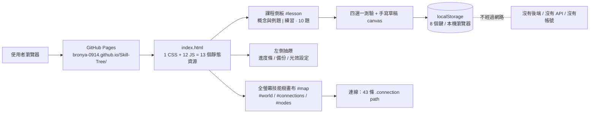
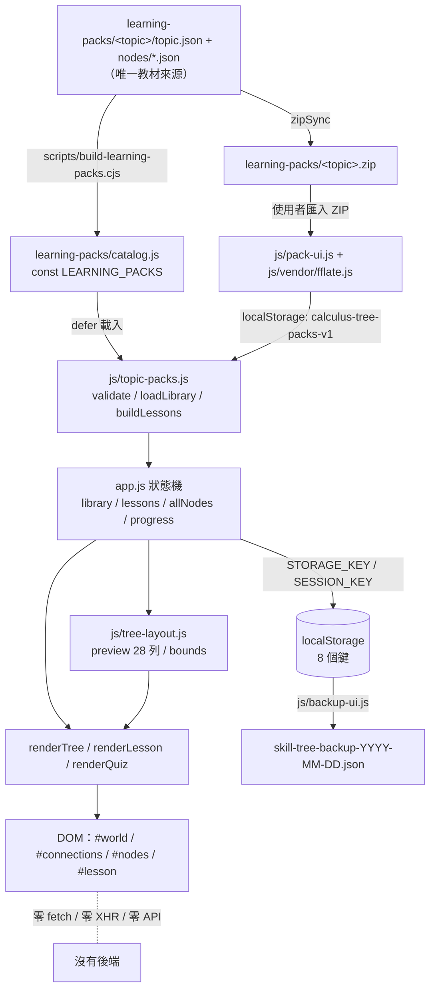
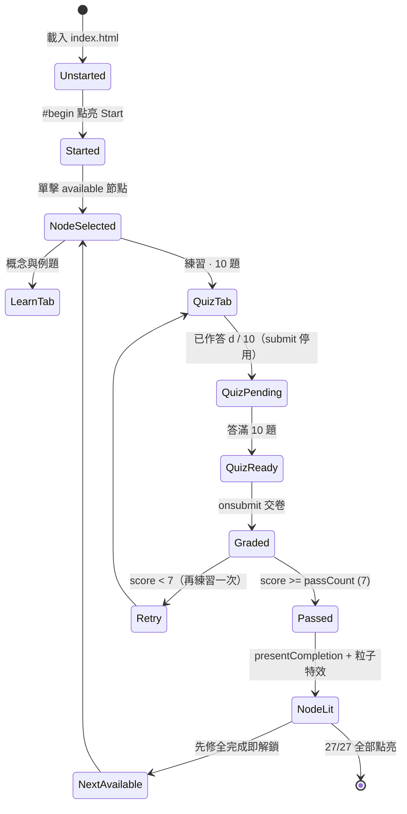

<a id="readme-top"></a>

<div align="center">

<h1 align="center">微積分漫遊 · Calculus Skill Tree</h1>

<p align="center"><strong>把微積分拆成一棵可以逐步點亮的技能樹：27 個節點、270 道題、零後端、零帳號、零套件安裝的純靜態學習網站。</strong></p>

<p align="center">繁體中文 · <a href="README.en.md">English</a></p>

<p align="center">
  <a href="https://bronya-0914.github.io/Skill-Tree/">線上展示 Live Demo</a> ·
  <a href="https://github.com/Bronya-0914/Skill-Tree">GitHub Repo</a> ·
  <a href="https://github.com/Bronya-0914/Skill-Tree/issues">回報問題 Report an Issue</a> ·
  <a href="#documentation">文件導覽 Documentation</a>
</p>

<p align="center">
  <a href="#built-with"></a>
  <a href="#features"></a>
  <a href="#features"></a>
  <a href="#development-testing"></a>
  <a href="https://bronya-0914.github.io/Skill-Tree/"></a>
  <a href="#license"></a>
  <a href="#architecture"></a>
  <a href="#documentation"></a>
</p>

<p align="center"><sub>徽章依序：純靜態 · 27 課 · 270 題 · 20/20 測試 · GitHub Pages · 授權未指定 · 無後端 · 雙語文件<br>Badges: static · lessons · questions · tests · Pages · license · backend · docs</sub></p>

</div>

繁體中文 · [English](README.en.md)

> **版本狀態提示（請先讀）**：本檔描述的是**本機工作樹**（Git HEAD `8d7b4cb`）。線上展示 `https://bronya-0914.github.io/Skill-Tree/` 目前是**較舊的版本**（教材 `version: 1`、雙擊開合），與本機 HEAD（教材 `version: 5`、單擊開合）**不一致**。本機 Git **沒有任何 remote、沒有 push 紀錄**，因此本檔**不宣稱「已同步」或「已部署目前版本」**。詳情見 [部署與發布](#deployment)。
> **文件整併狀態**：本批 22 份 Markdown 已寫入工作樹，但**尚未提交**；下文「工作樹乾淨」指 HEAD `8d7b4cb` 當時的基準快照，目前工作樹有未提交變更。

---

<details>
<summary><strong>目錄 Table of Contents（按一下展開）</strong></summary>

<ol>
  <li><a href="#about">一、關於本專案（About the Project）</a>
    <ul>
      <li><a href="#about-background">背景與動機（Background &amp; Motivation）</a></li>
      <li><a href="#about-why-tree">為何使用技能樹（Why a Skill Tree）</a></li>
      <li><a href="#about-audience">適用對象（Who It Is For）</a></li>
      <li><a href="#about-not-for">不適用情境（When Not to Use It）</a></li>
    </ul>
  </li>
  <li><a href="#features">二、功能（Features）</a>
    <ul>
      <li><a href="#features-core">核心學習流程（Core Learning Loop）</a></li>
      <li><a href="#features-interaction">互動與個人化（Interaction &amp; Personalisation）</a></li>
      <li><a href="#features-data">教材與資料（Content &amp; Data）</a></li>
      <li><a href="#features-table">功能與底層機制對照表（Feature / Mechanism Table）</a></li>
    </ul>
  </li>
  <li><a href="#demo">三、線上展示與畫面（Live Demo &amp; Screenshots）</a>
    <ul>
      <li><a href="#demo-url">線上網址（Live URL）</a></li>
      <li><a href="#demo-diff">線上版本與本機版本差異（Live vs. Local HEAD）</a></li>
      <li><a href="#demo-walkthrough">畫面與流程示意（Walkthrough Diagram）</a></li>
    </ul>
  </li>
  <li><a href="#built-with">四、技術組成（Built With）</a>
    <ul>
      <li><a href="#built-with-stack">技術堆疊（Stack）</a></li>
      <li><a href="#built-with-constraints">明確不包含（What Is Deliberately Absent）</a></li>
    </ul>
  </li>
  <li><a href="#getting-started">五、快速開始（Getting Started）</a>
    <ul>
      <li><a href="#gs-prereq">先決條件（Prerequisites）</a></li>
      <li><a href="#gs-open">三種開啟方式（Three Ways to Open）</a></li>
      <li><a href="#gs-steps">完整操作流程（Step-by-step）</a></li>
      <li><a href="#gs-devices">桌機與手機差異（Desktop vs. Mobile）</a></li>
    </ul>
  </li>
  <li><a href="#usage">六、使用方式（Usage）</a>
    <ul>
      <li><a href="#usage-start">開始與解鎖（Start &amp; Unlocking）</a></li>
      <li><a href="#usage-quiz">答題與批改（Quiz &amp; Grading）</a></li>
      <li><a href="#usage-workspace">草稿與答題框（Scratchpad &amp; Resizable Frame）</a></li>
      <li><a href="#usage-personal">主題、光效、語言（Theme, Glow, Language）</a></li>
      <li><a href="#usage-data">備份、學習包、重設（Backup, Packs, Reset）</a></li>
    </ul>
  </li>
  <li><a href="#architecture">七、架構（Architecture）</a>
    <ul>
      <li><a href="#arch-modules">模組表（Module Map）</a></li>
      <li><a href="#arch-dataflow">資料流（Data Flow）</a></li>
      <li><a href="#arch-state">狀態機（State Machine）</a></li>
      <li><a href="#arch-storage">8 個 localStorage 鍵（Storage Keys）</a></li>
      <li><a href="#arch-build">教材建置流程（Content Build Pipeline）</a></li>
    </ul>
  </li>
  <li><a href="#data-privacy">八、資料與私隱（Data &amp; Privacy）</a>
    <ul>
      <li><a href="#dp-storage">資料存放在哪裏（Where Data Lives）</a></li>
      <li><a href="#dp-answers">答案在前端（Answers Are Client-side）</a></li>
      <li><a href="#dp-backup">備份與覆蓋式匯入（Backup &amp; Overwrite Import）</a></li>
      <li><a href="#dp-limits">同源限制、無帳號、無追蹤（Same-origin, No Accounts, No Tracking）</a></li>
    </ul>
  </li>
  <li><a href="#deployment">九、部署與發布（Deployment / Release）</a>
    <ul>
      <li><a href="#dep-pages">GitHub Pages 與儲存庫（Pages &amp; Repository）</a></li>
      <li><a href="#dep-hosting">托管設定 hosting.json（Hosting Config）</a></li>
      <li><a href="#dep-gap">線上落後於本機（Deployment Gap）</a></li>
      <li><a href="#dep-git">本機 Git 狀態（Local Git State）</a></li>
      <li><a href="#dep-checklist">發布前排除清單（Pre-release Exclusion Checklist）</a></li>
    </ul>
  </li>
  <li><a href="#development-testing">十、開發與測試（Development &amp; Testing）</a>
    <ul>
      <li><a href="#dev-commands">指令（Commands）</a></li>
      <li><a href="#dev-tests">20/20 與三個測試檔（Test Suite）</a></li>
      <li><a href="#dev-rules">不可手改與升版規則（Generated Assets &amp; Versioning）</a></li>
    </ul>
  </li>
  <li><a href="#documentation">十一、文件索引（Documentation Index）</a>
    <ul>
      <li><a href="#doc-index">完整索引表（Full Index）</a></li>
      <li><a href="#doc-bilingual">雙語對照與文件整併（Bilingual Mirrors）</a></li>
    </ul>
  </li>
  <li><a href="#roadmap">十二、藍圖與已知限制（Roadmap / Known Limitations）</a>
    <ul>
      <li><a href="#roadmap-done">已完成（Shipped）</a></li>
      <li><a href="#roadmap-limits">已知限制（Known Limitations）</a></li>
      <li><a href="#roadmap-not">未實作（Not Implemented）</a></li>
    </ul>
  </li>
  <li><a href="#contributing">十三、參與貢獻（Contributing）</a></li>
  <li><a href="#license">十四、授權（License）</a></li>
  <li><a href="#acknowledgments">十五、致謝（Acknowledgments）</a></li>
  <li><a href="#faq">十六、常見問題（FAQ）</a></li>
  <li><a href="#contact">十七、聯絡（Contact）</a></li>
</ol>

</details>

---

<a id="about"></a>

## 一、關於本專案（About the Project）

<a id="about-background"></a>

### 背景與動機（Background & Motivation）

「微積分漫遊 · Calculus Skill Tree」是一個**單頁、純靜態**的微積分互動教材。它把一門課的知識拆解成 **27 個循序漸進的節點**，每個節點包含概念講解、公式、逐步例題、以及 **10 道四選一練習**；學習者讀完教材、答對至少 **7 題**，該節點便會「點亮」並解鎖後續節點，直到整棵技能樹亮起。

專案的核心設計取捨是**極致的簡單與可攜性**：

- **不需要架伺服器**：`index.html` 是一個完全自足的入口，用瀏覽器直接開啟即可運作。
- **不需要安裝**：沒有 `package.json`、沒有 `npm install`、沒有 bundler、沒有框架、沒有 CDN 依賴。
- **不需要登入**：沒有帳號、沒有資料庫、沒有任何 `fetch`／`XMLHttpRequest`／API 呼叫。
- **可以離線、可以隨身帶走**：所有教材、程式、樣式與進度都在瀏覽器本機。

目前內建的教材為 **CIS221 微積分完整學習路線**（`topic.json` 的 `version: 5`），涵蓋代數與函數基礎、微分、多變量、積分與數值方法。教材以繁體中文撰寫，網站另提供完整英文翻譯目錄，可即時切換。

<a id="about-why-tree"></a>

### 為何使用技能樹（Why a Skill Tree）

| 取捨 | 說明 |
|---|---|
| **先修關係可視化** | 每個節點以 `parents` 明確標示先修；`js/tree-layout.js` 把它們排成「母線＋分支」的連線圖，學習者一眼看到「要學這個，先完成那些」。節點可有多個先修，**全部完成才解鎖**。 |
| **小單位、可驗收** | 一課 ≈ 15 分鐘、10 題、通過門檻 7 題。比起章節式教材，進度粒度更細，完成感更明確。 |
| **進度即狀態** | 點亮的節點、連線與進度條都由同一份 `progress` 狀態驅動，視覺回饋與資料一致。 |
| **可擴充成他科** | 教材與程式分離：網站匯入的是結構化「學習包 ZIP」，不是寫死的課程。新科目可接到 `start` 與既有課程並存。 |
| **零成本分享** | 一個資料夾丟到任何靜態托管就能用；想分享教材就匯出 ZIP，想搬家就匯出 JSON 備份。 |

<a id="about-audience"></a>

### 適用對象（Who It Is For）

- 正在修讀微積分、需要**按先修順序自主複習**的學生（對應 CIS221 程度的 27 課路線）。
- 想要一個**不必註冊、不必連網、不會被追蹤**的練習環境的自學者。
- 教師或教材作者，需要把既有講義整理成**可驗證、可匯入、可雙語**的 JSON 學習包。
- 想研究**純前端狀態機、SVG 連線幾何、ZIP 在瀏覽器端讀寫、localStorage 備份設計**的開發者。
- 需要一份**可直接靜態托管**、沒有後端維運負擔的展示專案。

<a id="about-not-for"></a>

### 不適用情境（When Not to Use It）

- **需要保密答案的正式考試**：答案與解析隨 `learning-packs/catalog.js`、`nodes/*.json` 與 ZIP 一起送到前端，任何人都可從開發者工具讀到，無法保密。
- **需要跨裝置／跨瀏覽器同步**：所有狀態只存在單一 origin 的 `localStorage`，不會自動同步。
- **需要帳號、成績紀錄、教師後台、伺服端批改**：本專案**沒有後端**，這些能力未實作（見 [未實作](#roadmap-not)）。
- **需要正式授權再散佈**：專案目前**沒有 LICENSE**，使用前須先取得授權明確化（見 [授權](#license)）。
- **要把 `references/` 書籍全文公開**：該目錄為本機 OCR 參考資料，有版權疑慮，發布前必須排除（見 [發布前排除清單](#dep-checklist)）。

<p align="right">(<a href="#readme-top">回到頂部 · back to top</a>)</p>

---

<a id="features"></a>

## 二、功能（Features）

<a id="features-core"></a>

### 核心學習流程（Core Learning Loop）

1. **Start 點亮**：初次進入只看到 `Start` 節點；按下「點亮 Start · 開始探索」後，`progress.started = true`，整棵樹才展開。
2. **先修解鎖**：節點狀態由 `isCompleted(id) || node.parents.every(isCompleted)` 決定，分為 `lit`（已完成）、`available`（可學）、`locked`（未解鎖）三態。
3. **概念／練習分頁**：每個節點有「概念與例題」與「練習 · N 題」兩個分頁；教材 `content[]` 支援 `heading`、`paragraph`、`formula`、`example`、`tip` 五種區塊，公式內的 `\n` 會轉成 `<br>` 並逐行置中。
4. **答滿才可交卷**：`#quiz-submit` 在「已作答數 < 10」時為 `disabled`（灰階、不可按），答滿才轉為可交卷的綠色狀態；`onsubmit` 另有第二道防線。
5. **即時批改與回饋**：正確選項與解析標綠，錯誤標紅；通過門檻取 `lesson.passCount`（目前全為 7），不寫死在程式。
6. **點亮特效與解鎖**：通過後 `presentCompletion()` 會關閉側板、把視角移到該節點、觸發粒子特效，並解鎖下一批可用節點；另有「下一課」捷徑。

<a id="features-interaction"></a>

### 互動與個人化（Interaction & Personalisation）

- **縮放平移技能樹**：滾輪縮放、拖曳平移、雙指手勢，缩放範圍夾在 `0.03`–`2.2`；工具列提供放大、縮小、Fit（`#fit` 依 bounds 自動置中）。
- **可拖曳縮放的答題框**：桌機下 `#lesson` 可用標題列拖動、用 8 個方向的 `.frame-resize` 把手調整大小；首次進入練習會自動放大工作區。
- **手寫草稿紙**：練習分頁側欄 `#quiz-scratch` 注入 `<canvas id="scratch-canvas">`，可畫筆／橡皮擦、復原、清除，筆跡存於 `calculus-tree-scratch-v1`。
- **深淺主題**：`index.html` 的 inline script 在載入前先讀 `skill-tree-theme`，避免閃白；`html.dark` 覆寫整組 CSS 變數。
- **光效換色**：8 個預設色票加 HSV 色盤與 HEX 輸入，寫入 `--glow-rgb`／`--lit` 等變數，影響 **Start、已點亮節點、連線** 的發光色；跨分頁以 `storage` 事件同步。
- **中英切換**：`js/i18n.js` 就地翻譯文字節點與 `aria-label`／`title`／`placeholder`／`content` 屬性，**不重建 DOM、不改進度、不改匯入教材**；原文字以 `WeakMap` 保存，可精確還原。
- **行動裝置 bottom sheet**：`max-width:760px` 時課程卡變成底部抽屜，只露 46px 把手，練習模式高度改為 `86vh`；工具列改為兩欄。
- **單擊開合**：單擊節點開啟課程，單擊地圖背景關閉；連擊只處理第一下。
- **無障礙與減動**：`prefers-reduced-motion` 會關閉全部動畫與轉場，點亮特效直接結束；另有 skip link、鍵盤可操作的 HSV 步進。

<a id="features-data"></a>

### 教材與資料（Content & Data）

- **學習包 ZIP 匯入／匯出**：`js/pack-ui.js` 支援選檔或拖放，先預覽名稱、版本、先修關係再確認；可從「主題學習包」圖書館把教材匯出成 `<topic.id>-v<version>.zip`（**只含教材，不含個人進度**）。
- **8 鍵 JSON 備份**：`js/backup-ui.js` 匯出／匯入全部站台狀態，檔名 `skill-tree-backup-YYYY-MM-DD.json`；匯入為**覆蓋式**、失敗會回滾、成功後重新載入。
- **嚴格格式驗證**：`js/topic-packs.js` 同時供瀏覽器與 Node 使用，檢查 `schemaVersion`、`id` 命名空間、先修不可循環、題數與選項上限、ZIP 的 CRC32／加密／路徑穿越等。
- **版本合併**：`loadLibrary()` 以使用者版本 `>=` 內建版本者取代；`prepare()` 拒絕舊版，也拒絕「內容有變更卻未提高 `version`」。

<a id="features-table"></a>

### 功能與底層機制對照表（Feature / Mechanism Table）

| 功能 | 使用者操作 | 底層機制 |
|---|---|---|
| 開始學習 | 按「點亮 Start」 | `renderWelcome()` 設 `progress.started`，寫 `calculus-tree-progress-v1`，`renderTree()` 由只畫 Start 改為畫全部節點 |
| 解鎖判斷 | 看到節點由灰轉為可點 | `isAvailable()` 檢查 `parents.every(isCompleted)`；`app.js` 三態 class `locked`／`available`／`lit` |
| 連線繪製 | 看到母線與箭頭 | `renderTree()` 產出 **43 條 `.connection` path**（16 條母線 + 27 條進線）、8 個 `.tree-junction`、8 條 `.prerequisite-join`，**0 個中繼接點** |
| 答題 | 選選項、按交卷 | `#quiz-form.onchange` 寫 `attempt.answers` → `saveSession()` → `updateQuizSubmit()`；`onsubmit` 比對 `question[2]` |
| 通過門檻 | 綠色回饋、節點點亮 | `score >= lesson.passCount`（7），push `progress.completed`，`presentCompletion()` + `unlock-effects.js` |
| 工作框 | 拖曳標題列、拉邊角 | `js/workspace.js` 八方向 resize，狀態存 `calculus-tree-lesson-frame-v1` |
| 草稿 | 在 canvas 書寫 | `mountScratchpad()`，筆跡存 `calculus-tree-scratch-v1`（`MAX_STROKES=300`、`MAX_POINTS=30000`） |
| 光效 | 選色票／調 HSV | `js/glow-settings.js` 寫 CSS 變數與 `calculus-tree-glow-v1` |
| 語言 | 按「中文 / EN」 | `js/i18n.js` + `js/i18n-messages.js`（1,831 個 key、46 個參數化模板），存 `skill-tree-language` |
| 主題 | 按太陽／月亮 | `index.html` inline script 切 `html.dark`，寫 `skill-tree-theme` |
| 備份 | 匯出／匯入 JSON | `SkillTreeBackup` 逐鍵讀寫 8 個 `localStorage` 鍵，`importPayload()` 覆蓋並可回滾 |
| 學習包 | 拖入 ZIP、確認 | `js/vendor/fflate.js` 解壓 → `TopicPacks.readZip()` → `prepare()` → 寫 `calculus-tree-packs-v1` |
| 重設 | 對話框確認 | 移除 `SESSION_KEY`、清空 `attempts` 與 `progress`、`selectedId='start'` |

<p align="right">(<a href="#readme-top">回到頂部 · back to top</a>)</p>

---

<a id="demo"></a>

## 三、線上展示與畫面（Live Demo & Screenshots）

<a id="demo-url"></a>

### 線上網址（Live URL）

| 項目 | 內容 |
|---|---|
| 線上展示 | **<a href="https://bronya-0914.github.io/Skill-Tree/">https://bronya-0914.github.io/Skill-Tree/</a>** |
| 網頁標題 | 微積分漫遊 · Calculus Skill Tree |
| 連線狀態 | 已查證 `GET /` 回應 **200**，可正常取得內容 |
| GitHub 儲存庫 | <a href="https://github.com/Bronya-0914/Skill-Tree">https://github.com/Bronya-0914/Skill-Tree</a>（public、default branch `main`、has_pages=true、0 stars、無 description、無 license） |
| 回報問題 | <a href="https://github.com/Bronya-0914/Skill-Tree/issues">GitHub Issues</a> |

<a id="demo-diff"></a>

### 線上版本與本機版本差異（Live vs. Local HEAD）

**線上版本較舊，並非本機 HEAD。** 這是本專案目前最重要的事實，請勿把兩者混為一談：

| 比較項 | 線上 GitHub Pages | 本機工作樹（HEAD `8d7b4cb`） |
|---|---|---|
| `topic.json` 版本 | `version: 1` | **`version: 5`** |
| 節點開合互動 | **雙擊開合**（`selectNode(id,{open})`、`dblclick`、`backgroundDoubleClick`） | **單擊開合**（節點開、背景關） |
| `app.js` 行數 | 459 行 | 435 行 |
| 首節點教材 | 6 個 content 區塊 | 11 個 content 區塊（書本改寫版） |
| `app.js`／`styles.css`／`catalog.js` SHA-256 | 與本機皆不同 | 現行版本 |
| 13 個靜態資源路徑 | 與本機**逐項相同** | 相同 |
| `README.md`、`js/hosting.json` | 200 | 本機檔案 |
| `DESIGN-v2.md`、`BOOK-REFERENCE.md`、`references/3000-solved-problems/*` | **404**（未公開） | 本機檔案 |

線上與本機的差異代表「部署尚未更新」，而非「功能故障」；相關背景見 [部署與發布](#deployment)。

<a id="demo-walkthrough"></a>

### 畫面與流程示意（Walkthrough Diagram）

本專案**不附任何螢幕截圖檔**，因此不以假造的圖片連結呈現；改以下列 Mermaid 流程圖與文字示意說明實際畫面結構。



文字示意（桌機版面）：

```text
┌──────────────────────────────────────────────────────────────┐
│ [≡]  ∫  微積分漫遊                       [中文 / EN]  [重設]  │
├───────────┬──────────────────────────────────┬───────────────┤
│ 抽屜       │  技能樹畫布（可縮放 / 拖曳）       │  課程側板      │
│ 進度 3/27  │   Start ─┬─ 01 函數 ─┬─ 07 冪法則  │  [概念][練習]  │
│ 備份       │          ├─ 02 圖形 ─┤            │  概念與例題    │
│ 光效 8 色  │          └─ 03 三角 ─┴─ 08 乘法則  │  ── 或 ──      │
│ 8 色 + HSV │   43 條母線 / 分支連線             │  10 題四選一    │
│ 功能介紹   │                                  │  + 草稿 canvas │
├───────────┴──────────────────────────────────┴───────────────┤
│ [−] 100% [+] [Fit] [主題]                      右下角縮放工具    │
└──────────────────────────────────────────────────────────────┘
```

<p align="right">(<a href="#readme-top">回到頂部 · back to top</a>)</p>

---

<a id="built-with"></a>

## 四、技術組成（Built With）

<a id="built-with-stack"></a>

### 技術堆疊（Stack）

| 技術 | 用途 | 備註 |
|---|---|---|
| **HTML5** | 唯一入口 `index.html` | 155 行、**53 個靜態 DOM ID**；`<head>` 內以 `defer` 依序載入 13 個資源 |
| **CSS3** | `styles.css` | 690 行；CSS 變數主題、玻璃質感、`@keyframes` 點亮特效、`@media` 手機 bottom sheet、`prefers-reduced-motion` |
| **Vanilla JavaScript (ES2020+)** | `app.js` 與 `js/*.js` | **無框架、無轉譯、無 bundler**；以全域物件與 `module.exports` 雙模式共用 |
| **SVG** | `#connections` | `viewBox` 由 `0 0 760 950` 改為 **`0 0 3069 1998`**；連線、箭頭 marker、先修標籤 |
| **Canvas 2D** | 手寫草稿紙 | `<canvas id="scratch-canvas">`，筆跡以 stroke 陣列保存 |
| **localStorage** | 全部持久狀態 | **8 個鍵**，其中 **5 個**帶 `schemaVersion:1` |
| **fflate** | ZIP 壓縮／解壓 | `js/vendor/fflate.js`（UMD minified，33,044 B），瀏覽器端 `window.fflate`；學習包匯入／匯出與 `scripts/build-learning-packs.cjs` 建置皆使用 |
| **GitHub Pages** | 靜態托管 | `https://bronya-0914.github.io/Skill-Tree/` |
| **Node.js** | **僅用於建置與測試** | `node --test`、`node --check`、`node scripts/build-learning-packs.cjs`；**網站執行完全不需要 Node** |

`index.html` 的 13 個靜態資源載入順序（`defer`）：

```text
styles.css
learning-packs/catalog.js        （建置產物：教材）
js/vendor/fflate.js             （ZIP）
js/topic-packs.js               （資料層 / 驗證 / ZIP 讀寫）
js/workspace.js                 （答題框 + 草稿）
js/tree-layout.js               （連線幾何）
js/unlock-effects.js            （點亮特效）
app.js                          （狀態機 / DOM 模板 / 縮放平移）
js/backup-ui.js                 （備份）
js/pack-ui.js                   （學習包）
js/glow-settings.js             （光效）
js/i18n-messages.js             （英文訊息目錄）
js/i18n.js                      （語言引擎）
```

<a id="built-with-constraints"></a>

### 明確不包含（What Is Deliberately Absent）

> **無框架、無套件安裝、無後端。**

- 沒有 `package.json`、`node_modules`、npm script、`npm install` 或任何 CDN 腳本。
- 沒有 React／Vue／Svelte／jQuery／TypeScript／Webpack／Vite 等框架或建置工具。
- 全專案搜尋 `fetch(`、`XMLHttpRequest`、`/api/`、`firebase`、`supabase`、`cloudservice` **零命中**：沒有後端、沒有 API、沒有資料庫、沒有帳號、沒有伺服端批改。
- 沒有追蹤腳本、分析服務、Cookie 或第三方網路請求。
- 沒有 `LICENSE`、`.gitignore`、`CNAME`、`.nojekyll`、`_config.yml`、`.github/workflows`、`404.html`（見 [發布前排除清單](#dep-checklist)）。

<p align="right">(<a href="#readme-top">回到頂部 · back to top</a>)</p>

---

<a id="getting-started"></a>

## 五、快速開始（Getting Started）

<a id="gs-prereq"></a>

### 先決條件（Prerequisites）

| 用途 | 需要 | 說明 |
|---|---|---|
| **使用網站** | 一個現代瀏覽器 | 支援 ES2020、`localStorage`、SVG、Canvas、`<dialog>`、`ResizeObserver`。建議最新版 Chrome／Edge／Firefox／Safari。 |
| **使用網站** | 不必連網、不必登入、不必安裝 | 直接開檔或開線上網址即可。 |
| **本機 HTTP 預覽（選用）** | Python 3（或其他靜態伺服器） | 只是為了讓 origin 固定、方便測試 `localStorage`；網站本身不需要。 |
| **建置教材／跑測試（選用）** | Node.js | **只用於** `node --test`、`node --check`、`scripts/build-learning-packs.cjs`，網站執行不依賴它。 |

<a id="gs-open"></a>

### 三種開啟方式（Three Ways to Open）

**(A) 直接開檔（最簡單）**

用瀏覽器開啟本資料夾的 `index.html`。不需登入、不需安裝套件、不需伺服器。

**(B) 直接開線上展示**

開啟 <a href="https://bronya-0914.github.io/Skill-Tree/">https://bronya-0914.github.io/Skill-Tree/</a>。請留意這是**較舊版本**（見 [線上落後](#dep-gap)）。

**(C) 本機 HTTP server（選用）**

在專案根目錄執行，然後開 `http://localhost:8000/`：

```bash
# Python 3（無需安裝任何套件）
python -m http.server 8000

# 或 Python 3 的另一種寫法
python3 -m http.server 8000
```

注意：

- 這是**本機預覽選項**，不是網站的必要條件；網站沒有 `package.json`，因此**沒有** `npm install`／`npm start`。
- 用 HTTP server 的好處是 origin 固定（`http://localhost:8000`），`localStorage` 資料較不會因 `file://` 的瀏覽器差異而遺失。
- 換 port、換網址、改用 `file://` 或換瀏覽器，都算不同 origin／儲存區，進度不會互通（見 [資料與私隱](#data-privacy)）。

<a id="gs-steps"></a>

### 完整操作流程（Step-by-step）

1. **開啟網站**：用上述 (A)、(B) 或 (C) 任一方式載入 `index.html`。初次載入只會看到 `Start` 節點與空白提示。
2. **點亮 Start**：按「點亮 Start · 開始探索」，`progress.started` 寫入 `localStorage`，整棵 27 節點技能樹展開並自動聚焦第一個可學節點。
3. **選取可用節點**：單擊狀態為 `available` 的節點開啟課程側板；`locked` 節點無法選取，若有多個先修，**必須全部完成**。
4. **閱讀概念與例題**：在「概念與例題」分頁看 `heading`／`paragraph`／`formula`／`example`／`tip`；公式可橫向捲動，逐行置中。
5. **切到練習並演算**：按「練習 · 10 題」，需要時用右側草稿紙手寫；桌機可拖曳標題列、拉邊角調整答題框大小。
6. **作答 10 題並交卷**：未答滿 10 題時交卷鈕為停用；答滿後按交卷，正確標綠、錯誤標紅並顯示逐題解析。
7. **通過並前進**：答對至少 7 題即通過，節點點亮、觸發特效並解鎖後續節點；可按「下一課」或「再練習一次」。
8. **（選用）個人化與搬遷**：調整深淺主題、光效顏色、語言；更換瀏覽器或裝置前，用「資料備份 → 匯出記錄」保存 JSON，需要時匯入還原。

<a id="gs-devices"></a>

### 桌機與手機差異（Desktop vs. Mobile）

| 項目 | 桌機（`>= 761px`） | 手機（`<= 760px`） |
|---|---|---|
| 課程卡 | 右側浮動視窗，可拖曳、八方向 resize | 底部 bottom sheet，只露 46px 把手；練習模式高度 `86vh` |
| 開合 | 單擊節點開、單擊背景關 | 以 `#lesson-toggle` 抽屜語意開合；`workspace.js` 會反轉 `checked` 並設 `inert` |
| 縮放工具 | 右下角單排 | 改為兩欄 grid |
| 學習包對話框 | 一般 `dialog` | 滿版 |
| 玻璃模糊 | 啟用 `backdrop-filter` | `@media (hover:none) and (pointer:coarse)` 全部關閉以避免掉幀 |
| 公式字級 | 18px | 15px |
| 草稿紙 | 側欄並排 | 隨練習分頁捲動 |

<p align="right">(<a href="#readme-top">回到頂部 · back to top</a>)</p>

---

<a id="usage"></a>

## 六、使用方式（Usage）

<a id="usage-start"></a>

### 開始與解鎖（Start & Unlocking）

- 初次載入 `visible = progress.started ? allNodes : [startNode]`，只畫 Start 並顯示 `#map-empty`。
- 按下 `#begin` 後，`justLitId='start'` 觸發一次點亮特效，並自動 `selectNode()` 到第一個「未完成且可學」的節點。
- 節點狀態：`completed → lit`、`available`（先修全完成）、`locked`。類別 `base`／`derivative`／`integral` 以左側色條區分。
- 額外先修以 `.prerequisite-label` 標示（目前 **10 個標籤分布於 8 個節點**），可按標籤跳轉到該先修。
- 進度條 `#progress` 的 `max = lessons.length`（27），`#progress-text` 顯示 `N / 27`；全部完成時 caption 改為完成訊息。

<a id="usage-quiz"></a>

### 答題與批改（Quiz & Grading）

- 每課 `quiz` 為 `[題幹, 選項陣列, 答案索引, 解析]` 四元陣列；目前 **27 課 × 10 題 = 270 題**，每題 4 個選項。
- `answeredCount()` 統計已作答題數；`updateQuizSubmit()` 在 `d < t` 時設 `#quiz-submit.disabled = true` 並加 `.quiz-pending`。
- 交卷時 `onsubmit` 再檢查一次 `attempt.submitted || answeredCount < total` 才放行，避免繞過 UI。
- `score = quiz.filter((q,i) => attempt.answers[i] === q[2]).length`；`passed = score >= lesson.passCount`（**7**）；通過後 `progress.scores[id]` 取歷史最大值並 push `progress.completed`。
- 回饋樣式：`.option.correct`／`.feedback.correct` 綠；`.option.incorrect`／`.feedback.incorrect` 紅；解析包在 `.feedback-detail`。
- 已批改可按「再練習一次 ↺」清空該課 `attempts` 重做；通過後可用「下一課」跳到下一個未完成且可學節點。
- 作答中的選項、分頁與目前節點會存進 `calculus-tree-session-v1`，重新整理可接續。

<a id="usage-workspace"></a>

### 草稿與答題框（Scratchpad & Resizable Frame）

- `js/workspace.js` 提供 `mountScratchpad()`／`unmountScratchpad()`／`setQuizMode()`／`setOpen()`／`resetFrame()`。
- 桌機下 `#lesson` 以 `left/top/width/height` 記錄位置（存 `calculus-tree-lesson-frame-v1`），最小寬 `min(340, innerWidth-16)`、最小高 `min(300, innerHeight-16)`。
- 草稿紙可選畫筆／橡皮擦、調整筆觸、復原、清除；筆跡以 `{tool, size, points}` 陣列存 `calculus-tree-scratch-v1`，上限 `MAX_STROKES=300`／`MAX_POINTS=30000`。
- `setOpen()` 為非同步，會等待 transform 動畫 `animation.finished`；`prefers-reduced-motion` 時直接結束。

<a id="usage-personal"></a>

### 主題、光效、語言（Theme, Glow, Language）

| 設定 | 操作 | 儲存鍵 | 影響範圍 |
|---|---|---|---|
| 深淺主題 | 右下角太陽／月亮 | `skill-tree-theme`（`'dark'`｜`'light'`，無 schemaVersion） | 整組 CSS 變數、`<meta name="theme-color">` |
| 光效顏色 | 8 色票、HSV 色盤、HEX 輸入、預覽、重設 | `calculus-tree-glow-v1`（`schemaVersion:1`） | Start、已點亮節點、連線、交卷鈕光暈；跨分頁同步 |
| 語言 | 右上／抽屜「中文 / EN」 | `skill-tree-language`（`'zh-Hant'`｜`'en'`，無 schemaVersion） | 介面與內建教材文字；`html[lang="en"]` 時節點標題可換兩行 |

8 個預設色票：`#ffffff`、`#f2d9a8`、`#e8b264`、`#e0655f`、`#a58bd6`、`#7aa2e3`、`#4fc3b8`、`#8a8a92`。切換語言**不重建 DOM、不改進度、不改匯入教材**；未知匯入文字保留原語言，如要翻譯須在 `js/i18n-messages.js` 補精確對照。

<a id="usage-data"></a>

### 備份、學習包、重設（Backup, Packs, Reset）

- **資料備份**：`SkillTreeBackup.exportPayload()` 把 8 個鍵以**原始字串**打包成 `{app, schemaVersion:1, exportedAt, keys}`，檔名 `skill-tree-backup-YYYY-MM-DD.json`；`importPayload()` 逐鍵寫回，值為 `null` 表示移除該鍵，**覆蓋現有資料**、失敗回滾、成功後 500ms 重新載入。備份**不加密**、含草稿筆跡。
- **主題學習包匯入**：選檔或拖放 ZIP（上限 5 MB），`fflate` 解壓後 `TopicPacks.readZip()` 驗證、`prepare()` 檢查版本與變更，預覽後按「確認加入技能樹」寫入 `calculus-tree-packs-v1`。新科目通常接 `start`，與既有課程並存。
- **主題學習包匯出**：從圖書館匯出 `<topic.id>-v<version>.zip`，**只含教材，不含個人進度**。
- **重設進度**：`#reset` → 對話框確認 → 移除 `SESSION_KEY`、清空 `attempts`、`progress = {started:false, completed:[], scores:{}}`、`selectedId='start'`、`activeTab='learn'`。

<p align="right">(<a href="#readme-top">回到頂部 · back to top</a>)</p>

---

<a id="architecture"></a>

## 七、架構（Architecture）

<a id="arch-modules"></a>

### 模組表（Module Map）

| 檔案 | 職責 | 公開 API／關鍵常數 |
|---|---|---|
| `index.html` | 唯一入口、53 個靜態 DOM ID、資源載入順序、防閃白 inline script | `1 CSS + 12 JS = 13` |
| `styles.css` | 主題變數、玻璃質感、節點卡、連線、光效、手機 bottom sheet | `--lit`／`--glow-rgb`／`@keyframes ignite-*` |
| `app.js` | 狀態機、DOM 模板、縮放平移、進度、答題流程 | `STORAGE_KEY`／`PACKS_KEY`／`SESSION_KEY`／`BACKUP_KEYS`（8 鍵）；初始化末行 `renderTree(); renderLesson(); fitTree();` |
| `learning-packs/catalog.js` | **建置產物**：`const LEARNING_PACKS = [...]` | 170 KB／4,515 行，270 個 `"answer"` |
| `js/topic-packs.js` | 格式驗證、拓樸排序、座標、版本合併、ZIP 讀寫／CRC32 | `validate, prepare, buildLessons, loadLibrary, ordered, readZip, writeZip, escape`；`MAX_FILE=512KB`／`MAX_TOTAL=4MB`／上限 30 主題・300 節點 |
| `js/pack-ui.js` | 學習包對話框：選檔／拖放 → 預覽 → 確認；圖書館匯出 | `importSequence` 防競態、`escapePack` |
| `js/workspace.js` | 可拖曳縮放答題框 + canvas 草稿紙 | `window.LessonWorkspace`；`SCHEMA=1` |
| `js/backup-ui.js` | 8 鍵備份匯出／覆蓋式匯入 | `window.SkillTreeBackup`；`APP='calculus-skill-tree'`／`SCHEMA=1` |
| `js/glow-settings.js` | HSV 色盤、CSS 變數、跨分頁同步 | `KEY='calculus-tree-glow-v1'`／`DEFAULT='#ffffff'` |
| `js/i18n.js` | 就地翻譯、MutationObserver、WeakMap | `window.SkillTreeI18n`；46 個模板、`depth<=6`、Han 偵測 |
| `js/i18n-messages.js` | 英文訊息目錄 `window.SkillTreeEnglish` | 270 KB／1,848 行／**1,831 個 key** |
| `js/tree-layout.js` | 連線幾何、固定 preview 座標、bounds | `preview` **28 列**、`nodeWidth=282`／`layerStep=168`；bounds `{minX:40, maxX:3045, maxY:1974}` → world **`3069 × 1998`** |
| `js/unlock-effects.js` | 點亮粒子特效 | `window.SkillTreeEffects.play()` |
| `js/vendor/fflate.js` | UMD minified ZIP 函式庫 | Node 下 `require()`、瀏覽器下 `window.fflate`；**檔內查無版本字串** |
| `js/hosting.json` | 托管設定 | `{"static":{"directory":"."}}` |
| `scripts/build-learning-packs.cjs` | 產生 `catalog.js` 與 ZIP | `zipSync(files,{level:6})` 後立即 `readZip()` 自我驗證 |
| `tests/*.test.cjs` | 3 個測試檔 | 見 [開發與測試](#development-testing) |

現行連線為「母線＋分支」**43 條 `.connection` path**（16 母線 + 27 進線）、8 個 `.tree-junction`、8 條 `.prerequisite-join`、8 個 `.prerequisite-dot`、**0 個中繼接點**。舊設計文件所載的「117 段／31 中繼接點」已過時，`relay`／`connectionSegments`／`buildLaneMap` 在程式內零命中，**不應作為現況引用**。

<a id="arch-dataflow"></a>

### 資料流（Data Flow）



<a id="arch-state"></a>

### 狀態機（State Machine）



<a id="arch-storage"></a>

### 8 個 localStorage 鍵（Storage Keys）

`app.js` 的 `BACKUP_KEYS` 共 **8 個**，`js/backup-ui.js` 的 `FALLBACK_KEYS` 相同，透過 `window.SkillTreeBackupKeys` 供備份模組取用。其中 **5 個帶 `schemaVersion:1`**。

| # | 鍵 | 值格式 | 用途 | 備份 |
|---|---|---|---|---|
| 1 | `calculus-tree-progress-v1` | `{started, completed[], scores{}}`，**無 schemaVersion** | 進度與最佳成績 | 是 |
| 2 | `calculus-tree-packs-v1` | `{schemaVersion:1, packs[]}` | 使用者匯入／合併後的教材 | 是 |
| 3 | `calculus-tree-session-v1` | `{schemaVersion:1, selectedId, activeTab, attempts{}}` | 作答中狀態與分頁 | 是 |
| 4 | `skill-tree-theme` | 原始字串 `'dark'`｜`'light'`，**無 schemaVersion** | 深淺主題 | 是 |
| 5 | `calculus-tree-glow-v1` | `{schemaVersion:1, color:"#rrggbb"}` | 光效顏色 | 是 |
| 6 | `calculus-tree-lesson-frame-v1` | `{schemaVersion:1, left, top, width, height, quizInitialized}` | 答題框位置尺寸 | 是 |
| 7 | `calculus-tree-scratch-v1` | `{schemaVersion:1, strokes[]}` | 草稿筆跡 | 是 |
| 8 | `skill-tree-language` | 原始字串 `'zh-Hant'`｜`'en'`，**無 schemaVersion** | 語言選擇 | 是 |

補充：備份 payload 自帶 `schemaVersion:1`（不存於 localStorage）；備份以**原始字串**保存，`null` 代表該鍵不存在；內建預設教材（`catalog.js`）不進 localStorage；主題學習包匯出的 ZIP 只含教材、不含個人進度。

<a id="arch-build"></a>

### 教材建置流程（Content Build Pipeline）

1. 編輯 `learning-packs/<topic>/topic.json` 與 `nodes/*.json`（`schemaVersion:1`）。
2. **內容有變更就必須提高 `topic.version` 整數**，並保留既有節點 ID；`prepare()` 會拒絕「有變更卻未升版」與舊版。
3. 在專案根目錄執行 `node scripts/build-learning-packs.cjs`：掃描含 `topic.json` 的子目錄 → `validate()` → 依 `localeCompare(..., 'zh-Hant', {numeric:true})` 排序節點 → `loadLibrary()` 合併 → 對每包 `zipSync(level:6)` 並立即 `readZip()` 自我驗證 → 寫出 `<topic>.zip` 與 `catalog.js`。
4. 執行 `node --test tests/*.test.cjs` 確認 `catalog.js`、ZIP 與 27 個來源 JSON 逐檔一致。
5. **不要手動修改或刪除 `catalog.js` 與 `<topic>.zip`**：它們是網站使用的建置產物。新增中文內建教材時，同步補齊 `js/i18n-messages.js` 的英文對照。

目前統計（以 `node -e` 實算，非文件轉述）：`version=5`、**27 節點**、**270 題**、每課 10 題四選一、`passCount=7`、`minutes=15`；`kind` 為 `base 6`／`derivative 15`／`integral 6`；`content` 共 **271 區塊**（`heading 81`、`paragraph 81`、`formula 27`、`example 55`、`tip 27`），`\n` 換行 **365 處**（`formula 116`、`example 169`、`paragraph 54`、`tip 26`）。

<p align="right">(<a href="#readme-top">回到頂部 · back to top</a>)</p>

---

<a id="data-privacy"></a>

## 八、資料與私隱（Data & Privacy）

<a id="dp-storage"></a>

### 資料存放在哪裏（Where Data Lives）

所有狀態都存在**目前瀏覽器、目前 origin** 的 `localStorage`，共 8 個鍵（見 [8 鍵表](#arch-storage)）。沒有任何資料會傳送到伺服器，因為專案**根本沒有伺服器**。

<a id="dp-answers"></a>

### 答案在前端（Answers Are Client-side）

`learning-packs/catalog.js` 有 **270 個 `"answer"` 欄位**，與 `nodes/*.json`、ZIP 同源；`renderQuiz()` 直接比對 `question[2]`。全專案搜尋 `fetch(`、`XMLHttpRequest`、`/api/`、`firebase`、`supabase`、`cloudservice` **零命中**。

> 這代表**答案無法保密**：任何人都能從開發者工具、檢視原始碼或下載 ZIP 取得題目、選項、答案索引與解析。純前端搭配雲端資料庫也做不到答案保密；若需要正式評量，必須導入伺服端批改（**未實作**）。

<a id="dp-backup"></a>

### 備份與覆蓋式匯入（Backup & Overwrite Import）

- 匯出的 JSON 含 8 個鍵的**原始字串**、`exportedAt` 與 `app='calculus-skill-tree'` 辨識欄位；`validate()` 會檢查 `app`／`schemaVersion`／`keys` 型別，並額外解析進度鍵。
- 匯入是**覆蓋式**：`importPayload()` 逐鍵寫回，遇 `null`／`undefined` 則 `removeItem`；寫入失敗用 `before` 快照回滾，成功後 `location.reload()`。
- 備份**不加密**，且包含草稿筆跡與匯入過的教材內容；請自行妥善保管檔案。
- 備份**不含** `learning-packs/cis221-calculus.zip` 檔案本身，但使用者匯入過的教材內容會落在 `PACKS_KEY` 內而被備份。

<a id="dp-limits"></a>

### 同源限制、無帳號、無追蹤（Same-origin, No Accounts, No Tracking）

- **跨 origin／瀏覽器資料不相通**：換網址、換網域、換瀏覽器、換裝置、無痕模式或清除網站資料，進度即全部重來；只能靠「資料備份」手動匯出匯入。
- **無帳號**：沒有註冊、登入、使用者識別，也沒有任何個人資料被收集。
- **無追蹤**：沒有分析腳本、Cookie、第三方請求或 CDN 依賴。
- **無伺服端批改**：計分全在瀏覽器完成，成績只存在本機。

<p align="right">(<a href="#readme-top">回到頂部 · back to top</a>)</p>

---

<a id="deployment"></a>

## 九、部署與發布（Deployment / Release）

<a id="dep-pages"></a>

### GitHub Pages 與儲存庫（Pages & Repository）

| 項目 | 值 |
|---|---|
| 線上展示 | `https://bronya-0914.github.io/Skill-Tree/`（`GET /` 回應 200，標題「微積分漫遊 · Calculus Skill Tree」） |
| 儲存庫 | `https://github.com/Bronya-0914/Skill-Tree` |
| 可見性／分支 | public／default branch `main` |
| GitHub Pages | `has_pages=true` |
| 中繼資料 | 0 stars、**無 description**、**無 license** |
| 回報問題 | `https://github.com/Bronya-0914/Skill-Tree/issues` |

<a id="dep-hosting"></a>

### 托管設定 hosting.json（Hosting Config）

`js/hosting.json` 是專案內**唯一**的部署設定：

```json
{
  "project_id": "appgprj_6af1852c8bc88191999e930daeb549ac",
  "static": { "directory": "." }
}
```

`static.directory = "."` 代表**以整個專案根目錄作為靜態根**。專案內查無 `package.json`、`CNAME`、`404.html`、`.nojekyll`、`_config.yml`、`.github/workflows`、`.gitignore`。

<a id="dep-gap"></a>

### 線上落後於本機（Deployment Gap）

**線上版本較舊，不是本機 HEAD。** 線上 `topic.json` 為 `version: 1`、採用**雙擊開合**（`app.js` 459 行、`selectNode(id,{open})`、`dblclick`、`backgroundDoubleClick`）；本機 HEAD `8d7b4cb` 為 `version: 5`、**單擊開合**（`app.js` 435 行）。線上首節點只有 6 個 content 區塊，本機為 11 個書本改寫版；`app.js`／`styles.css`／`catalog.js` 的 SHA-256 與本機皆不同。線上 13 個資源路徑與本機逐項相同，但內容不同。

線上 `README.md`、`js/hosting.json` 回應 200；`DESIGN-v2.md`、`BOOK-REFERENCE.md`、`references/3000-solved-problems/*` 回應 **404**（書籍全文目前未公開）。

> 本檔**不宣稱「已同步」或「已部署目前版本」**；舊設計文件中「未發布、未部署、未對外分享」的說法亦須修正為「已上線，但版本落後」。

<a id="dep-git"></a>

### 本機 Git 狀態（Local Git State）

- `git remote -v` **空**：本機 Git **沒有任何 remote**。
- `git config --list` 無任何 `remote.*`；reflog 只見本機 commit（作者 `Sites <sites@users.noreply.openai.com>`），**沒有 push／fetch 紀錄**。
- `git branch --show-current` = `main`；`HEAD` = `8d7b4cb Checkpoint current site: i18n, tree layout, unlock effects, workspace and docs`；`git status --short` 於文件基準快照時乾淨（本批文件整併後有未提交變更）。
- `git ls-files | wc -l` = **105**，等於全部檔案數，代表 `references/` 的 48 個 txt **全數已被 Git 追蹤**。
- 因此：**不設 remote、不推送、不宣稱同步**；本檔僅記錄現況。

<a id="dep-checklist"></a>

### 發布前排除清單（Pre-release Exclusion Checklist）

因為 `static.directory = "."` 且**沒有 `.gitignore`**，直接打包或推送會把下列內容一併公開，**發布前必須排除**：

| 優先 | 路徑 | 原因 |
|---|---|---|
| 最高 | `references/`（`3000-solved-problems/`，`book-full.txt` 892 KB、46 個章節 txt、`chapters.json`） | Schaum's／McGraw-Hill 1988 OCR 書籍全文，**已被 Git 追蹤**但線上目前 404；有版權疑慮，僅供本機參考 |
| 高 | `tests/*.test.cjs`、`scripts/*.cjs`、`*.cjs` | 測試與建置腳本，不需對外 |
| 高 | `learning-packs/<topic>/nodes/*.json`、來源 `topic.json`、`*.zip` | 來源教材與建置輸入；網站只需 `catalog.js` |
| 中 | `DESIGN-v2.md`、`BOOK-REFERENCE.md`、`MULTIUSER-ARCH.md` | 設計驗收歷史、書目紀錄、未實作架構評估 |
| 中 | `AI_TEACHING_GUIDE.md`、`PACK_FORMAT.md`、`I18N.md` 及各 `.en.md` | 開發／維護文件，可選擇是否公開 |
| 中 | `.git/`、工具產生的暫存檔 | 不應隨靜態包發布 |

建議做法：增設 `.gitignore` 排除上述路徑，或把 `static.directory` 改指向一個只含 `index.html`、`styles.css`、`app.js`、`js/`、`learning-packs/catalog.js` 的乾淨發布目錄。另須注意本專案**沒有 LICENSE**（見 [授權](#license)），以及 `js/vendor/fflate.js` **檔內查無版本字串**（`PACK_FORMAT.md` 記為 `fflate 0.8.3`，但無法從檔案驗證）。

<p align="right">(<a href="#readme-top">回到頂部 · back to top</a>)</p>

---

<a id="development-testing"></a>

## 十、開發與測試（Development & Testing）

<a id="dev-commands"></a>

### 指令（Commands）

在專案根目錄執行（Node.js **僅用於建置與測試**，網站執行不需要）：

```bash
# 執行全部測試
node --test tests/*.test.cjs

# 語法檢查 15 個檔案
node --check app.js js/*.js learning-packs/catalog.js scripts/*.cjs tests/*.cjs

# 重建教材產物（會改寫 catalog.js 與 ZIP，請在確認版本後執行）
node scripts/build-learning-packs.cjs
```

> 本次文件整理為唯讀產出，並未執行 `node scripts/build-learning-packs.cjs`（該指令會重寫 `catalog.js` 與 ZIP），也未改動任何非指派檔案。

<a id="dev-tests"></a>

### 20/20 與三個測試檔（Test Suite）

`node --test tests/*.test.cjs` 的實測結果：

```text
# tests 20
# suites 0
# pass 20
# fail 0
# cancelled 0
# skipped 0
# todo 0
# duration_ms 234.7205
```

另有 `node --check` 對 `app.js`、`js/*.js`（10 檔）、`learning-packs/catalog.js`、`scripts/build-learning-packs.cjs`、3 個測試檔共 **15 個檔案全數通過**。

| 測試檔 | 測試數 | 職責 |
|---|---|---|
| `tests/topic-packs.test.cjs` | 14 | `catalog.js` 與 ZIP／27 個來源 JSON 逐檔一致、27 課／270 題；`loadLibrary` 同 ID 不重複與版本優先；`readZip(writeZip())` 往返；拓樸排序不依賴檔名、`passCount===7`；`prepare()` 冪等／`retained===26`／舊版拒絕／內容變更未升版拒絕；缺先修、循環、重複 ID、無效答案、命名空間、`schemaVersion=2`；HTML 轉義；ZIP 截斷／壞 JSON／路徑穿越／缺 `topic.json`／解壓過大／CRC 損壞；跨主題先修與循環 |
| `tests/tree-layout.test.cjs` | 3 | `verifyGraph()`：不改 `parents`、`primary.size === nodes.length-1`、座標有限、父節點 y 小於子節點、祖先集合一致、節點不重疊、母線與進線不穿過其他卡片；approved tree 的 `additional` 攤平後 10 個、`elementary` 的 primary／additional、`functions.x === start.x`；修改／匯入包與 300 節點壓力測試 |
| `tests/i18n.test.cjs` | 3 | 以 `vm` 載入 `i18n-messages.js` + `i18n.js`，掃描 `catalog.js` 所有字串確認 `english()` 後無漢字殘留（27 課／270 題）；動態標籤翻譯、課名嵌入、飽和度、純數學式不變；未知匯入內容與 HTML 保持原樣、錯誤訊息模板翻譯 |

> 注意：多份舊文件寫「14/14」，那是只有 `topic-packs.test.cjs` 時期的數字；**現行是 20/20**。

<a id="dev-rules"></a>

### 不可手改與升版規則（Generated Assets & Versioning）

- **不可手動修改／刪除** `learning-packs/catalog.js` 與 `learning-packs/*.zip`：兩者都是 `scripts/build-learning-packs.cjs` 的建置產物，且測試會逐檔比對來源 JSON。
- **修改教材必須提高 `topic.version`**：`prepare()` 拒絕舊版，也拒絕「內容有變更卻未升版」；同時保留節點 ID 以免先修關係斷裂。
- **新增中文內建教材要同步補英文對照**：`js/i18n-messages.js` 以精確繁體中文字串為 key；`i18n.test.cjs` 會檢查翻譯後無漢字殘留。
- **改 `BACKUP_KEYS` 要同步 `FALLBACK_KEYS`**：兩份定義重複存在於 `app.js` 與 `js/backup-ui.js`。
- **注意隱性耦合**：`app.js` 與 `js/pack-ui.js` 共用全域 `map`、`viewport`；`SkillTreeLayout.build()` 會就地改寫傳入節點的 `x/y`。
- **舊設計數值請勿引用為現況**：`DESIGN-v2.md` §10–15 的「117 段／31 中繼接點」、`Fit scale=0.596`、`14/14`、35／44 個 DOM ID、六／七鍵、`11/11`～`13/13` 資源、雙擊／`resize:both`／第三分頁、「未發布」等皆已過時；現值為 43 條 path／0 relay、53 IDs、8 鍵、13 資源、20/20、1,831 keys、`version=5`、單擊開合、GitHub Pages 已上線但落後。

<p align="right">(<a href="#readme-top">回到頂部 · back to top</a>)</p>

---

<a id="documentation"></a>

## 十一、文件索引（Documentation Index）

<a id="doc-index"></a>

### 完整索引表（Full Index）

本機目前共有 **22 份 Markdown 文件**：根目錄 10 份、`docs/` 10 份、`learning-packs/cis221-calculus/` 2 份。全部為「本機既有」；`I18N.md` 為單檔雙語，其餘中英成對者以 `.en.md` 標示。GitHub 儲存庫上的原始英文 MD 檔已以複製方式整合進本機，未刪除、未推送、未設 remote；本機專案外的 35 個 MD 檔依老闆決定全數保留原處。

| 分類 | 中文文件 | 英文對照 | 用途 | 狀態 |
|---|---|---|---|---|
| 使用 | [README.md](README.md)（本檔） | [README.en.md](README.en.md) | 專案總覽、快速開始、架構、部署、限制 | 本機既有／英文對照 |
| 格式 | [PACK_FORMAT.md](PACK_FORMAT.md) | [PACK_FORMAT.en.md](PACK_FORMAT.en.md) | 學習包格式 v1：`topic.json`／node 欄位、ZIP、版本與容量限制 | 本機既有／英文對照 |
| 教材 | [AI_TEACHING_GUIDE.md](AI_TEACHING_GUIDE.md) | [AI_TEACHING_GUIDE.en.md](AI_TEACHING_GUIDE.en.md) | 給接手 AI 的 8 個製作階段、課數決策、雙語交付 | 本機既有／英文對照 |
| 教材 | [learning-packs/cis221-calculus/README.md](learning-packs/cis221-calculus/README.md) | [learning-packs/cis221-calculus/README.en.md](learning-packs/cis221-calculus/README.en.md) | 27 課清單、先修關係、改題流程 | 本機既有／英文對照 |
| 教材 | [BOOK-REFERENCE.md](BOOK-REFERENCE.md) | — | Schaum's 書目、46 章對應、改寫進度與 R5 驗收 | 本機既有／僅本機參考，不公開 |
| 設計 | [DESIGN-v2.md](DESIGN-v2.md) | — | 設計決策與 R4／R5 驗收歷史（檔首附現況對照） | 本機既有／歷史文件 |
| 架構 | [MULTIUSER-ARCH.md](MULTIUSER-ARCH.md) | — | 多使用者 A／B／C 方案評估（未實作） | 本機既有／歷史文件 |
| 架構 | [I18N.md](I18N.md) | [I18N.md](I18N.md)（同檔，`## 繁體中文`／`## English`） | 語言切換、`skill-tree-language`、訊息目錄維護 | 本機既有／雙語合一 |
| 導覽 | [docs/README.md](docs/README.md) | — | 全部文件的分類導覽（繁中＋English 對照表） | 本機既有／雙語合一 |
| 架構 | [docs/ARCHITECTURE.md](docs/ARCHITECTURE.md) | [docs/ARCHITECTURE.en.md](docs/ARCHITECTURE.en.md) | 現況架構、模組、狀態機、8 鍵儲存、風險登錄 | 本機既有／英文對照 |
| 歷史 | [docs/CHANGELOG.md](docs/CHANGELOG.md) | [docs/CHANGELOG.en.md](docs/CHANGELOG.en.md) | 17 個 commit 的變更、驗證數值與限制 | 本機既有／英文對照 |
| 社群 | [docs/CONTRIBUTING.md](docs/CONTRIBUTING.md) | [docs/CONTRIBUTING.en.md](docs/CONTRIBUTING.en.md) | 貢獻流程、教材製作 SOP、測試與提交紀律 | 本機既有／英文對照 |
| 社群 | [docs/SECURITY.md](docs/SECURITY.md) | [docs/SECURITY.en.md](docs/SECURITY.en.md) | 安全邊界、資料私隱、發布前排除清單 | 本機既有／英文對照 |
| 稽核 | [docs/MD-AUDIT.md](docs/MD-AUDIT.md) | — | 本次 MD 盤點、35 個外部檔分類與保留決策 | 本機既有／雙語摘要 |

<a id="doc-bilingual"></a>

### 雙語對照與文件整併（Bilingual Mirrors）

每一份成對文件頂端都採一致的語言切換列，例如：

```text
繁體中文 · [English](README.en.md)          （中文主檔）
[繁體中文](README.md) · English             （英文對照檔）
```

本次文件整併已把 GitHub 儲存庫上原先不在本機的英文 MD 檔（`README.en.md`、`AI_TEACHING_GUIDE.en.md`、`PACK_FORMAT.en.md`、`learning-packs/cis221-calculus/README.en.md` 等）複製進本機並大幅擴充，保留其**英文技術用語**（learning pack、lesson、node、prerequisite、light up Start、glow settings、scratchpad、quiz、backup）與**雙語切換連結格式**；`I18N.md` 本身為 `## 繁體中文`／`## English` 雙語合一，故不另立 `.en.md`。`docs/` 下的架構、變更、貢獻、安全、稽核與導覽文件亦已一併建立；完整盤點與外部檔清單見 [docs/MD-AUDIT.md](docs/MD-AUDIT.md)。

所有連結皆指向本機現存檔案；GitHub 儲存庫上的原始英文檔**不刪除、不推送、不設 remote**；本機專案外的 35 個 MD 檔依老闆決定**不刪、不搬**。

<p align="right">(<a href="#readme-top">回到頂部 · back to top</a>)</p>

---

<a id="roadmap"></a>

## 十二、藍圖與已知限制（Roadmap / Known Limitations）

<a id="roadmap-done"></a>

### 已完成（Shipped）

- 27 課／270 題雙語微積分教材（`version=5`）、概念與練習分頁、答滿才可交卷、綠／紅回饋。
- Start 點亮、先修解鎖、進度條、點亮粒子特效、43 條母線＋分支連線、單擊開合。
- 可拖曳縮放答題框、canvas 手寫草稿紙、深淺主題、8 色票＋HSV 自訂光效。
- 中英即時切換（不重建 DOM）、手機 bottom sheet、`prefers-reduced-motion`。
- 學習包 ZIP 匯入／匯出、8 鍵 JSON 備份匯出／覆蓋式匯入、重設進度。
- `node --test` **20/20**、`node --check` 15 檔通過；`js/tree-layout.js` preview 28 列、world `3069 × 1998`。
- GitHub Pages 已上線（但為較舊版本，見 [線上落後](#dep-gap)）。

<a id="roadmap-limits"></a>

### 已知限制（Known Limitations）

1. **答案在前端，不能保密**：270 個答案隨 `catalog.js`／`nodes/*.json`／ZIP 公開，無伺服端批改。
2. **跨 origin／瀏覽器資料不相通**：僅 `localStorage`，換環境即重來；備份不加密且為覆蓋式匯入。
3. **`static.directory = "."` 且無 `.gitignore`**：會把設計稿、測試、來源教材、`references/` OCR 書籍全文一併公開；`references/` 已被 Git 追蹤，線上目前 404，**發布前必須排除**。
4. **無 LICENSE**：僅第三方 `js/vendor/fflate-LICENSE.txt` 為 MIT，專案本身無授權條款。
5. **部署不一致**：線上 `version:1`／雙擊開合 vs 本機 `version:5`／單擊開合；本機無 remote、無 push 紀錄。
6. **`fflate` 版本查無實證**：`js/vendor/fflate.js` 內沒有版本字串，`PACK_FORMAT.md` 所記 `0.8.3` 無法從檔案核對。
7. **程式面隱性耦合**：`BACKUP_KEYS`／`FALLBACK_KEYS` 重複定義、共用全域 `map`／`viewport`、`SkillTreeLayout.build()` 就地改寫 `x/y`、`i18n-messages.js` 需精確中文字串 key。
8. **`static.directory = "."` 未於真實托管平台完整驗證**（`DESIGN-v2.md` §10.4 自行列為限制）。
9. **舊文件數值過時**：見 [不可手改與升版規則](#dev-rules)。

<a id="roadmap-not"></a>

### 未實作（Not Implemented）

> **伺服端批改／帳號同步／遠端備份未實作。** 這是純前端設計的直接結果，不是待修的 bug。

- 沒有伺服端批改或防作弊計分。
- 沒有帳號、登入、跨裝置同步、雲端資料庫。
- 沒有遠端備份或自動同步；只能手動匯出／匯入 JSON。
- 沒有 `LICENSE`、`.gitignore`、CI workflow、`package.json`。
- 沒有套用 `MULTIUSER-ARCH.md` 的 A／B／C 多使用者方案（該文件為評估，非實作）。

<p align="right">(<a href="#readme-top">回到頂部 · back to top</a>)</p>

---

<a id="contributing"></a>

## 十三、參與貢獻（Contributing）

歡迎協助改進教材、修正翻譯、回報問題。建議流程：

1. 先在 <a href="https://github.com/Bronya-0914/Skill-Tree/issues">GitHub Issues</a> 開立或認領 issue，說明重現步驟與預期行為。
2. 在 `main` 之外建立分支；本專案無 bundler，改動請直接對應 `app.js`、`styles.css` 或 `js/*.js`。
3. 教材改動請遵循 [教材建置流程](#arch-build)：編輯 `learning-packs/<topic>/` 的 JSON、**提高 `topic.version`**、保留節點 ID，並同步補齊 `js/i18n-messages.js` 英文對照。
4. **不要手改 `catalog.js` 與 ZIP**；確認後再執行 `node scripts/build-learning-packs.cjs` 重建。
5. 送出前執行 `node --test tests/*.test.cjs`（應為 20/20）與 `node --check`。
6. 詳細規範見 **[docs/CONTRIBUTING.md](docs/CONTRIBUTING.md)**；學習包格式見 [PACK_FORMAT.md](PACK_FORMAT.md)，教材製作見 [AI_TEACHING_GUIDE.md](AI_TEACHING_GUIDE.md)。

提交前請確認沒有把 `references/` 書籍全文、測試暫存檔或個人備份 JSON 一併納入（見 [發布前排除清單](#dep-checklist)）。

<p align="right">(<a href="#readme-top">回到頂部 · back to top</a>)</p>

---

<a id="license"></a>

## 十四、授權（License）

**本專案尚未指定授權條款。** 儲存庫沒有 `LICENSE` 檔，GitHub 中繼資料亦無 license 欄位；在授權明確化之前，請勿假定可自由再散佈或改作，並先向維護者確認。

唯一的第三方授權檔案為 `js/vendor/fflate-LICENSE.txt`：**fflate 為 MIT**（Copyright (c) 2026 Arjun Barrett）。其餘內容（教材文字、排版、程式）之授權狀態待定。另請注意 `references/` 內的 Schaum's／McGraw-Hill 1988 OCR 書籍全文**僅供本機參考**，不屬於本專案可授權範圍，不應公開或打包發布。

<p align="right">(<a href="#readme-top">回到頂部 · back to top</a>)</p>

---

<a id="acknowledgments"></a>

## 十五、致謝（Acknowledgments）

- **Schaum's / McGraw-Hill（1988）** 的解題書：僅作為本機 `references/` 的 OCR 參考與教材改寫依據，全文不納入公開部署（詳見 [BOOK-REFERENCE.md](BOOK-REFERENCE.md)）。
- **Standard Readme**：採用其 `Table of Contents`、`Background`、`Install`、`Usage`、`Badge`、`Maintainers`、`Contributing`、`Contributors`、`License` 的章節精神。
- **Best-README-Template**：採用其置中 `<div align="center">` 標題區、shields.io 徽章列、`<details>` 折疊目錄、About／Built With／Getting Started／Usage／Roadmap／Contributing／License／Contact／Acknowledgments 編排，以及各章節末尾的 back-to-top。
- **Shields.io**：本檔所有靜態徽章。
- **GitHub Pages**：靜態托管與線上展示。
- **fflate**：瀏覽器端 ZIP 壓縮／解壓（MIT）。

<p align="right">(<a href="#readme-top">回到頂部 · back to top</a>)</p>

---

<a id="faq"></a>

## 十六、常見問題（FAQ）

<details>
<summary>為什麼換瀏覽器或換網址後進度不見了？</summary>

所有狀態存在單一 origin 的 `localStorage`（8 個鍵），不會自動同步。請在更換前用「資料備份 → 匯出記錄」下載 `skill-tree-backup-YYYY-MM-DD.json`，再到新環境「匯入記錄」還原。匯入是覆蓋式，請先確認目標環境沒有想保留的資料。詳見 [資料與私隱](#data-privacy)。
</details>

<details>
<summary>可以直接把 PDF 丟給網站自動變成課程嗎？</summary>

不行。網站匯入的是結構化「學習包 ZIP」（`topic.json` + `nodes/*.json`）。請把文件交給 AI 並附上 [AI_TEACHING_GUIDE.md](AI_TEACHING_GUIDE.md)，由它整理成教材後再匯入；格式見 [PACK_FORMAT.md](PACK_FORMAT.md)。
</details>

<details>
<summary>答案會不會被看到？可以用來正式考試嗎？</summary>

會，而且不建議。270 個答案索引與解析隨 `learning-packs/catalog.js`、`nodes/*.json` 與 ZIP 送到前端，`renderQuiz()` 直接比對；沒有伺服端批改、沒有防作弊。這是一個自主練習工具，不是評量系統。詳見 [答案在前端](#dp-answers)。
</details>

<details>
<summary>線上展示和本機下載的專案是一樣的嗎？</summary>

不一樣。線上 `https://bronya-0914.github.io/Skill-Tree/` 是較舊版本（`version:1`、雙擊開合），本機 HEAD 為 `version:5`、單擊開合；本機 Git 沒有 remote、沒有 push 紀錄，兩者並未同步。詳見 [線上落後](#dep-gap)。
</details>

<details>
<summary>需要安裝 Node.js 或執行 npm install 才能用嗎？</summary>

不需要。直接用瀏覽器開 `index.html` 或開線上網址即可。Node.js **只用於**建置教材（`scripts/build-learning-packs.cjs`）與跑測試（`node --test`、`node --check`）；專案沒有 `package.json`，因此沒有 `npm install`。
</details>

<details>
<summary>為什麼沒有 LICENSE？可以分享或改作嗎？</summary>

專案目前沒有 `LICENSE` 檔，授權尚未指定；第三方 fflate 為 MIT。分享或改作前請先向維護者確認，並務必排除 `references/` 書籍全文。詳見 [授權](#license)。
</details>

<details>
<summary>為什麼舊設計文件寫 117 段連線、14/14 測試？</summary>

那些是歷史值。現行連線為 43 條 `.connection` path／0 個中繼接點，測試為 20/20，DOM ID 53 個、資源 13 個、localStorage 8 鍵、i18n 1,831 keys、`version=5`。`DESIGN-v2.md` §10–15 與 `BOOK-REFERENCE.md` 部分段落已過時，請以本檔與 [架構](#architecture) 為準。
</details>

<details>
<summary>手機上答題框可以像桌機那樣拖曳縮放嗎？</summary>

不行，屬設計取捨。`max-width:760px` 時課程卡改為底部 bottom sheet（只露 46px 把手，練習模式 `86vh`），`.frame-resize` 把手隱藏、玻璃模糊關閉以避免掉幀。詳見 [桌機與手機差異](#gs-devices)。
</details>

<p align="right">(<a href="#readme-top">回到頂部 · back to top</a>)</p>

---

<a id="contact"></a>

## 十七、聯絡（Contact）

| 用途 | 管道 |
|---|---|
| 回報錯誤、提出建議 | <a href="https://github.com/Bronya-0914/Skill-Tree/issues">https://github.com/Bronya-0914/Skill-Tree/issues</a> |
| 儲存庫 | <a href="https://github.com/Bronya-0914/Skill-Tree">https://github.com/Bronya-0914/Skill-Tree</a> |
| 線上展示 | <a href="https://bronya-0914.github.io/Skill-Tree/">https://bronya-0914.github.io/Skill-Tree/</a> |
| 文件導覽 | [文件索引](#documentation) |
| 貢獻指南 | [docs/CONTRIBUTING.md](docs/CONTRIBUTING.md) |

維護者與貢獻者名單以 GitHub 儲存庫的 commit 紀錄為準；本檔不另列個人聯絡資訊。

<p align="right">(<a href="#readme-top">回到頂部 · back to top</a>)</p>

---

<p align="center">微積分漫遊 · Calculus Skill Tree　|　繁體中文 · <a href="README.en.md">English</a>　|　<a href="#readme-top">回到頂部 back to top</a></p>
