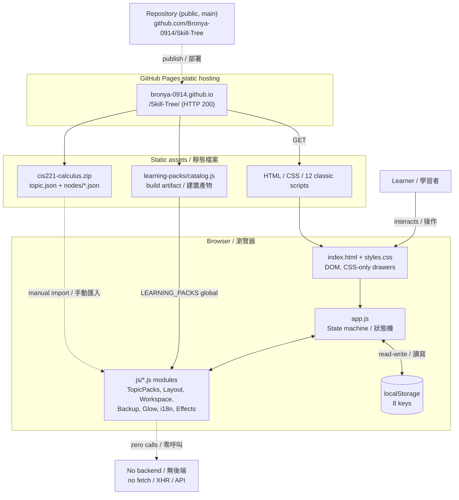
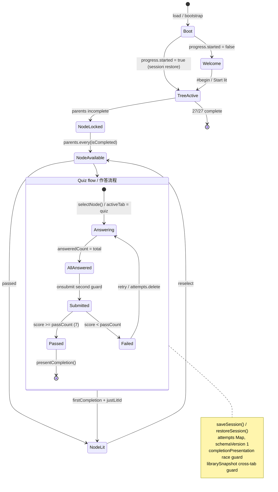
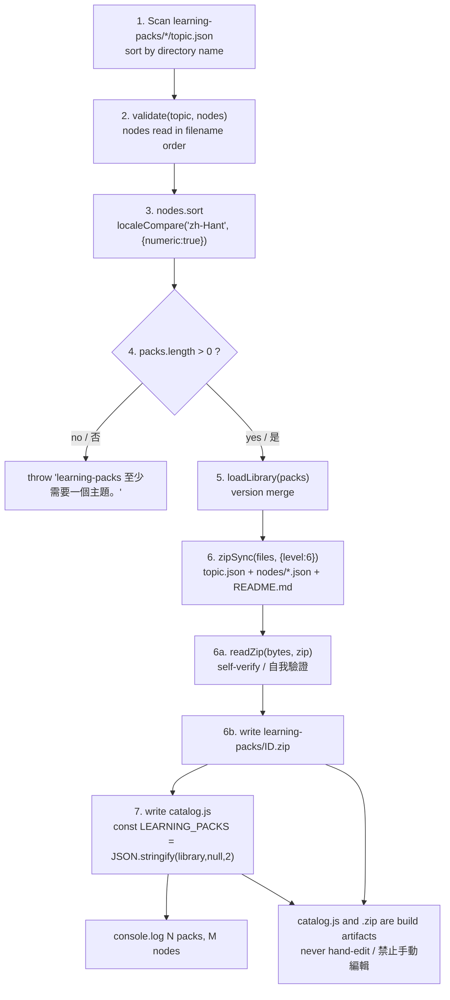

<a id="top"></a>

# Calculus Skill Tree · 微積分漫遊 — Technical Architecture Document

**技術架構文件 · English Edition**

**Language / 語言:** [繁體中文](./ARCHITECTURE.md) · [English](./ARCHITECTURE.en.md)

**Live demo / 線上展示:** <https://bronya-0914.github.io/Skill-Tree/>

**Repository / 原始碼庫:** <https://github.com/Bronya-0914/Skill-Tree>

---

<a id="s01"></a>

## 1. Document Information, Status & Table of Contents

### 1.1 Document Status

> **STATUS: `Current against local HEAD 8d7b4cb`**

This document is written against the single source of truth: the local working tree at `HEAD` = `8d7b4cb Checkpoint current site: i18n, tree layout, unlock effects, workspace and docs`, cross-checked with a read-only reconnaissance report and direct reads of the project source files. Every figure (line counts, byte sizes, cardinalities, constants, geometry bounds) is a measured value at that commit, not a paraphrase of design documents.

Four state differences that must be kept in mind:

| Item | Local HEAD `8d7b4cb` | Deployed GitHub Pages |
|---|---|---|
| Curriculum `version` | **version 5** | **version 1** (older) |
| Node open/close gesture | **single-click** | **double-click** |
| `app.js` lines | 435 | 459 |
| First node in `catalog.js` | 11 `content` blocks, book-rewrite edition | 6 `content` blocks, `intro` = "掌握函數代入、輸入限制和可能輸出…" |
| SHA-256 of `app.js` / `styles.css` / `catalog.js` | local values | **all differ** from local |
| Git remote / push | **no remote, no push/fetch record** | hosted in a public repository (`main`) |

Additional status notes:

- The live site `https://bronya-0914.github.io/Skill-Tree/` returns **HTTP 200** with the title "微積分漫遊 · Calculus Skill Tree", i.e. it **is deployed and publicly reachable**, but its content lags behind local HEAD. Several existing MD documents state "not published, not deployed, not shared"; that wording is **outdated** and this section supersedes it.
- Local Git: `git remote -v` is empty, `git config --list` contains no `remote.*`, `git branch --show-current` = `main`, `git status --short` was clean at the documentation baseline (the documentation pass leaves uncommitted changes), there is no `packed-refs` and no `FETCH_HEAD`, and the reflog shows only local commits (author `Sites <sites@users.noreply.openai.com>`) — **no push/fetch records**.
- `git ls-files | wc -l` = **105**, equal to the total file count excluding `.git/`, which means all 48 TXT files under `references/` **are tracked by Git** (see §4, §17, §18).
- The live URL and repository URL in this document were supplied by the requirement; no string recording the Pages URL exists anywhere inside the project (including `.git/`). Verification method: §17.

### 1.2 Document Metadata

| Field | Value |
|---|---|
| Project | 微積分漫遊 · Calculus Skill Tree |
| Document set | `docs/ARCHITECTURE.md` (繁體中文) / `docs/ARCHITECTURE.en.md` (English) |
| Status marker | `Current against local HEAD 8d7b4cb` |
| Local root | `<repo-root>` |
| Site type | Pure static, framework-free, backendless |
| Branch | `main` (public) |
| License | **No LICENSE file** (only third-party `fflate-LICENSE.txt`, MIT) |
| Deploy config | `js/hosting.json` → `static.directory = "."` |
| File count | 105 (excluding `.git/`) |
| Tests | **20/20** (`node --test tests/*.test.cjs`) |
| Syntax check | `node --check` passes on 15 files |
| Audience | Maintainers, handover AI agents, reviewers, release engineers |

### 1.3 Language & Writing Conventions

- This document uses **technical English**. Section numbers, tables, figures, constants, and diagrams are **one-to-one parallel** with `ARCHITECTURE.md`; the two files form a bilingual pair (中英對照).
- Technical terms are given with their Traditional Chinese equivalents where useful (e.g. "State Machine (狀態機)"), and §1.4 plus §20.3 carry explicit bilingual mappings.
- No emoji anywhere. Code, constants, paths, and identifiers remain verbatim.
- All paths are relative to the project root; relative links inside `docs/` use `../` to reach root-level files.
- Literal data strings inside JSON examples are kept **verbatim in the source language (Traditional Chinese)**, because they are data, not prose; they are translated at runtime by the i18n engine (§14). Translating the literals would misrepresent the shipped artifacts.

**Bilingual section index / 中英章節對照表:**

| # | English | 繁體中文 |
|---|---|---|
| 1 | Document Information, Status & Table of Contents | 文件資訊、狀態與目錄 |
| 2 | System Context | 系統脈絡 |
| 3 | Technology Stack & Design Principles | 技術堆疊與設計原則 |
| 4 | Complete Directory Tree & Responsibilities | 完整目錄樹與職責 |
| 5 | Bootstrap & Load Order | 啟動與載入順序 |
| 6 | Module Responsibility Matrix | 模組責任表 |
| 7 | State Machine | 狀態機 |
| 8 | Skill-Tree Geometry | 技能樹幾何 |
| 9 | Centering & Zooming | 置中與縮放 |
| 10 | Learning-Pack Data Model | 教材資料模型 |
| 11 | Build Pipeline | 建置管線 |
| 12 | Validation Rules | 驗證規則總表 |
| 13 | `localStorage` Keys | `localStorage` 完整表 |
| 14 | i18n Engine | i18n 引擎 |
| 15 | Visual System | 視覺系統 |
| 16 | Tests & Quality | 測試與品質 |
| 17 | Deployment & Version Consistency | 部署與版本一致性 |
| 18 | Known Limitations & Risk Register | 已知限制與風險登錄 |
| 19 | Decision Records | 決策紀錄 |
| 20 | Appendix | 附錄 |

### 1.4 Table of Contents

<details>
<summary><strong>Expand Table of Contents / 展開目錄</strong></summary>

1. [Document Information, Status & Table of Contents](#s01)
2. [System Context](#s02)
3. [Technology Stack & Design Principles](#s03)
4. [Complete Directory Tree & Responsibilities](#s04)
5. [Bootstrap & Load Order](#s05)
6. [Module Responsibility Matrix](#s06)
7. [State Machine](#s07)
8. [Skill-Tree Geometry](#s08)
9. [Centering & Zooming](#s09)
10. [Learning-Pack Data Model](#s10)
11. [Build Pipeline](#s11)
12. [Validation Rules](#s12)
13. [`localStorage` Keys](#s13)
14. [i18n Engine](#s14)
15. [Visual System](#s15)
16. [Tests & Quality](#s16)
17. [Deployment & Version Consistency](#s17)
18. [Known Limitations & Risk Register](#s18)
19. [Decision Records](#s19)
20. [Appendix](#s20)

</details>

### 1.5 Relationship to Other Documents

This document is the **current-state technical reference**. Relationship to the existing 8 MD files: `README.md` (getting started), `PACK_FORMAT.md` (pack format v1), `DESIGN-v2.md` (acceptance history, **partially outdated values**), `MULTIUSER-ARCH.md` (multi-user assessment, not implemented), `BOOK-REFERENCE.md` (bibliography and rewrite progress), `I18N.md` (language maintenance), `AI_TEACHING_GUIDE.md` (curriculum authoring guide), `learning-packs/cis221-calculus/README.md` (27-lesson list). Where any existing document conflicts with this one, **this document (aligned to HEAD `8d7b4cb`) takes precedence**; conflicts are enumerated in §8.6, §16.4, §17.6, §18.

[↑ Back to top / 回到頂端](#top)

---

<a id="s02"></a>

## 2. System Context

### 2.1 C4-Style Narrative

Described at the System Context level of the C4 model, the system boundary is deliberately small:

- **Person — Learner**: operates the skill tree through a browser, reads lessons, answers quizzes, adjusts theme and glow, exports/imports backups. The learner is the only user role; there is **no administrator, no account, no server-side identity**.
- **Software System — Calculus Skill Tree**: a pure static website. All business logic (unlock decisions, grading, progress, geometry, translation, backup) executes inside the browser, with `app.js` as the state-machine core and `js/*.js` as supporting modules.
- **External Systems**:
  - **GitHub Pages**: static file hosting, serving `https://bronya-0914.github.io/Skill-Tree/` (HTTP 200).
  - **GitHub Repository**: `https://github.com/Bronya-0914/Skill-Tree` (`main`, public), holding the source.
  - **`localStorage`**: the browser same-origin persistence layer, 8 keys (§13), the only place state is saved.
- **Data assets**: `learning-packs/catalog.js` (build artifact containing the full curriculum and 270 `answer` fields), `learning-packs/cis221-calculus.zip` (importable pack), `topic.json` + `nodes/*.json` (the single curriculum source).
- **Components explicitly absent**: **no backend**. A project-wide search for `fetch(`, `XMLHttpRequest`, `/api/`, `firebase`, `supabase`, `cloudservice` yields **zero hits**; there is no server-side grading, no database, no account sync, no API calls.

### 2.2 System Context Diagram



> Legend: solid lines are load or data flows; dashed lines are optional/conceptual relations. The cylinder denotes persistence; `catalog.js` and the ZIP are static files, never retrieved dynamically as JSON over the network.

### 2.3 Key Context Facts

| Fact | Evidence |
|---|---|
| All 13 static resource paths are identical online and locally | comparison of online `index.html` |
| Curriculum is injected as a global constant by `catalog.js`, not `fetch`ed | `index.html:35`, first line of `catalog.js` |
| All state lives only in `localStorage` | §13; `app.js:3,6,47` |
| Switching domain / browser / device loses data | same-origin policy |
| `references/` OCR full text is not published (online 404) | HTTP checks in §17 |
| Local has no remote; deployment was not produced by a local push | §1.1, §17 |

[↑ Back to top / 回到頂端](#top)

---

<a id="s03"></a>

## 3. Technology Stack & Design Principles

### 3.1 Stack

| Layer | Technology | Notes |
|---|---|---|
| Markup | HTML5, single `index.html` (155 lines / 14,524 B) | `lang="zh-Hant"`, inline favicon, inline theme script, CSS-only checkbox drawers |
| Styling | Plain CSS, `styles.css` (690 lines / 44,404 B) | CSS variables, glassmorphism, three-layer grid background, pure-CSS animations |
| Logic | Plain JavaScript (ES2018+, IIFEs / global constants), 12 classic `<script>` tags | No framework, no bundler, no `type="module"` |
| Data | JSON (`topic.json`, `nodes/*.json`) + `catalog.js` build artifact | 270 questions, 270 `answer` fields |
| ZIP | `js/vendor/fflate.js` (UMD minified, 33,044 B, single line) | Browser `window.fflate`; Node `require()` |
| Build | Node.js CommonJS `scripts/build-learning-packs.cjs` (37 lines / 2,053 B) | The only build command; **not executed during this documentation task** |
| Tests | Node built-in `node:test` (`node --test`) | 3 files, 20 tests |
| Persistence | `localStorage` (8 keys) | No IndexedDB, no cookies, no server |
| Hosting | GitHub Pages (static) | `js/hosting.json` → `static.directory="."` |
| VCS | Git (`main`, no remote) | 105 tracked files |

### 3.2 Why Framework-Free

1. **The deployment target is static files**: GitHub Pages serves static files only; no build output, no Node runtime, no hydration needed.
2. **Small interaction surface**: the core is "one 28-node graph + one quiz form + one pannable viewport". `document.querySelector`, `innerHTML` templates, and event delegation express it directly; a virtual DOM would add load cost.
3. **12 scripts execute in order via `defer`**: HTML guarantees the order, and modules communicate through explicit global namespaces (`TopicPacks`, `SkillTreeLayout`, `LessonWorkspace`, `SkillTreeBackup`, `SkillTreeI18n`, `SkillTreeEffects`, `SkillTreeEnglish`, `LEARNING_PACKS`, `fflate`), so no module system is required.
4. **Auditability**: `app.js` is 435 lines and every `js/*.js` is a directly readable pure function/IIFE; `node --check` validates each file; `js/topic-packs.js` and `js/tree-layout.js` also `module.exports`, letting Node tests `require()` them without jsdom.
5. **No dependency supply chain**: apart from `fflate`, no third-party packages; no `package.json`, no lockfile, no npm install step.

### 3.3 Why It Works Over `file://`

This conclusion follows from verified code facts, not speculation:

- **No ES Modules**: the 12 `<script src=...>` tags in `index.html` are all classic scripts with `defer`; there is **no** `type="module"`. ES modules are blocked by CORS over `file://`; classic scripts are not.
- **No dynamic fetching of local resources**: `fetch(` / `XMLHttpRequest` have zero hits project-wide. The curriculum is not read via `fetch('topic.json')`; instead `learning-packs/catalog.js` directly assigns a global constant `const LEARNING_PACKS = [...]` (`index.html:35`), which avoids the most typical `file://` failure.
- **All paths are relative**: `styles.css`, `js/...`, `learning-packs/catalog.js`, `PACK_FORMAT.md`, and the ZIP download all use relative paths, with no server-side routing or rewrites.
- **No server requirements**: no API, no SSR, no `CNAME` / `404.html` route rules; `dialog.showModal()`, `ResizeObserver`, `MutationObserver`, and `matchMedia` are all native browser APIs.

Caveat to retain: even though the design above allows `index.html` to be opened by double-clicking, `localStorage` behavior on a `file://` origin is browser-implementation-defined (some browsers treat each file as a distinct origin or restrict writes). Therefore the **supported usage is over HTTP(S)**; `saveProgress()` wraps storage access in `try/catch` and degrades to `storageAvailable = false` with the notice "瀏覽器儲存不可用，本次進度僅暫存", precisely for such environments.

### 3.4 Why `catalog.js` Is a Build Artifact

- **Single source of truth**: the only files a human should edit are `learning-packs/<id>/topic.json` and `learning-packs/<id>/nodes/*.json`. `scripts/build-learning-packs.cjs` generates both the site-loadable `catalog.js` and the uploadable ZIP from these JSON files, avoiding two copies of the curriculum (the script's lines 3–4 comment states exactly this).
- **Necessary format conversion**: the browser needs a JS global constant that a `<script>` can load; the import feature needs a ZIP conforming to `PACK_FORMAT.md` (`topic.json` + `nodes/*.json` + `README.md`). Both must be consistent, so one script produces both.
- **Consistency enforced by tests**: `tests/topic-packs.test.cjs` compares `catalog.js`, the ZIP, and the 27 source JSON files field-by-field (including all 270 `answer` fields).
- **Never hand-edit**: the first line of `catalog.js` reads `// 此檔由 scripts/build-learning-packs.cjs 產生，請編輯各主題的 JSON。`; `cis221-calculus.zip` is likewise a build artifact. Any manual edit is overwritten on the next build and breaks the tests.

### 3.5 Progressive Enhancement & `prefers-reduced-motion`

| Principle | Implementation |
|---|---|
| Base content in HTML | Title, progress, feature notes, glow palette, dialog skeletons are hardcoded in `index.html` and visible without JS. |
| CSS-only toggles | Two `<input type="checkbox" class="overlay-toggle">` (`#nav-toggle`, `#lesson-toggle`) with `#nav-toggle:checked ~ .drawer` and `#lesson-toggle:checked ~ .lesson-card`; no JS bound. |
| JS as enhancement only | `app.js` injects `#begin`, lesson tabs, `#quiz-form`, etc.; `workspace.js` injects the scratchpad canvas. |
| Graceful degradation | All `localStorage` access wrapped in `try/catch`; `isDesktop()` via `matchMedia('(min-width:761px)')`; `.overlay-toggle` has `tabindex="-1" aria-hidden="true"`. |
| Touch performance | `@media (hover:none) and (pointer:coarse)` (`styles.css:643–645`) disables every `backdrop-filter` to avoid frame drops. |
| Accessibility | Skip link, `aria-label`, `aria-pressed`, `role="status"`, `aria-live="polite"`, `inert` (`syncCollapseDirection()`), keyboard palette step `.01` / Shift `.1`. |
| Reduced motion | `@media (prefers-reduced-motion:reduce)` (`styles.css:688–690`) disables all animations/transitions; `play()` in `js/unlock-effects.js` removes `just-lit` and returns immediately, producing no particles. |

### 3.6 Other Design Principles

- **Presentation layer separated from unlock layer**: `js/tree-layout.js` states in a comment `The original parents remain the authority for unlocking.`; `primary` / `additional` / `children` decide only "how to draw wires", while `isAvailable()` still uses the original `parents` to decide "whether it can be studied".
- **Defense in depth**: a `disabled` submit button is the first guard; the `answeredCount` check in `#quiz-form.onsubmit` is the second (§7).
- **Race guards**: `completionPresentation` protects `presentCompletion()`; `importSequence` protects async imports; `librarySnapshot` prevents cross-tab overwrite.
- **Versioned persistence**: 5 keys carry `schemaVersion:1` for future migrations (§13).

[↑ Back to top / 回到頂端](#top)

---

<a id="s04"></a>

## 4. Complete Directory Tree & Responsibilities

### 4.1 File Census

The project contains **105 files** (excluding `.git/`). The root has **no hidden files other than `.git/` (there is no `.gitignore`)**:

| Type | Count | Notes |
|---|---|---|
| `.md` | **8** | 7 root documents + `learning-packs/cis221-calculus/README.md` |
| `.js` | **12** | `app.js` + 9 in `js/` + `js/vendor/fflate.js` + `learning-packs/catalog.js` |
| `.json` | **30** | `js/hosting.json` + `topic.json` + 27 node JSON + `references/.../chapters.json` |
| `.txt` | **48** | `fflate-LICENSE.txt` + `book-full.txt` + 46 chapter txt |
| `.cjs` | **4** | 1 build script + 3 test files |
| `.zip` | **1** | `learning-packs/cis221-calculus.zip` |
| `.html` | **1** | `index.html` |
| `.css` | **1** | `styles.css` |
| **Total** | **105** | `git ls-files | wc -l` is also 105 |

### 4.2 Directory Tree

```
<repo-root>/
├── .git\                                    Local Git repo (branch main, no remote, no push)
├── index.html                               Sole entry point (14,524 B / 155 lines)
├── app.js                                   State machine, DOM templates, zoom/pan (26,875 B / 435 lines)
├── styles.css                               Visual layer (44,404 B / 690 lines)
├── js\
│   ├── hosting.json                         Sole deployment config (103 B)
│   ├── topic-packs.js                       Curriculum data layer / validation / ZIP I/O (15,338 B / 256 lines)
│   ├── pack-ui.js                           Learning-pack import preview UI (6,976 B / 123 lines)
│   ├── workspace.js                         Draggable/resizable quiz frame + handwriting scratchpad (14,381 B / 317 lines)
│   ├── backup-ui.js                         Data backup export/import (5,405 B / 114 lines)
│   ├── glow-settings.js                     Glow color + HSV palette (8,433 B / 195 lines)
│   ├── i18n.js                              Language-switch engine (9,179 B / 152 lines)
│   ├── i18n-messages.js                     English message catalog (270,208 B / 1,848 lines / 1,831 keys)
│   ├── tree-layout.js                       Wire geometry + fixed preview coordinates (5,293 B / 104 lines)
│   ├── unlock-effects.js                    Ignite particle effects (3,877 B / 91 lines)
│   └── vendor\
│       ├── fflate.js                        UMD minified ZIP library (33,044 B, single line)
│       └── fflate-LICENSE.txt               MIT (Copyright (c) 2026 Arjun Barrett)
├── learning-packs\
│   ├── catalog.js                           Build artifact (169,996 B / 4,515 lines)
│   ├── cis221-calculus.zip                  Build artifact, 29 entries (58,184 B)
│   └── cis221-calculus\                     Sole curriculum source directory
│       ├── topic.json                       Topic settings (306 B)
│       ├── README.md                        27-lesson list (2,579 B)
│       └── nodes\                           27 node JSON files (4,682–6,668 B each)
│           └── cis221-calculus.functions.json … cis221-calculus.newton-optimization.json
├── references\                              OCR book full text (tracked by Git, must not be published)
│   └── 3000-solved-problems\
│       ├── book-full.txt                    892 KB full text
│       ├── chapters.json                    Chapter index (source points to a local PDF path)
│       └── chapters\                        46 chapter txt files ch01…ch46
├── scripts\
│   └── build-learning-packs.cjs             Generates catalog.js and ZIP (2,053 B / 37 lines)
├── tests\
│   ├── topic-packs.test.cjs                 14 tests (7,641 B)
│   ├── tree-layout.test.cjs                 3 tests (4,255 B)
│   └── i18n.test.cjs                        3 tests (2,282 B)
├── README.md                                Getting started (3,047 B)
├── AI_TEACHING_GUIDE.md                     Curriculum authoring guide for AI (7,805 B)
├── BOOK-REFERENCE.md                        Book sources / rewrite progress (17,629 B)
├── DESIGN-v2.md                             Design & acceptance history (55,023 B / 721 lines, partly outdated)
├── I18N.md                                  Language maintenance (1,035 B, all English)
├── MULTIUSER-ARCH.md                        Multi-user architecture assessment (20,470 B, not implemented)
├── PACK_FORMAT.md                           Learning-pack format v1 (5,536 B)
└── docs\
    ├── ARCHITECTURE.md                      This document's counterpart (繁體中文)
    └── ARCHITECTURE.en.md                   This document (English)
```

> Note: the two `docs/` files were added by this task; the 105-file census above **excludes** these two new files (the reconnaissance report's 105 counts pre-existing files).

### 4.3 Special Marking: `references/`

- **Contents**: OCR full text of Schaum's / McGraw-Hill *3000 Solved Problems in Calculus* (1988): `book-full.txt` (892 KB), 46 chapter txt files, `chapters.json`.
- **Purpose**: **local OCR reference**, used by `BOOK-REFERENCE.md` when rewriting curriculum against chapters.
- **Must not be published**: `BOOK-REFERENCE.md` records the copyright up front; online paths for the book full text return **404**, meaning the current deployment excludes it.
- **Risk**: the 48 TXT files under `references/` **are tracked by Git** (`git ls-files` = 105), and `static.directory="."` with no `.gitignore` means any push or root-directory packaging can leak them (see §18 R01).

### 4.4 `cis221-calculus.zip` Manifest

29 entries, **145,337 B** uncompressed: `topic.json`, `README.md`, and 27 JSON files under `nodes/`:

`functions, graphs, trigonometry, exp-log, rates, limits, power, product-quotient, elementary, chain, implicit, extrema, optimization, surfaces, partials, higher-implicit, multi-chain, antiderivatives, elementary-integrals, definite, integral-properties, substitution, integral-applications, linearization, taylor, newton-roots, newton-optimization` (all prefixed `cis221-calculus.`).

### 4.5 Responsibility Grouping

| Group | Files | Responsibility |
|---|---|---|
| Entry point | `index.html` | Structure, 53 static IDs, 13 resources, inline theme script |
| Orchestration | `app.js` | State machine, rendering, events, zoom |
| Presentation | `styles.css`, `js/unlock-effects.js` | Visuals and ignite effects |
| Curriculum | `js/topic-packs.js`, `learning-packs/catalog.js`, `learning-packs/cis221-calculus/`, `scripts/build-learning-packs.cjs` | Data, validation, build |
| Geometry | `js/tree-layout.js` | Preview coordinates, wire graph, bounds |
| Workspace | `js/workspace.js` | Drag / resize / scratchpad |
| Peripheral features | `js/pack-ui.js`, `js/backup-ui.js`, `js/glow-settings.js` | Import, backup, glow |
| Internationalization | `js/i18n.js`, `js/i18n-messages.js` | In-place translation |
| Third party | `js/vendor/fflate.js`, `fflate-LICENSE.txt` | ZIP compression |
| Quality | `tests/*.test.cjs` | 20 tests |
| Documentation | 8 MD + `docs/` | Explanations (two added in this task) |

### 4.6 Verification Commands (Read-Only)

```bash
cd "<repo-root>"
find . -not -path './.git/*' -type f | wc -l        # 105
unzip -l learning-packs/cis221-calculus.zip          # 29 entries
git ls-files | wc -l                                 # 105 (references/ also fully tracked)
```

[↑ Back to top / 回到頂端](#top)

---

<a id="s05"></a>

## 5. Bootstrap & Load Order

### 5.1 The 13 Static Resources in `index.html`

All are in `<head>`; the stylesheet loads via `<link>`, and the 12 JS files all carry `defer`, executing **strictly in document order**:

| # | Resource | Line | Type | Role |
|---|---|---|---|---|
| 1 | `styles.css` | 10 | CSS | All visuals, theme variables, animations |
| 2 | `learning-packs/catalog.js` | 35 | JS | Defines global `const LEARNING_PACKS` |
| 3 | `js/vendor/fflate.js` | 36 | JS | Defines `window.fflate` |
| 4 | `js/topic-packs.js` | 37 | JS | Defines `TopicPacks` |
| 5 | `js/workspace.js` | 38 | JS | Defines `window.LessonWorkspace` |
| 6 | `js/tree-layout.js` | 39 | JS | Defines `SkillTreeLayout` |
| 7 | `js/unlock-effects.js` | 40 | JS | Defines `window.SkillTreeEffects` |
| 8 | `app.js` | 41 | JS | State machine core; depends on 2–7 being ready |
| 9 | `js/backup-ui.js` | 42 | JS | Depends on `window.SkillTreeBackupKeys` (set by 8) |
| 10 | `js/pack-ui.js` | 43 | JS | Depends on `TopicPacks` and `app.js` globals |
| 11 | `js/glow-settings.js` | 44 | JS | Attaches CSS variables |
| 12 | `js/i18n-messages.js` | 45 | JS | Defines `window.SkillTreeEnglish` |
| 13 | `js/i18n.js` | 46 | JS | Depends on 12's message catalog; translates last |

Dependency rationale: `catalog.js` must precede `app.js` (the latter calls `TopicPacks.loadLibrary(LEARNING_PACKS)` on line 7); `i18n-messages.js` must precede `i18n.js`; `backup-ui.js` must follow `app.js` (it reads `window.SkillTreeBackupKeys`); the last line of `app.js` initialization (`app.js:434`) is `renderTree(); renderLesson(); fitTree();`.

Two further `<a href>` elements (not `<script>` / `<link>`): `learning-packs/cis221-calculus.zip` (`download`) and `PACK_FORMAT.md` (`target="_blank"`), plus an inline `data:image/svg+xml` favicon (`index.html:9`).

### 5.2 Why the Inline Theme Script Is Not Deferred

The inline script at `index.html:11–34` is **deliberately not deferred** and is placed at the very top of `<head>` (after the stylesheet, before the 12 deferred scripts):

```js
(function(){
  var KEY='skill-tree-theme';
  function paint(dark){
    document.documentElement.classList.toggle('dark',dark);
    var meta=document.querySelector('meta[name="theme-color"]');
    if(meta)meta.setAttribute('content',dark?'#0a0a0b':'#f3f3f5');
  }
  var dark=true;
  try{var saved=localStorage.getItem(KEY);dark=saved!=='light';}catch(_){}
  paint(dark);
  document.addEventListener('DOMContentLoaded',function(){ /* bind #theme-toggle */ });
})();
```

Reasons:

1. **Avoid flash of wrong theme (FOUC)**: if `.dark` were applied only in a deferred script or on `DOMContentLoaded`, the browser could paint one frame in light mode before switching. Running synchronously sets the class on `document.documentElement` and the `<meta name="theme-color">` (dark `#0a0a0b` / light `#f3f3f5`) **before `<body>` is painted**.
2. **Dark by default**: `var dark=true`; only `localStorage['skill-tree-theme'] === 'light'` switches to light.
3. **Fault tolerance**: the `localStorage` read is wrapped in `try/catch`; if unavailable, dark mode still works.
4. **Responsibility split**: the inline script handles only first-frame coloring; button binding is deferred to `DOMContentLoaded` because `#theme-toggle` does not exist in the DOM yet.

### 5.3 The 53 Static DOM IDs

`index.html` contains **53 unique static IDs** (`grep -oE 'id="[^"]+"' index.html | sort -u | wc -l` = 53). Grouped below (total plus highlights rather than a verbatim list):

| Category | Count | Representative IDs |
|---|---|---|
| Overlay toggles | 2 | `nav-toggle`, `lesson-toggle` |
| Stage / map | 5 | `map`, `world`, `connections`, `nodes`, `map-empty` |
| Map tools | 5 | `zoom-out`, `zoom-label`, `zoom-in`, `fit`, `theme-toggle` |
| Drawer & progress | 9 | `reset`, `topic-jump`, `manage-packs`, `pack-count`, `catalog-warning`, `progress`, `progress-text`, `progress-caption`, `storage-note` |
| Backup | 3 | `backup-export`, `backup-file`, `backup-status` |
| Glow settings | 12 | `glow-swatches`, `glow-spectrum`, `glow-cursor`, `glow-hue`, `glow-hue-value`, `glow-spectrum-value`, `glow-chip`, `glow-color`, `glow-value`, `glow-preview`, `glow-reset`, `glow-sample` |
| Lesson panel | 2 | `lesson`, `lesson-content` |
| Toast | 1 | `toast` |
| Dialogs | 14 | `reset-dialog`, `cancel-reset`, `confirm-reset`, `pack-dialog`, `pack-dialog-title`, `close-packs`, `pack-drop`, `pack-file`, `pack-status`, `pack-preview`, `pack-confirm-actions`, `cancel-import`, `confirm-import`, `pack-library` |
| **Total** | **53** | |

Structural highlights:

- Full-screen canvas `<section class="stage map" id="map">` contains `#world` > `<svg id="connections" viewBox="0 0 760 950">` + `#nodes`; `app.js` rewrites the viewBox to `0 0 3069 1998` (§8).
- Two language-switch groups `.language-switch[data-language-control]` (one in `.topright-ctl`, one inside the drawer), with buttons carrying `data-language="zh-Hant"|"en"`.
- Glow settings include 8 `.glow-swatch[data-color]`: `#ffffff, #f2d9a8, #e8b264, #e0655f, #a58bd6, #7aa2e3, #4fc3b8, #8a8a92`.
- The lesson card `.lesson-card` contains a `.lesson-frame-bar` drag handle and 8 `.frame-resize[data-resize="n|e|s|w|ne|nw|se|sw"]` handles; **the scratchpad is not static DOM**.
- `<dialog id="reset-dialog">` and `<dialog id="pack-dialog">` are both opened with `showModal()`.

### 5.4 Dynamically Generated IDs

| Source | Dynamic IDs |
|---|---|
| `app.js` | `begin`, `learn-tab`, `quiz-tab`, `lesson-body`, `to-quiz`, `quiz-content`, `quiz-scratch`, `quiz-form`, `quiz-submit`, `quiz-progress`, `next-lesson`, `tree-arrow` (12) |
| `js/workspace.js` | `scratch-canvas`, `scratch-size` (2) |

`app.js` generates `<aside id="quiz-scratch">` when `activeTab==='quiz'`; then `workspace.js` `mountScratchpad()` injects `.scratch` + `<canvas id="scratch-canvas">`.

### 5.5 Bootstrap Sequence

1. Browser parses `<head>`: loads `styles.css`; **synchronously** runs the inline theme script (first-frame coloring).
2. Executes the 12 deferred JS files in order, establishing each global namespace.
3. `app.js` top level (`app.js:7–81`): `loadLibrary(LEARNING_PACKS)` → read `PACKS_KEY` (requires `schemaVersion===1 && Array.isArray(packs)`) → `buildLessons()` → read `STORAGE_KEY` → `attempts = new Map()` → `restoreSession()`.
4. `backup-ui.js`, `pack-ui.js`, `glow-settings.js`, `i18n.js` each read their own keys and register `storage` listeners.
5. `app.js:434`: `renderTree(); renderLesson(); fitTree();`.
6. `new ResizeObserver(focusTree).observe(map)` watches viewport changes.

[↑ Back to top / 回到頂端](#top)

---

<a id="s06"></a>

## 6. Module Responsibility Matrix

Each of the 12 required modules is listed with **public API, constants, side effects**; a supplementary table follows.

### 6.1 `app.js` (State machine core, 435 lines / 26,875 B)

| Aspect | Detail |
|---|---|
| Public API | No `module.exports`; exposes `window.SkillTreeBackupKeys` plus global lexical bindings used by `pack-ui.js`: `library`, `lessons`, `allNodes`, `startNode`, `progress`, `selectedId`, `activeTab`, `attempts`, `viewport`, `map`, `selectNode`, `renderTree`, `renderLesson`, `fitTree`, `applyTransform`, `notify`, `PACKS_KEY`, `librarySnapshot`, `catalogError` |
| Constants | `STORAGE_KEY='calculus-tree-progress-v1'`; `PACKS_KEY='calculus-tree-packs-v1'`; `SESSION_KEY='calculus-tree-session-v1'`; `BACKUP_KEYS` (8 keys); `startNode={id:'start',title:'Start',en:'從這裡開始',icon:'✧',x:590,y:65,parents:[]}`; `$=(s)=>document.querySelector(s)` |
| State | `progress={started:false,completed:[],scores:{}}`; `allNodes=[startNode,...lessons]` (28); `attempts=new Map()`; `viewport={x:0,y:0,scale:1}`; `justLitId`, `completionPresentation`, `storageAvailable`, `treeLayout`, `layoutNodes` |
| Side effects | Writes `STORAGE_KEY` / `SESSION_KEY`; re-renders `#nodes` / `#connections` / `#lesson-content`; registers many listeners and a `ResizeObserver`; reads `PACKS_KEY`; `notify()` manipulates `#toast` |

### 6.2 `js/topic-packs.js` (Pure data layer, 256 lines / 15,338 B)

| Aspect | Detail |
|---|---|
| Public API | `TopicPacks = {validate, prepare, buildLessons, loadLibrary, ordered, readZip, writeZip, escape}`; `if (typeof module !== 'undefined') module.exports = TopicPacks` |
| Constants | `MAX_FILE=512*1024`, `MAX_TOTAL=4*1024*1024`, `idPattern=/^[a-z][a-z0-9-]*(?:\.[a-z0-9-]+)*$/`; ZIP `bytes.length ∈ [22, 5*1024*1024]`, entries `1..128`, EOCD `0x06054b50`, central directory `0x02014b50`, local header `0x04034b50`, CRC32 polynomial `0xedb88320`, only method `0`/`8`; `buildLessons` limits 30 topics / 300 nodes; geometry `left=65`, layer `115`, column `210`, `+60` per segment |
| Side effects | **No DOM, no `localStorage`**; a pure library. `readZip` / `writeZip` receive an injected `fflate` instance; usable in both browser and Node |

### 6.3 `js/pack-ui.js` (Learning-pack import UI, 123 lines / 6,976 B)

| Aspect | Detail |
|---|---|
| Public API | No module export; uses globals directly (see §6.1) and `TopicPacks.escape` |
| Constants | `pendingPack`, `importSequence` (async race guard), rejects `file.size > 5*1024*1024`, writes `JSON.stringify({schemaVersion:1,packs:pendingPack.packs})`, export filename `` `${topic.id}-v${topic.version}.zip` `` |
| Side effects | Writes `PACKS_KEY`; checks `localStorage.getItem(PACKS_KEY) !== librarySnapshot` to prevent cross-tab overwrite; reassigns `library/lessons/allNodes` and triggers `renderTree()/renderLesson()/fitTree()`; registers a `storage` listener |

### 6.4 `js/workspace.js` (Quiz frame & scratchpad, 317 lines / 14,381 B)

| Aspect | Detail |
|---|---|
| Public API | `window.LessonWorkspace = {mountScratchpad, unmountScratchpad, setQuizMode, setOpen, isOpen, resetFrame}` |
| Constants | `FRAME_KEY='calculus-tree-lesson-frame-v1'`, `SCRATCH_KEY='calculus-tree-scratch-v1'`, `SCHEMA=1`, `VW=1000`, `VH=700`, `MAX_STROKES=300`, `MAX_POINTS=30000`; `isDesktop()=matchMedia('(min-width:761px)')`; min width `min(340,innerWidth-16)`, min height `min(300,innerHeight-16)`; first quiz auto-enlarges to `max(900,w)×max(600,h)`; `setOpen()` is async, awaiting `animation.finished` |
| Side effects | Writes `FRAME_KEY` / `SCRATCH_KEY`; injects `.scratch` + `<canvas id="scratch-canvas">` inside `#quiz-scratch`; `syncCollapseDirection()` inverts checkbox semantics for desktop/mobile and sets `card.inert`; registers pointer / canvas listeners |

### 6.5 `js/backup-ui.js` (Backup, 114 lines / 5,405 B)

| Aspect | Detail |
|---|---|
| Public API | `window.SkillTreeBackup = {exportPayload, importPayload, validate, keys:KEYS, schemaVersion:SCHEMA}` |
| Constants | `APP='calculus-skill-tree'`, `SCHEMA=1`, `MAX_FILE=5*1024*1024`; `KEYS = window.SkillTreeBackupKeys` (8 keys) or `FALLBACK_KEYS`; payload `{app, schemaVersion, exportedAt, keys:{key: raw string | null}}`; filename `skill-tree-backup-YYYY-MM-DD.json` |
| Side effects | `window.confirm(SkillTreeI18n.t(...))`; writes key-by-key, `null/undefined` → `removeItem`; rolls back with `before` on failure; `location.reload()` after 500 ms on success |

### 6.6 `js/glow-settings.js` (Glow, 195 lines / 8,433 B)

| Aspect | Detail |
|---|---|
| Public API | No export; attaches CSS variables and events |
| Constants | `KEY='calculus-tree-glow-v1'`, `SCHEMA=1`, `DEFAULT='#ffffff'`, `HEX=/^#([0-9a-f]{3}|[0-9a-f]{6})$/i`; writes `--glow-rgb`, `--glow-bright-rgb` (tint `.42`), `--glow-core-rgb` (tint `.68`), `--lit`, `--lit-soft` (`rgba(...,0.16)`), `--lit-ink` (luminance `>.179` → `#181a20`, else `#ffffff`), `--picker-hue`; `endGlow` recognizes only `ignite-node` / `ignite-line`; keyboard step `.01` / Shift `.1` |
| Side effects | Sets CSS custom properties on `document.documentElement`; writes `KEY`; registers a `storage` listener |

### 6.7 `js/i18n.js` (Translation engine, 152 lines / 9,179 B)

| Aspect | Detail |
|---|---|
| Public API | `window.SkillTreeI18n = {t, english, setLanguage, get language}` |
| Constants | `KEY='skill-tree-language'`; `messages=window.SkillTreeEnglish`; **46** parameterized templates (`{0}`…); `english(text,depth)` stops at `depth>6`, acts only on text containing `\p{Script=Han}`; `attributes=['aria-label','title','placeholder','content']` (4 kinds); `ignored='script,style,noscript,textarea,[data-language-control]'`; separators `」與「`, `，`, `、` |
| Side effects | **Rewrites in place** text nodes and display attributes (does not rebuild DOM); sets `html[lang]`; writes `KEY`; `WeakMap` stores originals; `MutationObserver` watches later mutations; registers a `storage` listener |

### 6.8 `js/i18n-messages.js` (English message catalog, 1,848 lines / 270,208 B)

| Aspect | Detail |
|---|---|
| Public API | `window.SkillTreeEnglish` |
| Constants | **1,831 keys** (documents say 1,830, outdated); contains 3 `Object.assign(window.SkillTreeEnglish, {...})` blocks (lines 1147, 1201, 1288) |
| Side effects | Defines a global object only; no DOM, no events |

### 6.9 `js/tree-layout.js` (Geometry, 104 lines / 5,293 B)

| Aspect | Detail |
|---|---|
| Public API | `SkillTreeLayout = {build}`; `module.exports` (for Node tests) |
| Constants | `nodeWidth=282`, `nodeHeight=74`, `layerStep=168`, `columnStep=350`, `prefix='cis221-calculus.'`; `preview` is **28 rows** `[id,x,y,parents,preferredParent]` (including `start`); `matchesPreview` requires `nodes.length===28` and every row's `parents` to match exactly; `bounds.minX=min(x)-nodeWidth/2-24`, `maxX=max(x+(additional?267:nodeWidth/2))+24`, `maxY=max(y)+nodeHeight/2+24` |
| Side effects | **Mutates `x`/`y` of the passed nodes in place** (writes fixed preview coordinates on a hit; otherwise fallback `node.x=180+column++*350` or subtree midpoint, `node.y=65+depth*168`). Returns `{byId, primary, additional, children, bounds, nodeWidth, nodeHeight}` |

### 6.10 `js/unlock-effects.js` (Ignite effects, 91 lines / 3,877 B)

| Aspect | Detail |
|---|---|
| Public API | `window.SkillTreeEffects = {play(element,{compact})}` |
| Constants | `WeakMap active`; on `prefers-reduced-motion` removes `just-lit` and returns; compact: `10` inward / `16` shard / `22` mote / spread `70` / radius `55`; normal: `18` / `26` / `46` / `160` / `125`; cleanup timeout `1600ms` |
| Side effects | Creates `.unlock-burst/.unlock-charge/.unlock-inward/.unlock-ring/.unlock-shard/.unlock-mote` plus `--charge-*`, `--shard-*`, `--mote-*` CSS variables; sets cleanup timeouts |

### 6.11 `js/vendor/fflate.js` (Third-party ZIP, 33,044 B single line)

| Aspect | Detail |
|---|---|
| Public API | Under Node, `require()` exports `deflate, inflate, zipSync, unzipSync, Inflate, strToU8, strFromU8…`; under the browser, `window.fflate` |
| Constants | UMD minified, single line with no newlines; **no version string found inside the file**; `PACK_FORMAT.md` records `fflate 0.8.3` (not verifiable from the file); license in `fflate-LICENSE.txt` (MIT, Copyright (c) 2026 Arjun Barrett) |
| Side effects | Defines a global/export only |

### 6.12 `scripts/build-learning-packs.cjs` (Build, 37 lines / 2,053 B)

| Aspect | Detail |
|---|---|
| Public API | CLI command (not a module); `require('../js/topic-packs.js')` and `require('../js/vendor/fflate.js')` |
| Constants | `root=path.resolve(__dirname,'..','learning-packs')`; `zipSync(files,{level:6})`; `'learning-packs 至少需要一個主題。'`; `localeCompare('zh-Hant',{numeric:true})` |
| Side effects | **Writes** `learning-packs/<id>.zip` and `learning-packs/catalog.js`; self-verifies with `api.readZip(bytes,zip)` before writing. **This command was NOT executed during this documentation task** (see scope constraints) |

### 6.13 Supplementary Module Table

| File | Responsibility | Public API / Constants | Side effects |
|---|---|---|---|
| `js/hosting.json` | Sole deployment config | `{"project_id":"appgprj_6af1852c8bc88191999e930daeb549ac","static":{"directory":"."}}` | None |
| `learning-packs/catalog.js` | Build artifact, curriculum loaded by site | `const LEARNING_PACKS = [...]` (4,515 lines) | Defines a global constant |
| `styles.css` | Visual layer | CSS variables / `@keyframes` | Style rendering |
| `index.html` | Entry point | 53 static IDs, 13 resources | Inline theme script |
| `tests/*.test.cjs` | Quality | `node:test` | Read-only verification |

[↑ Back to top / 回到頂端](#top)

---

<a id="s07"></a>

## 7. State Machine

### 7.1 Top-Level State

```js
let progress = {started:false, completed:[], scores:{}};
let selectedId = 'start', activeTab = 'learn';
const attempts = new Map();
const viewport = {x:0, y:0, scale:1};
let justLitId = null, completionPresentation = 0, storageAvailable = true;
```

### 7.2 Start & the Three Node States

- **Start**: `isCompleted('start')` is equivalent to `progress.started`. Before starting, `renderTree()` uses `visible = [startNode]`, drawing only Start, with `#map-empty.hidden = progress.started`.
- **Lighting Start**: `renderWelcome()` binds `#begin.onclick`: `firstStart = !progress.started` → `progress.started = true` → `justLitId='start'` → `saveProgress()` → `selectNode(next.id)` (first incomplete, `isAvailable` node, else `lessons[0]`) → `focusTree()` → `notify('Start 已點亮！…')`.
- **Node states**:

```js
const state = completed ? 'lit' : available ? 'available' : 'locked';
```

| State | Predicate | Rendering |
|---|---|---|
| `lit` | `progress.completed.includes(id)` | `.lit` (`--lit-soft` background, `--lit` border) |
| `available` | `isAvailable(node)` = `isCompleted(node.id) || node.parents.every(isCompleted)` | `.available` |
| `locked` | otherwise | `.locked` (`--node-locked`) |

When `parents` is an empty array, `lessonFromNode()` fills it with `[topic.attachTo]` (currently `start`). Node card classes also include `node.kind` (`base|derivative|integral|start`), `selected`, `just-lit`. Only direct parents not implied by another prerequisite are wired; extra prerequisites render as `.prerequisite-label[data-prerequisite]`.

### 7.3 `progress` and `scores`

- `progress.started:boolean`, `progress.completed:string[]`, `progress.scores:{[id]:number}`.
- Startup restore (`app.js:24–37`): accepts only `started` boolean and `completed` array; **keeps only node IDs that still exist**; `scores` must be integers in `0…lesson.quiz.length`.
- Progress display (`renderTree()` lines 156–159): `#progress.max = lessons.length` (27), `#progress.value = progress.completed.length`, `#progress-text = "N / 27"`, and `#progress-caption` switches among all-complete / started / not-started messages.

### 7.4 `attempts` Map & Session Restore

`attempts` is `Map<id, {answers:{[index]:number}, submitted:boolean}>`.

- `saveSession()` writes `SESSION_KEY = {schemaVersion:1, selectedId, activeTab, attempts:{id:{answers,submitted}}}`, called at the start of `renderLesson()` and in `#quiz-form.onchange`.
- `restoreSession()` (`app.js:58–80`, invoked immediately on line 81) validates:
  - `state.schemaVersion===1`;
  - `selectedId` exists and `isAvailable()`;
  - `activeTab ∈ learn|quiz|scratch` (`scratch` normalized to `quiz`);
  - `answers` keys must be integers `0 ≤ index < lesson.quiz.length`, values integers `0 ≤ v < lesson.quiz[index][1].length`;
  - `submitted===true` only when strictly true.
- `#confirm-reset` calls `localStorage.removeItem(SESSION_KEY)`, `attempts.clear()`, `progress={started:false,completed:[],scores:{}}`, `selectedId='start'`, `activeTab='learn'`.

### 7.5 Quiz & the Second Guard

Each `lesson.quiz` item is a 4-tuple `[prompt, options, answerIndex, explanation]` (produced by `lessonFromNode()`).

- Scoring: `score = lesson.quiz.filter((q,i) => attempt.answers[i] === q[2]).length`; `passed = score >= lesson.passCount` (currently all 27 lessons have `passCount:7`, `quiz.length:10`; the threshold reads `lesson.passCount`, not a hardcoded value).
- **First guard** `updateQuizSubmit()`: `done = answeredCount(attempt,total)` (counts integer-valued `attempt.answers[index]`); when incomplete, `#quiz-submit.disabled=true`, class `quiz-pending`, and `#quiz-progress` shows "已作答 d / t 題…"; when complete, `quiz-ready`.
- `#quiz-form.onchange`: writes `attempt.answers[...]` → `saveSession()` → `updateQuizSubmit()`.
- **Second guard** `#quiz-form.onsubmit`:

```js
if (attempt.submitted || answeredCount(attempt, lesson.quiz.length) < lesson.quiz.length) return;
attempt.submitted = true;
progress.scores[id] = Math.max(progress.scores[id] || 0, correct);
const firstCompletion = passed && !isCompleted(id);
if (passed) progress.completed.push(id);
saveProgress(); renderTree(); renderLesson(); presentCompletion(lesson, firstCompletion);
```

A disabled button is therefore not sufficient; the submit handler re-checks "already submitted" and "answered count" to prevent bypassing the UI and triggering `submit` directly.

- After grading, `#quiz-submit` ("再練習一次 ↺") → `attempts.delete(id); renderLesson()`; after passing, `#next-lesson` → finds the next incomplete, available node.
- Feedback: correct `.option.correct` / `.feedback.correct` (green), incorrect `.option.incorrect` / `.feedback.incorrect` (red), explanation wrapped in `.feedback-detail`.

### 7.6 `presentCompletion()` Race Guard

`presentCompletion(lesson, firstCompletion)` is `async`: `#nav-toggle.checked=false` → `await setOpen(false)` → the `completionPresentation` counter guards against races (every `selectNode()` increments it; if it changed while awaiting, the presentation is abandoned) → `viewport.y = map.clientHeight*.45 - lesson.y*scale` → `justLitId=lesson.id` + `renderTree()` triggers effects → focuses the node and `notify()`.

### 7.7 State Diagram



### 7.8 Event Inventory

`#theme-toggle` click (inline script), `#begin`, tab buttons, `#quiz-form` change/submit, `#quiz-submit`, `#next-lesson`, `#nodes` click, `#map` click/pointerdown/pointermove/wheel, `window` pointerup/pointercancel, `#zoom-in/#zoom-out/#fit/#reset`, dialog buttons, `new ResizeObserver(focusTree).observe(map)`, `window.storage` (in `pack-ui.js` / `glow-settings.js` / `i18n.js`).

[↑ Back to top / 回到頂端](#top)

---

<a id="s08"></a>

## 8. Skill-Tree Geometry

### 8.1 `startNode` and `build()`

```js
const startNode = {id:'start',title:'Start',en:'從這裡開始',icon:'✧',x:590,y:65,parents:[]};
let allNodes = [startNode, ...lessons];   // 28 nodes
```

`SkillTreeLayout.build(allNodes)` is called by `updateTreeLayout()` (cached via `layoutNodes === allNodes`), returns `{byId, primary, additional, children, bounds, nodeWidth, nodeHeight}`, and sets `#world` width/height plus the `#connections` `viewBox` to `0 0 3069 1998`.

**Critical side effect**: when preview matches, `startNode.x` is **overwritten in place to `x=1572, y=65`** (measured); all `x/y` produced by `buildLessons()` are likewise overwritten by preview. Fallback geometry is used only when "the curriculum does not match preview".

### 8.2 Fixed Preview Coordinates and `matchesPreview`

`js/tree-layout.js:11–40` defines **28 preview rows** (including `start`), each `[id, x, y, parents, preferredParent]`:

```
["start", 1572, 65, [], null]
["functions", 1572, 233, ["start"], "start"]
...
["newton-optimization", 1494, 1913, ["newton-roots","optimization","taylor"], "newton-roots"]
```

`matchesPreview` (`tree-layout.js:63–66`):

```js
const matchesPreview = nodes.length === preview.length &&
  preview.every(([id, x, y, parents]) => {
    const node = byId.get(fullId(id));
    return node && node.parents.length === parents.length &&
           parents.every(parent => node.parents.includes(fullId(parent)));
  });
```

That is: **`nodes.length===28` and every row's `parents` set matches exactly**. On a hit, `preferredParent` determines `primary` (displayed parent) and `Object.assign(node, {x, y})` writes back the fixed coordinates.

### 8.3 Fallback Geometry

When preview does not match (imported or modified curriculum), non-overlapping subtrees are placed:

```js
node.x = branch.length ? (branch[0].x + branch[last].x)/2 : 180 + column++*columnStep;
node.y = 65 + depth.get(node.id) * layerStep;
```

`ancestors` / `depth` are computed by `visit()` via DFS; `direct` parents are those not implied by another prerequisite:

```js
const direct = node.parents.filter(p => !node.parents.some(o => o !== p && ancestors.get(o).has(p)));
```

### 8.4 Geometry Constants & Bounds

| Constant | Value |
|---|---|
| `nodeWidth` | **282** |
| `nodeHeight` | **74** |
| `layerStep` | **168** |
| `columnStep` | **350** |
| `prefix` | `cis221-calculus.` |
| `bounds.minX` | **40** |
| `bounds.maxX` | **3045** |
| `bounds.maxY` | **1974** |
| world / viewBox | **3069 × 1998** (`maxX+24` × `maxY+24`) |

Derivation: `minX = min(x) - 282/2 - 24` (`min(x)=205` → 40); `maxX = max(x + (additional ? 267 : 282/2)) + 24` (`integral-applications` x=2754 with additional → 2754+267+24 = 3045); `maxY = max(y) + 74/2 + 24` (`newton-optimization` y=1913 → 1974).

### 8.5 Current Wiring: Bus + Branch

`renderTree()` (`app.js:132–154`) draws one horizontal bus per parent that has `children`, then one vertical incoming edge per child:

```js
const busY = parent.y + halfHeight + 25;
parts.push(`<path class="connection ${done} ${lit}" d="M ${parent.x} ${parent.y+halfHeight} V ${busY} M ${Math.min(...xs)} ${busY} H ${Math.max(...xs)}"/>`);
if (children.length > 1) parts.push(`<circle class="tree-junction ${done}" cx="${parent.x}" cy="${busY}" r="3"/>`);
for (const node of children)
  parts.push(`<path class="connection ..." data-edge="${parent.id}>${node.id}" d="M ${node.x} ${busY} V ${node.y-halfHeight}" marker-end="url(#tree-arrow)"/>`);
```

`<defs>` defines `marker#tree-arrow` (`fill="context-stroke"`). Nodes with `additional` prerequisites also get a `.prerequisite-join` path + `.prerequisite-dot` circle and a `.prerequisite-label` badge.

**Measured current counts**:

| Element | Count |
|---|---|
| `.connection` paths | **43** (16 bus + 27 incoming) |
| `.tree-junction` | **8** |
| `.prerequisite-join` | **8** |
| `.prerequisite-dot` | **8** |
| Extra-prerequisite labels `.prerequisite-label` | **10** (across 8 nodes) |
| Relay junctions `.relay` | **0** |

### 8.6 Explicit Statement: Historical Figures Are Outdated

> **Explicit declaration: the "117 segments / 31 relay junctions" in `DESIGN-v2.md` §§10–13 are outdated and must not be cited as current.**

`DESIGN-v2.md` itself admits this on line 717 (§16 limitations): "the working tree's wiring has been refactored into bus-style 43 paths, 0 relay junctions; the 117-segment / 31-junction record in §§10–13 is outdated". `BOOK-REFERENCE.md` line 224 (§9.4) likewise records "there is no longer `connectionSegments()` / `buildLaneMap()` / `.relay`; measured now 43 paths, 0 relay junctions".

Code-level verification: `app.js` now uses "bus + one incoming edge per card" with classes `.connection`, `.tree-junction`, `.prerequisite-join`, `.prerequisite-dot`; a project-wide search for `relay|connectionSegments|buildLaneMap|nearestLane|relay-halo` **returns only documentation text, zero hits in code**.

Records to be treated as historical, not current:

- `DESIGN-v2.md` §10.2 "43 connections", §11.4 "43 edges / 234 segments / longest vertical 115px / longest horizontal 630px", §12.4 "first edge `M 590 101 V 122.5 H 590 V 144`", §13.5 "117 segments / 43 edges / 31 junctions / total horizontal 7,213px", §13.7 "13 cross-layer prerequisites, relay junction is presentation layer", plus the repeated "117 segments / 31 junctions" at §14.4 (line 610), §14.5 (line 619), §15.4 (line 683), §16 (line 715).
- `MULTIUSER-ARCH.md` §9.6 line 301 "all 117 segments restored".
- §13.4 / §13.5 references to `resize:both`, "double-click title bar to restore", "a third Scratchpad tab": current `workspace.js` uses 8 custom `.frame-resize` handles (no `resize:both`), exposes only `resetFrame()` with no dblclick binding, `renderLesson()` has only two tabs, and the scratchpad lives in the quiz tab's `#quiz-scratch` sidebar.

[↑ Back to top / 回到頂端](#top)

---

<a id="s09"></a>

## 9. Centering & Zooming

### 9.1 `usableCenterX()`

```js
function usableCenterX(mapElement) {
  const rect = $('#lesson').getBoundingClientRect();   // subtract the right-hand lesson panel
  // returns width/2 when rect.width<300, rect.left>=width-20, rect.right<=20,
  // or when both side spaces are <140
}
```

Purpose: align the tree to the center of the region **not occluded by the lesson panel**, rather than the whole window center.

### 9.2 `fitTree()` Formula

```js
// app.js:315–317
viewport.scale = Math.min(1,
  Math.max(100, usableWidth - 64) / (maxX - minX),
  Math.max(100, map.clientHeight - 180) / maxY);
viewport.x = centerX - (maxX + minX) / 2 * viewport.scale;
viewport.y = 110 + (map.clientHeight - 180 - maxY * viewport.scale) / 2;
```

Current `(maxX - minX) = 3005`, `maxY = 1974`; `Math.min(1, …)` guarantees no zoom-in beyond 100%. The old `Fit scale=0.596` in existing documents belongs to a previous formula and is outdated.

### 9.3 `focusTree()` Formula

```js
// app.js:321
scale = map.clientWidth < 500 ? .85 : 1;
x = usableCenterX - node.x * scale;
y = Math.max(20, height * .35) - node.y * scale;
```

Called by `selectNode()` and the `ResizeObserver` to place the selected node in the upper part of the visible region.

### 9.4 `zoomAt()` and Clamp

```js
function zoomAt(scale, x, y) { /* clamp to [.03, 2.2], keeping (x,y) anchored */ }
```

- **Zoom bounds `[0.03, 2.2]`** (clamped in `zoomAt`).
- `zoom-in` / `zoom-out` use `×1.2` / `÷1.2`, anchored at `(usableCenterX, height/2)`.
- `applyTransform()`: applies `translate(x,y) scale(scale)` to `#world` and shows the percentage in `#zoom-label`.

### 9.5 Wheel, Pinch, Drag

| Input | Behavior |
|---|---|
| Wheel | `map.addEventListener('wheel', …, {passive:false})`, `Math.exp(-event.deltaY*.002)` with `preventDefault()`; not handled on `.prerequisite-label` |
| Pinch | `pointerdown/pointermove` maintain a `pointers` Map; zoom computed from `gesture.distance` |
| Drag | Threshold **`Math.hypot(dx,dy) > 5`** before `setPointerCapture` and adding `.dragging` (movement ≤5 px is treated as a click) |
| End | `endPointer(event)`, `window` `pointerup` / `pointercancel` |

### 9.6 Single-Click Open/Close & Background Detection

```js
function isMapBackground(target) {
  return target === map ||
    (inside #world and not button, a, input, select, textarea, [role=button]);
}
```

- `map` click (capture): when `event.detail!==0 && !suppressClick && isMapBackground(target)`, calls `window.LessonWorkspace?.setOpen(false)` (**single-click on background closes**).
- `#nodes` click: ignores `event.detail>1` (only the first click of a multi-click is handled); `[data-prerequisite]` jumps to the prerequisite; `[data-id]` calls `selectNode()` to open.
- **Version difference**: local HEAD uses **single-click**; the older online `app.js` (459 lines) uses **double-click** (`selectNode(id,{open})`, `dblclick`, `backgroundDoubleClick`). This difference is key evidence that the deployment is an older version.

[↑ Back to top / 回到頂端](#top)

---

<a id="s10"></a>

## 10. Learning-Pack Data Model

### 10.1 Complete `topic.json` Example

`learning-packs/cis221-calculus/topic.json` (306 B, verbatim):

```json
{
  "schemaVersion": 1,
  "id": "cis221-calculus",
  "title": "CIS221 微積分完整學習路線",
  "version": 5,
  "description": "27 個循序漸進的學習節點，涵蓋代數、微分、多變量、積分及數值方法。每節點 10 題，附教學、例題與解析。",
  "attachTo": "start"
}
```

Key points: `id=cis221-calculus`, `version=5`, `attachTo=start`, `schemaVersion=1`. Literal strings remain in the source language (Traditional Chinese) and are translated at runtime by `js/i18n-messages.js` + `js/i18n.js` (§14).

### 10.2 Complete Node Fields

Node keys (10): `schemaVersion, id, title, intro, kind, minutes, parents, content, questions, passCount`.

| Field | Type | Notes |
|---|---|---|
| `schemaVersion` | number | Must be `1` |
| `id` | string | Must start with `<topic.id>.`, unique |
| `title` | string | ≤60 chars; form `01 · 函數、定義域與值域` lets `courseLabel()` extract the number |
| `intro` | string | ≤2,000 chars |
| `kind` | string | `base|derivative|integral` (default `base`) |
| `minutes` | number | 1–120 (currently all `15`) |
| `parents` | string[] | ≤10, no duplicates, no missing refs, no cycles; empty array is filled with `[topic.attachTo]` |
| `content` | array | 1–60 blocks `{type, text}` |
| `questions` | array | 1–20 items `{prompt, options[], answer, explanation}` |
| `passCount` | number | `1…questions.length` (currently all `7`) |

`content[].type ∈ heading|paragraph|formula|example|tip` (**five types**); `\n` inside `text` is converted to `<br>` by `lessonFromNode()` after HTML escaping (`TopicPacks.escape`). `questions[].answer` is a 0-based index.

Complete excerpt from `cis221-calculus.functions.json` (literal data strings preserved; all field types and `\n` usage shown faithfully):

```json
{
  "schemaVersion": 1,
  "id": "cis221-calculus.functions",
  "title": "01 · 函數、定義域與值域",
  "intro": "從函數的對應關係出發，判別定義域與值域，並用垂直線測試、對稱性與一對一性質辨認圖形；例題取自《3000 Solved Problems in Calculus》第 5 章。",
  "kind": "base",
  "minutes": 15,
  "parents": [],
  "content": [
    { "type": "heading",   "text": "先用白話理解" },
    { "type": "paragraph", "text": "• 函數：輸入一個合法的 x，只能得到一個答案。\n• 定義域：哪些 x 可以放進去？先查分母、根號和對數的限制。\n• 值域：哪些 y 真的能得到？留意最高、最低和能否取到端點。" },
    { "type": "heading",   "text": "進一步理解" },
    { "type": "formula",   "text": "定義域 → 值域\n4 − x²：ℝ → y ≤ 4\n√(4 − x²)：[−2, 2] → [0, 2]\n−2√x：x ≥ 0 → y ≤ 0\n√(x² − 4)：|x| ≥ 2 → y ≥ 0" },
    { "type": "example",   "text": "求 H(x) = √(4 − x²) 的定義域與值域（原書 5.3）。\n① 根號內要求 4 − x² ≥ 0，即 x² ≤ 4，得 −2 ≤ x ≤ 2。\n② H(x) ≥ 0；由 y = √(4 − x²) 反解 x² = 4 − y² ≥ 0，得 0 ≤ y ≤ 2。\n③ 定義域 [−2, 2]，值域 [0, 2]；圖形是圓 x² + y² = 4 的上半部。" },
    { "type": "tip",       "text": "先解定義域，再求值域；端點能否代入要看不等號是 ≤ 還是 <。反解 y 時，別忘了根號或平方自帶的非負限制。" }
  ],
  "questions": [
    {
      "prompt": "函數 H(x) = √(4 − x²) 的實數定義域是？",
      "options": ["(−2, 2)", "x ≤ −2 或 x ≥ 2", "[−2, 2]", "所有實數"],
      "answer": 2,
      "explanation": "根號內要求 4 − x² ≥ 0，即 x² ≤ 4，得 −2 ≤ x ≤ 2；等號成立時根號內為 0，端點可以代入。"
    },
    {
      "prompt": "h(x) = 4 − x² 的值域是？",
      "options": ["y < 4", "y ≤ 4", "y ≥ 4", "所有實數"],
      "answer": 1,
      "explanation": "x² ≥ 0，故 4 − x² ≤ 4；而 x = 0 時恰取 4，所以上界包含在內，答案為 y ≤ 4。"
    }
  ],
  "passCount": 7
}
```

> Note: the excerpt above is structurally complete; the real file contains **11 `content` blocks** (all five types present) and **10 `questions`**. Data strings stay in source Traditional Chinese and are translated in place at runtime.

### 10.3 `lessonFromNode()` and the Quiz 4-Tuple

```js
lesson = {
  id, title, intro, kind, topicId, topicTitle, icon, minutes, parents,
  body, passCount, quiz
};
// quiz[i] = [prompt, options, answer, explanation]   ← 4-tuple
// icon = '∫' (integral) or '◇'
// empty parents array is filled with [topic.attachTo]
```

`renderQuiz()` grades by directly comparing `lesson.quiz[i][2]`; `content.text` is HTML-escaped first, then `\n` becomes `<br>`; formula blocks pair with `.formula{white-space:nowrap}` to preserve per-line centering (§15).

### 10.4 Current Statistics (measured with `node -e`)

| Item | Value |
|---|---|
| Topic version | **5** |
| Nodes | **27** |
| Questions | **270** (10 per node, 4 options) |
| `passCount` | all **7** |
| `minutes` | all **15** |
| `kind` distribution | `base 6`, `derivative 15`, `integral 6` |
| `parents` count distribution | `0 → 1`, `1 → 12`, `2 → 12`, `3 → 2` (max 3) |
| `content` blocks | **271**: `heading 81`, `paragraph 81`, `formula 27`, `example 55`, `tip 27` |
| `\n` line breaks | `formula 116`, `example 169`, `paragraph 54`, `tip 26` (total **365**) |
| `"answer"` fields in `catalog.js` | **270** (consistent with the 27 source JSON files and the ZIP) |

### 10.5 Verification Commands

```bash
node --test tests/*.test.cjs
# statistics: node -e "const fs=require('fs'); const p='learning-packs/cis221-calculus/nodes'; ..."
```

[↑ Back to top / 回到頂端](#top)

---

<a id="s11"></a>

## 11. Build Pipeline

### 11.1 Seven Steps of `scripts/build-learning-packs.cjs`

1. **Scan**: read subdirectories of `learning-packs/` that **contain `topic.json`**, sort by directory name with `a.name.localeCompare(b.name)`; call `api.validate({topic, nodes})` for each, where `nodes` are the `.json` files under `nodes/` read **in filename order**.
2. **Sort nodes**: `pack.nodes.sort((a,b) => a.title.localeCompare(b.title,'zh-Hant',{numeric:true}))`. `{numeric:true}` makes `01 · …`, `02 · …`, `10 · …` order numerically instead of lexicographically, preventing `10` from preceding `2`.
3. **Empty guard**: `if (!packs.length) throw new Error('learning-packs 至少需要一個主題。');`.
4. **Merge**: `const library = api.loadLibrary(packs.map(item => item.pack))` (version merge: §12).
5. **Produce ZIP and self-verify**: for each pack build `files` = `topic.json` + `nodes/<id>.json` + (`README.md` if present), compress with `zip.zipSync(files,{level:6})`; **immediately call `api.readZip(bytes,zip)` for self-verification**, and only then `fs.writeFileSync(learning-packs/<id>.zip, bytes)`.
6. **Write `catalog.js`**:

```js
fs.writeFileSync(path.join(root,'catalog.js'),
  '// 此檔由 scripts/build-learning-packs.cjs 產生，請編輯各主題的 JSON。\n' +
  'const LEARNING_PACKS = ' + JSON.stringify(library,null,2) + ';\n', 'utf8');
```

7. **Log summary**: `console.log(\`已建立 ${library.length} 個 Learning Pack、${節點總數} 個節點。\`)`.

### 11.2 `localeCompare('zh-Hant', {numeric:true})` Sorting

- Comparison key is `node.title` (e.g. `01 · 函數、定義域與值域`).
- `'zh-Hant'` selects Traditional Chinese collation; `{numeric:true}` enables numeric collation so lesson numbers `1..27` increase correctly.
- Directory-name sorting (step 1) uses plain `localeCompare` for a different purpose: the former determines curriculum order, the latter scan order.

### 11.3 ZIP Manifest Specification

- Required: `topic.json`, `nodes/<id>.json` (27 files).
- Optional: `README.md` (if present in the source directory).
- **29 entries** total; `level:6` Deflate.
- Immediately re-read with `api.readZip(bytes,zip)` after generation (EOCD, CRC32, entry count, path safety, etc.; see §12).

### 11.4 Never Hand-Edit

> `catalog.js` and `cis221-calculus.zip` **are both build artifacts and must not be edited manually**. The single source is `learning-packs/<id>/topic.json` + `nodes/*.json` (plus `README.md`). Manual edits are overwritten by the next build and break the consistency checks in `tests/topic-packs.test.cjs`.

This documentation task **did not execute** `node scripts/build-learning-packs.cjs` (that command rewrites those two artifacts).

### 11.5 Build Flowchart



[↑ Back to top / 回到頂端](#top)

---

<a id="s12"></a>

## 12. Validation Rules

### 12.1 `validate()` — Topic

| Target | Rule |
|---|---|
| topic / node | `schemaVersion === 1` (anything else rejected) |
| topic `id` | ≤100 chars and matches `idPattern=/^[a-z][a-z0-9-]*(?:\.[a-z0-9-]+)*$/` |
| topic `title` | 1–60 chars |
| topic `version` | integer `1…1,000,000` |
| topic `description` | ≤2,000 chars |
| topic `attachTo` | defaults to `'start'` |

### 12.2 `validate()` — Node

| Target | Rule |
|---|---|
| `id` | must start with `<topic.id>.`, unique |
| `title` | ≤60 chars |
| `intro` | ≤2,000 chars |
| `kind` | `base|derivative|integral` (default `base`) |
| `minutes` | `1…120` (default `8`) |
| `parents` | ≤10, no duplicates, no missing refs, no cycles (`ordered()` topological sort) |
| `content` | `1…60` blocks, each `text` ≤6,000 chars, `type ∈ heading|paragraph|formula|example|tip` |
| `questions` | `1…20` items; each `2…6` options (each ≤500 chars, no duplicates); `prompt` ≤1,000; `answer ∈ [0, options.length-1]`; `explanation` ≤2,000 |
| `passCount` | `1…questions.length` |

### 12.3 `validate()` — Pack & `buildLessons()` Limits

| Target | Rule |
|---|---|
| pack `nodes.length` | `1…100` |
| `buildLessons()` | at most **30 topics** / **300 imported nodes** total |

### 12.4 `readZip()` — ZIP / CRC32 / EOCD / Path Traversal / Encryption

| Target | Rule |
|---|---|
| File size | `bytes.length ∈ [22, 5*1024*1024]` (**5 MB** cap) |
| Entry count | `1…128` (**128 entries**) |
| Signatures | EOCD `0x06054b50`, central directory `0x02014b50`, local header `0x04034b50` |
| CRC32 | polynomial `0xedb88320`, verified per entry |
| Compression method | only `0` (Store) / `8` (Deflate) |
| Encryption / split volumes | **encryption forbidden, split volumes forbidden** |
| Filenames | may not start with `/`, may not contain `\`, `:`, NULL, `..`, `.`; no duplicates |
| Ignored files | `.md` / `.txt` ignored |
| All other files | must be `topic.json` or `nodes/*.json` |
| Topic file | **exactly one** `topic.json` |
| Directory | a single wrapper folder is allowed |
| Path traversal | **rejected** |
| Single decompressed file | ≤ **512 KB** (`MAX_FILE=512*1024`) |
| Total decompressed | ≤ **4 MB** (`MAX_TOTAL=4*1024*1024`) |

### 12.5 `ordered()` Topological Sort

`ordered()` builds a graph from `parents` and performs a topological sort; `tree-layout.test.cjs` / `topic-packs.test.cjs` verify "independence from filename order", "missing prerequisite / cycle / duplicate ID all rejected", and "cross-topic prerequisites and cycle checks".

### 12.6 `loadLibrary()` Version Merge

| Situation | Behavior |
|---|---|
| user version `>=` built-in version | **replace** |
| user version `<` built-in version | update same-ID nodes, **retain user's extra nodes** |
| same ID | no duplicates |

### 12.7 `prepare()` — `changes` / `retained` / `changed`

| Field | Semantics |
|---|---|
| older version (below the stored one) | **rejected** |
| `changes` | per-node labels `新增` / `更新` / `相同`; a different topic also counts as a change |
| `changed` | content changed but **`version` not bumped** → **rejected** (and the original set is left untouched) |
| `retained` | old nodes not listed in the new pack are **retained** (idempotence test `retained === 26`) |

### 12.8 Numeric Limits Cheat Sheet

`5 MB` (ZIP file) · `128` (entries) · `512 KB` (single decompressed file) · `4 MB` (total decompressed) · `30` (topics) · `300` (nodes) · `100` (nodes per pack) · `60` (content blocks) · `6,000` (text chars) · `20` (questions) · `6` (options) · `10` (parents) · `1,000,000` (version ceiling).

[↑ Back to top / 回到頂端](#top)

---

<a id="s13"></a>

## 13. `localStorage` Keys

### 13.1 Eight Keys

`BACKUP_KEYS` in `app.js:48–50` has **8 entries**; `FALLBACK_KEYS` in `js/backup-ui.js` is identical; `window.SkillTreeBackupKeys` exposes them to the backup module.

| # | Key | Value format / `schemaVersion` | Write timing | Read timing | In backup |
|---|---|---|---|---|---|
| 1 | `calculus-tree-progress-v1` | `{started:boolean, completed:string[], scores:{[id]:number}}`; **no schemaVersion** | `saveProgress()`: `#begin`, quiz `onsubmit`, `#confirm-reset` | `app.js:25` at startup | Yes |
| 2 | `calculus-tree-packs-v1` | `{schemaVersion:1, packs:[...]}` (fully merged library, including built-in pack) | `pack-ui.js` `#confirm-import` | `app.js:12`; parallel checks in `pack-ui.js` | Yes |
| 3 | `calculus-tree-session-v1` | `{schemaVersion:1, selectedId, activeTab, attempts:{[id]:{answers,submitted}}}` | `saveSession()`: start of `renderLesson()`, `#quiz-form.onchange` | `restoreSession()` (line 81) | Yes |
| 4 | `skill-tree-theme` | raw string `'dark' \| 'light'`; **no schemaVersion** | `index.html` inline script line 29 | inline script line 21 | Yes |
| 5 | `calculus-tree-glow-v1` | `{schemaVersion:1, color:"#rrggbb"}` | `glow-settings.js` `write()` (each `choose()`) | `read()` at startup, `storage` event | Yes |
| 6 | `calculus-tree-lesson-frame-v1` | `{schemaVersion:1, left, top, width, height, quizInitialized}` | `workspace.js` `rememberFrame()` | `readJson()` at startup | Yes |
| 7 | `calculus-tree-scratch-v1` | `{schemaVersion:1, strokes:[{tool:'pen'\|'eraser',size,points:[[x,y],…]}]}` | `saveStrokes()` (each stroke end, undo, clear) | `readJson()` at startup | Yes |
| 8 | `skill-tree-language` | raw string `'zh-Hant' \| 'en'`; **no schemaVersion** | `i18n.js setLanguage(next, persist=true)` | `i18n.js` line 82, `storage` event | Yes |

- Exactly **5 keys** carry `schemaVersion:1` (packs, session, glow, frame, scratch); progress, theme, and language do not.
- The backup payload carries its own `schemaVersion:1` (`backup-ui.js`), **not stored in `localStorage`**.

### 13.2 Duplicate Definition of `BACKUP_KEYS` / `FALLBACK_KEYS`

`app.js` defines `BACKUP_KEYS` and assigns `window.SkillTreeBackupKeys`; `backup-ui.js` defines an identical `FALLBACK_KEYS` as a fallback. The two are **duplicated**, so adding/removing a key requires synchronized edits in both places or the backup will miss keys (see §18 R08). Older documents stating "seven keys" predate the addition of `skill-tree-language`.

### 13.3 Backup Payload

```json
{
  "app": "calculus-skill-tree",
  "schemaVersion": 1,
  "exportedAt": "<ISO 8601>",
  "keys": { "<key>": "<raw string | null>" }
}
```

- Stored as **raw strings**; `null` means the key does not exist.
- `validate()` checks only `app==='calculus-skill-tree'`, `schemaVersion===1`, `keys` is an object, values are `null` or strings, and additionally parses `PROGRESS_KEY` (requires `started:boolean` + `completed:array`).
- **Overwriting import**: `importPayload()` writes key-by-key, `null/undefined` → `removeItem`; on write failure it **rolls back** with `before`; on success `location.reload()` after 500 ms.
- **5 MB cap** (`MAX_FILE=5*1024*1024`); filename `skill-tree-backup-YYYY-MM-DD.json`; `window.confirm(SkillTreeI18n.t(...))` before import.
- **The backup does not include** the `learning-packs/cis221-calculus.zip` file itself; however, curriculum the user imported lands in `PACKS_KEY` and is therefore backed up. The built-in default curriculum (`catalog.js`) never enters `localStorage`.
- The topic-pack "export ZIP" produced by `pack-ui.js` contains **only curriculum, no personal progress**.

[↑ Back to top / 回到頂端](#top)

---

<a id="s14"></a>

## 14. i18n Engine

### 14.1 Message Catalog

`window.SkillTreeEnglish` (`js/i18n-messages.js`): **1,831 keys**, 1,848 lines, 270,208 B, containing 3 `Object.assign(window.SkillTreeEnglish, {...})` blocks (lines 1147, 1201, 1288). The "1,830 keys" recorded in `I18N.md` / `BOOK-REFERENCE.md` is outdated.

### 14.2 `english(text, depth)`

- **46 parameterized templates** (`{0}`…`{45}`) handle dynamic strings such as "已作答 {0} / {1} 題…", embedded lesson names, and "飽和度 {0}% · 亮度 {1}%".
- **Han detection**: acts only on text containing `\p{Script=Han}`; pure math expressions (e.g. `√(4 − x²)`, `f(x) = 2/x³`) are **not translated**.
- **Depth limit `depth ≤ 6`**: `english(text, depth)` stops recursing when `depth > 6`, preventing infinite expansion.
- Separators: `」與「`, `，`, `、` split compound strings into segments for lookup.

### 14.3 In-Place Translation Mechanism

| Item | Detail |
|---|---|
| `attributes` | **4 kinds**: `aria-label`, `title`, `placeholder`, `content` |
| `ignored` | `script,style,noscript,textarea,[data-language-control]` |
| `WeakMap` | stores each text node's **original text** so switching back to Chinese can restore it |
| `MutationObserver` | watches later DOM mutations, translating dynamically created nodes (`#begin`, `#quiz-form`, etc.) immediately |
| Design | **does not rebuild DOM**, only rewrites text nodes and display attributes |
| `html[lang=en]` | node card titles switch to two lines with `-webkit-line-clamp:2` (`styles.css:312–316`) |
| `KEY` | `skill-tree-language` (`'zh-Hant'|'en'`, no `schemaVersion`) |

### 14.4 Public API

```js
window.SkillTreeI18n = { t, english, setLanguage, get language };
// setLanguage(next, persist=true) writes skill-tree-language
// storage event synchronizes across tabs
```

### 14.5 `i18n.test.cjs` Coverage

Loads `i18n-messages.js` + `i18n.js` via `vm`:

1. Scans every string in `catalog.js`, confirming **no Han characters remain** after `english()` (27 lessons / 270 questions).
2. Dynamic label translation: answer progress, embedded lesson names, saturation, leading/trailing whitespace, **pure math expressions unchanged**.
3. Unknown imported content and HTML **stay as-is**; error message templates translate.

Environment variables `I18N_TEST_ROOT` / `I18N_CATALOG_ROOT` select the test root and catalog location.

### 14.6 Maintenance Notes

`i18n-messages.js` requires **exact Chinese string keys**; if a curriculum rewrite changes any source string, a corresponding English key must be added or that string stays in Chinese (unknown content is intentionally preserved in its original language). This is a known coupling (§18 R12).

[↑ Back to top / 回到頂端](#top)

---

<a id="s15"></a>

## 15. Visual System

`styles.css` (690 lines / 44,404 B).

### 15.1 Theme Variables, Light/Dark, Glass

- `:root` (lines 6–85): `--safe-t/--safe-b` (`env(safe-area-inset-*)`), `--grad-light` / `--grad-dark` (two `radial-gradient` layers + `linear-gradient`, cross-faded 0.5s via `body::before/::after`), glass `--panel/--glass-bg/--glass-border/--glass-shadow/--blur:14px`, text `--text:#24242a/--muted/--faint`, `--accent:#8a8a92`, `--lit:#3FA7A0` (light) / `#4fc3b8` (dark), `--deriv`, `--integral`, `--danger`, `--correct:#2e9e63` (dark `#4fc98a`), `--grid-line/--grid-dot`, `--node-bg/--node-locked`, `--glow-rgb:255,255,255`.
- `html.dark` overrides a set and raises `--ignite-a-core:.55→.95`, halo `.20→.42`, flash `.30→.85` — i.e. **dark mode only increases brightness, it never changes the user's chosen color**.
- Glass `backdrop-filter:blur(...)` (with `-webkit-`) applies to `.site-card`, `.drawer`, `.lesson-card`, `.topright-ctl`, `.map-tools button`, `dialog`, `dialog::backdrop`, `.toast`, `.node`; `@media (hover:none) and (pointer:coarse)` (lines 643–645) disables all of it to avoid frame drops on touch devices.

### 15.2 Full-Screen Canvas & Grid

`.map` (lines 112–129): `position:fixed;inset:0;touch-action:none;cursor:grab`, three `background-image` layers (40px grid lines + 20px dot matrix); `html.dark .map` overrides with a bluer palette (`--line:#8495ac`, `background-color:#0c1017`, 32px grid); `.tree-world{transform-origin:0 0}`.

### 15.3 Node Cards

`.node` (lines 154–182): fixed **282×74**, `border-radius:13px`, `backdrop-filter:blur(10px)`; states `.locked` (`--node-locked`), `.lit` (`--lit-soft` background, `--lit` border), `.available`, `.selected` (`box-shadow:0 0 0 4px var(--accent-soft)`); `.derivative/.integral` get a 4px left color bar; `.start` (`--accent` background, white text, after lighting `background:var(--lit)` + `--lit-ink`); `html[lang="en"]` titles switch to two lines with `-webkit-line-clamp:2` (lines 312–316).

### 15.4 Connections

`.connection{fill:none;stroke:var(--line);stroke-width:2}` (lines 133–151); `.done` uses `--lit`; `.just-lit` runs `ignite-line` (`--ignite-speed:.9s`, delay `--unlock-charge-time:320ms`); `.tree-junction`, `prerequisite-join` (`#5786b6`), `.prerequisite-dot` (`#78a9d9`), `.prerequisite-label` (light `#e3eefb` / dark `#15263a`, `white-space:nowrap;overflow-x:auto`).

### 15.5 Glow CSS Variables

Written by `js/glow-settings.js`: `--glow-rgb`, `--glow-bright-rgb` (tint `.42`), `--glow-core-rgb` (tint `.68`), plus `--lit`, `--lit-soft`, `--lit-ink`, `--picker-hue`. `.node.just-lit` runs `ignite-node`; `::after` runs `ignite-flash` (`--glow-bright-rgb`); a family of `.unlock-*` elements is injected by `unlock-effects.js` together with `@keyframes unlock-charge/unlock-inward/unlock-ring/unlock-shard/unlock-mote`.

### 15.6 Red/Green Feedback

Lines 543–554: `.option.correct` / `.feedback.correct` / `.result` use green `--correct`; `.option.incorrect` / `.feedback.incorrect` / `.result.retry` use red `--danger`; `.option.correct:has(input:checked)` overrides the checked grey background. Submit button `.primary.quiz-pending` (grey, `opacity:.5`, `grayscale(1)`, `cursor:not-allowed`) → `.primary.quiz-ready` (`--correct` green + `rgba(var(--glow-rgb),.55/.40)` halo).

### 15.7 8-Direction Resize of the Quiz Frame

Lines 458–490: `.lesson-card` desktop `top:78px;right:82px;bottom:96px;width:374px;min-width:min(340px,100vw-16px);min-height:min(300px,100vh-16px)`; `.lesson-frame-bar{cursor:grab;touch-action:none}`; 8 `.frame-resize[data-resize=n|e|s|w|ne|nw|se|sw]` handles with matching cursors; while dragging `body.frame-interacting{user-select:none}` and `.lesson-card.frame-interacting{transition:none}`; the `se` handle draws a corner mark via `::after`; `@media(min-width:1550px)` changes width to 400px.

### 15.8 Mobile Bottom Sheet

Lines 647–682 (`max-width:760px`): `.lesson-card` becomes `top:auto;left:0;right:0;bottom:0;height:58vh`, `border-radius:18px 18px 0 0`, `transform:translateY(calc(100% - 46px))` (only a 46px handle visible); `.quiz-mode` uses `height:86vh`; `.frame-resize,.lesson-frame-hint{display:none}`; `#lesson-toggle:checked ~ .lesson-card{transform:translateY(0)}`; `.map-tools` becomes a 2-column grid; `dialog#pack-dialog` goes full-screen.

### 15.9 Formula Wrapping & Reduced Motion

- `.formula` (lines 524–531) `font-family:Georgia,…;font-size:18px;text-align:center;white-space:nowrap;overflow-x:auto;scrollbar-width:thin` — explicit `\n`→`<br>` preserves per-line centering and **prevents auto-wrapping**; mobile `@media(max-width:760px)` uses `15px`. `.example` / `.tip` / `.lesson-body p` / `.option` use `overflow-wrap:anywhere;word-break:break-word;min-width:0`.
- `@media(prefers-reduced-motion:reduce)` (lines 688–690) disables all animations/transitions; `unlock-effects.js` also returns immediately (§3.5).
- Others: `progress` appearance (lines 356–359), light `dialog::backdrop` mask (line 599), `.glow-spectrum` three-layer gradient HSV palette (line 419), `.scratch-frame` 22px square grid + `canvas{touch-action:none}`.

[↑ Back to top / 回到頂端](#top)

---

<a id="s16"></a>

## 16. Tests & Quality

### 16.1 Test Files

| File | Tests | Coverage |
|---|---|---|
| `tests/topic-packs.test.cjs` | **14** | `catalog.js` vs ZIP vs 27 source JSON files fully consistent, 27 lessons / 270 questions, no `lessons.js` / `examples`; `loadLibrary` no duplicate IDs and version priority; default-pack upgrade retains extra nodes; `readZip(writeZip())` round-trip; single wrapper folder + Store(level 0); topological sort independent of filenames, `passCount===7`; `prepare()` idempotence / `retained===26` / older version rejected; content change without version bump rejected and original set untouched; missing prerequisite / cycle / duplicate ID; invalid answer, `passCount=30`, namespace, `schemaVersion=2`; HTML escaping (`<script>`); truncated ZIP / bad JSON / path traversal / missing topic.json; oversized decompression and CRC corruption; cross-topic prerequisites and cycle checks |
| `tests/tree-layout.test.cjs` | **3** | `verifyGraph()`: does not modify `parents`, `primary.size === nodes.length-1`, finite coordinates, parent y less than child y, displayed-graph ancestor set equals original ancestor set, no two nodes overlap, bus and incoming edges never pass through other cards; approved tree `additional` flattens to **10**, each `children` group ≤3, `elementary` primary is `product-quotient`, additional is `[trigonometry, exp-log]`, `functions.x === start.x`; modified/imported packs and 300-node width/depth stress tests |
| `tests/i18n.test.cjs` | **3** | `vm` loads `i18n-messages.js` + `i18n.js`; scans all strings in `catalog.js` confirming no Han characters remain after `english()` (27 lessons / 270 questions); dynamic label translation (answer progress, embedded lesson name, saturation, leading/trailing whitespace, pure math unchanged); unknown imported content and HTML stay as-is, error message templates translate |
| **Total** | **20** | **20/20** |

### 16.2 Actual Run

```
# tests 20
# suites 0
# pass 20
# fail 0
# cancelled 0
# skipped 0
# todo 0
# duration_ms 234.7205
```

### 16.3 `node --check` on 15 Files

`node --check` passes on these **15 files**: `app.js` (1), `js/*.js` (9: `backup-ui.js`, `glow-settings.js`, `i18n-messages.js`, `i18n.js`, `pack-ui.js`, `topic-packs.js`, `tree-layout.js`, `unlock-effects.js`, `workspace.js`), `learning-packs/catalog.js` (1), `scripts/build-learning-packs.cjs` (1), `tests/*.test.cjs` (3).

### 16.4 Reproducible Commands & Outdated "14/14"

```bash
cd "<repo-root>"
node --test tests/*.test.cjs                                    # 20/20
for f in app.js js/*.js learning-packs/catalog.js scripts/*.cjs tests/*.cjs; do node --check "$f"; done
node -e "console.log(Object.keys(require('./js/topic-packs.js')))"   # 8 APIs
git status --porcelain                                         # should be empty
```

> **The old "14/14" in existing documents is outdated**: that was the figure when only `topic-packs.test.cjs` existed. After adding `tree-layout.test.cjs` (3) and `i18n.test.cjs` (3), current is **20/20**. The `11/11`, `12/12`, `13/13` resources, `14/14` tests, and `Fit scale=0.596` in `DESIGN-v2.md` R5 tables are all historical values.

[↑ Back to top / 回到頂端](#top)

---

<a id="s17"></a>

## 17. Deployment & Version Consistency

### 17.1 Hosting Configuration

`js/hosting.json` is the **only** deployment config in the project:

```json
{
  "project_id": "appgprj_6af1852c8bc88191999e930daeb549ac",
  "static": { "directory": "." }
}
```

There is no `package.json`, `CNAME`, `404.html`, `.nojekyll`, `_config.yml`, `.github/workflows`, or `.gitignore`. `static.directory = "."` means **the entire project root is the static root**, which several MD documents warn would also publish design documents, tests, source curriculum, and `references/` (`DESIGN-v2.md` §10.4, `MULTIUSER-ARCH.md` F4, `BOOK-REFERENCE.md` §8). The setting has also never been validated on a real hosting platform (`DESIGN-v2.md` §10.4 lists this as a limitation).

### 17.2 Live Verification (Read-Only HTTP GET)

- `GET https://bronya-0914.github.io/Skill-Tree/` → **200**, title "微積分漫遊 · Calculus Skill Tree", content retrievable.
- The **13 resource paths** in the online `index.html` are identical to local, item by item.
- Online `README.md`, `js/hosting.json` → **200**.
- Online `DESIGN-v2.md`, `BOOK-REFERENCE.md`, `references/3000-solved-problems/*` → **404** (**book full text not published**, consistent with the requirement).
- The Pages URL is **not recorded as a string anywhere** in the project (including `.git/`); the URL was supplied by the requirement.

### 17.3 Deployed Version Is Older

| Dimension | Online GitHub Pages | Local HEAD `8d7b4cb` |
|---|---|---|
| `topic.json` `version` | **1** | **5** |
| First node `content` in `catalog.js` | 6 blocks | **11 blocks** |
| First node `intro` | "掌握函數代入、輸入限制和可能輸出…" | book-rewrite edition (Chapter 5) |
| `app.js` lines | **459** | **435** |
| Node open/close | **double-click** (`selectNode(id,{open})`, `dblclick`, `backgroundDoubleClick`) | **single-click** |
| SHA-256 of `app.js` / `styles.css` / `catalog.js` | **all differ** from local | local values |

Conclusion: online is an **older version** (version 1, double-click), local is **version 5, single-click**. The existing "not published, not deployed, not shared" wording is outdated and should read "deployed but lagging".

### 17.4 Local Git State

| Item | Value |
|---|---|
| `git remote -v` | **empty** (no remote) |
| `git config --list` | no `remote.*` |
| `git branch --show-current` | `main` |
| `HEAD` | `8d7b4cb Checkpoint current site: i18n, tree layout, unlock effects, workspace and docs` |
| `git status --short` | clean |
| `git ls-files \| wc -l` | **105** |
| `packed-refs` / `FETCH_HEAD` | absent |
| reflog | local commits only (author `Sites <sites@users.noreply.openai.com>`), **no push/fetch records** |
| LICENSE | **absent** |

Also: `credentials.helper=manager`, `core.autocrlf=true`, `filter.lfs` are global settings.

### 17.5 Pre-Publish Exclusion List

Before publishing, **must exclude**: `references/` (48 OCR TXT, copyrighted), design documents (`DESIGN-v2.md`, `MULTIUSER-ARCH.md`, `BOOK-REFERENCE.md`, `AI_TEACHING_GUIDE.md`), `tests/`, `scripts/`, source JSON in `learning-packs/cis221-calculus/`, and optionally `docs/`. The current `static.directory="."` in `js/hosting.json` **does not** achieve this exclusion.

> **Risk**: `references/` is already tracked by Git (`git ls-files` = 105) and there is no `.gitignore`; any push or root-directory packaging can easily leak it. The current online 404 means it is excluded today, but local configuration does not guarantee that (§18 R01).

### 17.6 Other Outdated / Inconsistent Statements

| Location | Old statement | Current |
|---|---|---|
| `DESIGN-v2.md` §2.1 | `index.html 8 KB`, `styles.css 23 KB`, `app.js 16 KB`, `catalog.js 131 KB` | 14.5 / 44.4 / 26.9 / 170 KB |
| `DESIGN-v2.md` §2.3 | 34 DOM IDs, `760×950` viewBox, three localStorage keys, 5 scripts | 53 IDs; `3069×1998`; 8 keys; 13 resources / 12 JS |
| `DESIGN-v2.md` §10.2 line 304 | "now 44 ID-bearing elements" | 53 |
| `DESIGN-v2.md` §10.2 / §12.4 / R5 tables | `Fit scale=0.596`, `11/11`–`14/14` | formula and bounds changed; 13 resources, **20/20** |
| `DESIGN-v2.md` §10.4 etc. | "not published, not deployed, not shared" | GitHub Pages returns 200 (older version) |
| `DESIGN-v2.md` §14.3 / §14.4 / §15.3 | "seven keys" | `BACKUP_KEYS` has **8 keys** |
| `MULTIUSER-ARCH.md` §1 / §4.3 / §9.4 / §9.6 | "six keys", "three schemaVersion keys", "export seven keys", "117 segments" | 8 keys / 5 with `schemaVersion:1` / 8 keys / 43 paths, 0 relay |
| `BOOK-REFERENCE.md` §7 | "follow-up workflow (not yet executed)", `version` 1→2 | completed 2026-11-15, `version=5` |
| `BOOK-REFERENCE.md` §9.1 / §9.3 / §9.4 | "1,830 keys", "14/14", "uncommitted changes", "117 segments" | **1,831 keys**, **20/20**, HEAD committed and status clean, 43 paths |
| `PACK_FORMAT.md` line 113 | "fflate 0.8.3" | **no version string** inside `js/vendor/fflate.js`, unverifiable from the file |
| `README.md` | mostly correct (10 questions, pass with 7) | lacks deployment / architecture / limitations |

### 17.7 Verification Commands

```bash
git remote -v ; git status --short ; git branch --show-current ; git log --oneline -5 ; git ls-files | wc -l
curl -sS -o /dev/null -w "%{http_code}\n" https://bronya-0914.github.io/Skill-Tree/
curl -sS https://bronya-0914.github.io/Skill-Tree/learning-packs/cis221-calculus/topic.json
```

[↑ Back to top / 回到頂端](#top)

---

<a id="s18"></a>

## 18. Known Limitations & Risk Register

Each item is tagged: **"Must fix first"** (blocking before release/compliance) or **"Can defer"** (architectural debt, schedulable).

| ID | Risk | Current state / evidence | Impact | Recommendation | Priority |
|---|---|---|---|---|---|
| R01 | `references/` tracked by Git + `static.directory="."` + no `.gitignore` | `git ls-files` = 105; 48 copyrighted OCR TXT; online 404 but currently excluded only manually | Copyright leak, legal exposure | Add `.gitignore`, `git rm --cached references/`, narrow the static root, enforce the pre-publish exclusion list | **Must fix first** |
| R02 | No LICENSE file | only `fflate-LICENSE.txt` (MIT); the project itself has no license terms | Unclear terms for public distribution | Add a license and declare it in README | **Must fix first** |
| R03 | Online/local version mismatch | online v1 / double-click, local v5 / single-click; all SHA-256 differ | Users see stale content; documentation misleads | Align deployed version, update "deployed but lagging" wording, label measurements with a commit | **Must fix first** |
| R04 | Over-broad static root (`static.directory="."`) | design docs / tests / source curriculum / `references/` all reachable over HTTP | Information disclosure | Switch to a dedicated publish directory or add exclusion rules | **Must fix first** |
| R05 | Answers client-side, no server-side grading | 270 `answer` fields in `catalog.js`; `renderQuiz()` compares `quiz[i][2]` directly; `fetch` / XHR zero hits | Answers are inspectable; unsuitable for formal graded assessment | State the limitation in docs for a self-study tool; if confidentiality is needed, move grading server-side | **Can defer** (escalates to Must-fix-first for formal assessment) |
| R06 | No cross-origin data sharing | all 8 keys in `localStorage`, same-origin restriction | Changing domain / browser / device / incognito / clearing data resets everything | A manual "data backup" export/import already exists; document the limitation | **Can defer** |
| R07 | Unencrypted backup, overwriting import | payload is raw strings; `importPayload()` overwrites; includes handwriting strokes | Leaked backup is readable; mistaken import overwrites current state | `confirm` and rollback already present; add encryption for sensitive contexts | **Can defer** |
| R08 | Duplicate `BACKUP_KEYS` / `FALLBACK_KEYS` | one copy in `app.js:48`, one in `backup-ui.js` | Adding/removing keys easily misses one; incomplete backups | Consolidate to a single source (`window.SkillTreeBackupKeys`) | **Can defer** |
| R09 | Global coupling | `app.js` and `pack-ui.js` share global lexical bindings `map`, `viewport`, etc. | Refactor risk; tests must simulate globals | Move gradually to explicit namespaces / parameter injection | **Can defer** |
| R10 | `SkillTreeLayout.build()` mutates `x/y` in place | `tree-layout.js:83,91–92` uses `Object.assign(node,{x,y})` | Caller state is changed implicitly | Return a fresh coordinate object, or document explicitly | **Can defer** |
| R11 | No `fflate` version string | `js/vendor/fflate.js` is single-line minified with no version; `PACK_FORMAT.md` says 0.8.3 | Weak supply-chain traceability | Add a version note / SBOM / hash manifest | **Can defer** |
| R12 | i18n needs exact Chinese string keys | 1,831 keys map one-to-one to source strings | Rewriting curriculum without syncing keys leaves untranslated strings | Add a key-consistency check or index by stable IDs | **Can defer** |
| R13 | No `package.json` / CI workflow / `.nojekyll` | none found in the project | No automated test/deploy pipeline | Add as needed (does not change the pure-static nature) | **Can defer** |

### 18.1 Notes

- R05 is explicitly a **historical decision, not a security design** (see §19 ADR-05); `MULTIUSER-ARCH.md` §0 states "a pure frontend + cloud database cannot keep answers confidential".
- R01 / R02 / R03 / R04 are **release blockers**; the rest is schedulable architectural debt.
- R06 ("only movable via backup") and the 8 keys / overwriting import in §13 are two sides of the same design.

[↑ Back to top / 回到頂端](#top)

---

<a id="s19"></a>

## 19. Decision Records

Six key decisions recorded in ADR form (Context / Decision / Rationale / Consequences / Status).

### ADR-01 Why a Pure Static Site

- **Context**: the goal is "one interactive skill tree + curriculum quizzes"; the deployment environment is GitHub Pages, with no server budget or ops staff.
- **Decision**: a single `index.html` + plain CSS/JS + `localStorage`, zero framework, zero backend, zero bundler.
- **Rationale**: static files host directly, open directly over `file://` (§3.3), validate file-by-file with `node --check`, and carry no dependency supply chain.
- **Consequences**: all state is browser-local (R06), answers are client-side (R05), no account sync (ADR-06).
- **Status**: Accepted (HEAD `8d7b4cb`).

### ADR-02 Why `catalog.js`

- **Context**: the site needs a directly loadable curriculum; the import feature needs an uploadable ZIP; the two must be consistent.
- **Decision**: treat `topic.json` + `nodes/*.json` as the single source and have `scripts/build-learning-packs.cjs` generate both `catalog.js` (`const LEARNING_PACKS = ...`) and the ZIP.
- **Rationale**: avoids maintaining two copies; `catalog.js` is a classic-script global constant, avoiding the `fetch` restriction under `file://`; tests compare all three representations.
- **Consequences**: `catalog.js` / ZIP are build artifacts and must not be hand-edited; every curriculum change requires a rebuild (not executed during this documentation task).
- **Status**: Accepted.

### ADR-03 Why Fixed Preview Coordinates

- **Context**: the approved 27-node tree needs a stable, human-reviewed layout with no overlaps and no wires crossing cards; `buildLessons()` generic geometry (`left=65`, layer `115`, column `210`) cannot guarantee that quality.
- **Decision**: `js/tree-layout.js` embeds **28 preview rows** (`[id,x,y,parents,preferredParent]`); `matchesPreview` (`nodes.length===28` and all parents match) writes back fixed `x/y`.
- **Rationale**: makes the accepted layout reproducible, with `verifyGraph()` in `tree-layout.test.cjs` guaranteeing no overlaps, identical ancestor sets, and no bus/incoming wires crossing cards.
- **Consequences**: any curriculum change that makes `matchesPreview` false falls back to generic geometry (layout no longer equals the approved tree); `build()` mutates passed nodes' `x/y` in place (R10).
- **Status**: Accepted.

### ADR-04 Why Bus + Branch Wiring

- **Context**: the early design (`DESIGN-v2.md` §§10–13) planned a complex "117 segments / 31 relay junctions / relay" wiring.
- **Decision**: switch to "one horizontal bus per parent + one vertical incoming edge per child + junction / prerequisite-join / dot / label", **0 relays**.
- **Rationale**: drastically simplifies the presentation layer and reduces drawing and maintenance cost; `DESIGN-v2.md` §16 and `BOOK-REFERENCE.md` §9.4 both acknowledge the old record is outdated.
- **Consequences**: current measured 43 paths (16 bus + 27 incoming), 8 junctions, 8 joins, 8 dots, 10 labels; historical figures must not be cited (§8.6).
- **Status**: Accepted (supersedes the old design).

### ADR-05 Why Answers Live Client-Side — Historical, Not a Security Design

- **Context**: pure static, no backend (ADR-01); the curriculum must carry questions and explanations for self-study.
- **Decision**: `answer` indices live directly in `nodes/*.json` / `catalog.js` / ZIP; `renderQuiz()` compares `quiz[i][2]` in the browser.
- **Rationale**: **this is a historical convenience decision for a backendless self-study tool, not a security design**; `MULTIUSER-ARCH.md` §0 already states a pure frontend cannot keep answers confidential.
- **Consequences**: answers are inspectable (R05); `fetch` / XHR / API have zero hits project-wide; if used for formal assessment or grading later, server-side grading is mandatory (escalating to "must fix first").
- **Status**: Accepted with explicit caveat (documentation must state this limitation).

### ADR-06 Why No Account Sync

- **Context**: `MULTIUSER-ARCH.md` evaluated schemes A / B / C and designs R0–R2, but none were implemented.
- **Decision**: no accounts, no cloud database, no server-side sync; cross-device transfer is provided only by manual "data backup" JSON export/import.
- **Rationale**: preserves zero backend, zero ops, zero collection of private data; all 8 keys are local state.
- **Consequences**: no cross-origin / cross-device continuity (R06), backup is overwriting and unencrypted (R07); `SESSION_KEY` provides restart restore within a single browser.
- **Status**: Accepted (account sync not implemented).

[↑ Back to top / 回到頂端](#top)

---

<a id="s20"></a>

## 20. Appendix

### 20.1 Master Constants Table

| Constant | Value | Location |
|---|---|---|
| `STORAGE_KEY` | `calculus-tree-progress-v1` | `app.js:3` |
| `PACKS_KEY` | `calculus-tree-packs-v1` | `app.js:6` |
| `SESSION_KEY` | `calculus-tree-session-v1` | `app.js:47` |
| `BACKUP_KEYS` | 8 keys | `app.js:48–50` |
| `startNode` | `x=590,y=65` (preview overwrites to `1572,65`) | `app.js:5` |
| `allNodes` | 28 (start + 27) | `app.js:21` |
| `nodeWidth` / `nodeHeight` | 282 / 74 | `tree-layout.js:5–6` |
| `layerStep` / `columnStep` | 168 / 350 | `tree-layout.js:7–8` |
| `preview` rows | 28 | `tree-layout.js:11–40` |
| `bounds` | `minX=40, maxX=3045, maxY=1974` | `tree-layout.js:96–99` |
| world / viewBox | 3069 × 1998 | `app.js:102–106` |
| wiring | 43 paths (16+27), 8 junction, 8 join, 8 dot, 10 label, **0 relay** | `app.js:132–154` |
| scale clamp | `[0.03, 2.2]` | `zoomAt()` |
| zoom factor | `×1.2` / `÷1.2` | `app.js` |
| wheel | `Math.exp(-deltaY*.002)` | `app.js` |
| drag threshold | 5 px | `app.js` |
| `topic.version` | 5 | `topic.json` |
| nodes / questions | 27 / 270 | `catalog.js` |
| `passCount` / `minutes` | 7 / 15 | `nodes/*.json` |
| `MAX_FILE` / `MAX_TOTAL` | 512 KB / 4 MB | `topic-packs.js` |
| ZIP cap | 5 MB, 128 entries | `topic-packs.js` |
| CRC32 polynomial | `0xedb88320` | `topic-packs.js` |
| ZIP signatures | `0x06054b50` / `0x02014b50` / `0x04034b50` | `topic-packs.js` |
| topic / node limits | 30 / 300 | `buildLessons()` |
| i18n keys / templates | 1,831 / 46 | `i18n-messages.js`, `i18n.js` |
| `MAX_STROKES` / `MAX_POINTS` | 300 / 30000 | `workspace.js` |
| `VW` / `VH` | 1000 / 700 | `workspace.js` |
| glow tint / luminance threshold | `.42` / `.68` / `.179` | `glow-settings.js` |
| effect counts (compact / normal) | `10/16/22/70/55` / `18/26/46/160/125`, cleanup 1600ms | `unlock-effects.js` |
| backup cap | 5 MB | `backup-ui.js` |
| static resources / DOM IDs | 13 / 53 | `index.html` |
| tests / `node --check` | **20/20** / 15 files | `tests/` |
| HEAD | `8d7b4cb` | Git |

### 20.2 File SHA Concept

- **Concept**: computing a SHA-256 hash of file content yields a "version fingerprint". If the same path has a different hash, the content differs, with no need for line-by-line comparison.
- **Use in this project**: the read-only reconnaissance compared SHA-256 of online vs local `app.js`, `styles.css`, and `catalog.js`; **all three differ**, which is key evidence that the deployment is older (alongside `topic.json` `version 1 vs 5`, line counts 459 vs 435, double-click vs single-click).
- **Current state**: the project has **no** checksum manifest, SBOM, or version list; `fflate.js` also has no version string (R11). "File SHA" is therefore a verification method, not a tracked artifact.
- **Suggested command**:

```bash
sha256sum app.js styles.css learning-packs/catalog.js
# compare against the online copies to confirm version consistency
```

### 20.3 Bilingual Glossary / 詞彙表（中英對照）

| English | 繁體中文 |
|---|---|
| Skill Tree | 技能樹 |
| Learning Pack | 學習包 |
| Node | 節點 |
| Prerequisite | 先修 |
| Bus (trunk line) | 母線 |
| Incoming / branch edge | 進線 |
| Junction / relay | 接點／中繼接點 |
| Ignite / lit | 點亮 |
| Unlock | 解鎖 |
| State Machine | 狀態機 |
| Progress | 進度 |
| Attempt | 作答卷 |
| Pass threshold (`passCount`) | 門檻 |
| Workspace / Lesson frame | 工作區／答題框 |
| Scratchpad | 草稿紙 |
| Backup | 備份 |
| Overwriting import | 覆蓋式匯入 |
| Rollback | 回滾 |
| Race guard | 競態防護 |
| Second guard (defense in depth) | 第二道防線 |
| Session restore | Session 還原 |
| Topological sort | 拓樸排序 |
| Build artifact | 建置產物 |
| Single source of truth | 單一來源 |
| Self-verification | 自我驗證 |
| CRC32 checksum | CRC32 校驗 |
| Central directory (EOCD) | 中央目錄 |
| Path traversal | 路徑穿越 |
| Progressive enhancement | 漸進增強 |
| Graceful degradation | 優雅降級 |
| `prefers-reduced-motion` | 減少動態 |
| Same-origin policy | 同源政策 |
| `file://` (local file) | 在地端開啟 |
| Static hosting | 靜態托管 |
| Backendless | 無後端 |
| Glassmorphism | 玻璃質感 |
| Light / dark theme | 深淺主題 |
| Viewport | 視埠 |
| Bounds | 邊界 |
| Anchor | 錨點 |
| In-place translation | 就地翻譯 |
| MutationObserver | 變動觀察器 |
| WeakMap | 弱映射 |
| i18n / Internationalization | 國際化 |
| Bottom sheet | 底部抽屜 |
| Resize handle | 縮放把手 |
| Single-click / Double-click | 單擊／雙擊 |
| Architecture Decision Record (ADR) | 決策紀錄 |
| Risk register | 風險登錄 |
| Public repository | 公開儲存庫 |
| Tracked file (`git ls-files`) | 追蹤檔 |

### 20.4 Further Reading

Related documents inside the project (relative links from `docs/`; on GitHub they resolve to the repository root):

| Document | Topic |
|---|---|
| [`../README.md`](../README.md) | Getting started, 5 steps, backups, 7 document entry points |
| [`../PACK_FORMAT.md`](../PACK_FORMAT.md) | Learning-pack format v1, `topic.json` / node fields, file limits |
| [`../DESIGN-v2.md`](../DESIGN-v2.md) | Design & R4/R5 acceptance history (**§§10–16 values mostly outdated**, see §8.6 / §17.6) |
| [`../MULTIUSER-ARCH.md`](../MULTIUSER-ARCH.md) | Multi-user A/B/C scheme assessment (not implemented) |
| [`../BOOK-REFERENCE.md`](../BOOK-REFERENCE.md) | Bibliography & copyright, 46 chapters, 27-node mapping, rewrite progress |
| [`../I18N.md`](../I18N.md) | Language switch and message catalog maintenance (all English) |
| [`../AI_TEACHING_GUIDE.md`](../AI_TEACHING_GUIDE.md) | Curriculum authoring guide for handover AI |
| [`../learning-packs/cis221-calculus/README.md`](../learning-packs/cis221-calculus/README.md) | 27-lesson list |

Online resources:

- Live demo: **<https://bronya-0914.github.io/Skill-Tree/>** (HTTP 200, online is the older version 1)
- Repository: **<https://github.com/Bronya-0914/Skill-Tree>** (`main`, public, no LICENSE)

### 20.5 Unverifiable / Not Found Items

Per the read-only reconnaissance, the following **could not be found and are not speculated about**:

- No configuration or link string for `https://bronya-0914.github.io/Skill-Tree/` anywhere inside the project (URL supplied by the requirement).
- Local Git has no remote / push / fetch records.
- No `LICENSE`, `.gitignore`, `package.json`, `CNAME`, `.nojekyll`, `404.html`, `_config.yml`, or `.github/workflows` GitHub Actions workflow.
- `js/vendor/fflate.js` contains no version string, so `PACK_FORMAT.md`'s `0.8.3` cannot be verified from the file.
- No `fetch` / `XMLHttpRequest` / `/api/` calls, no server-side grading, no cloud database.
- No built-in checksum / SBOM manifest (the SHA in §20.2 is a verification method, not a project artifact).

---

> **Document status / 文件狀態:** `Current against local HEAD 8d7b4cb` · online GitHub Pages is an older version (version 1, double-click); local is version 5, single-click; local Git has no remote and no push record.

**Language / 語言:** [繁體中文](./ARCHITECTURE.md) · [English](./ARCHITECTURE.en.md)

[↑ Back to top / 回到頂端](#top)
