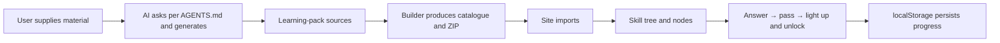
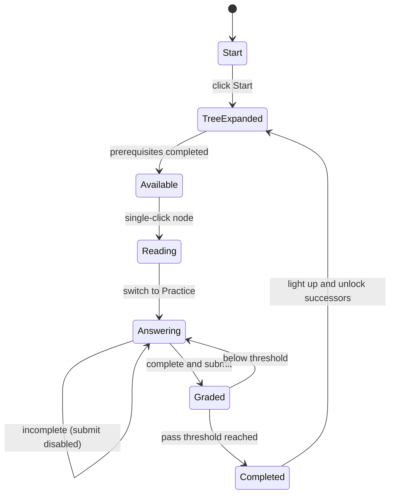
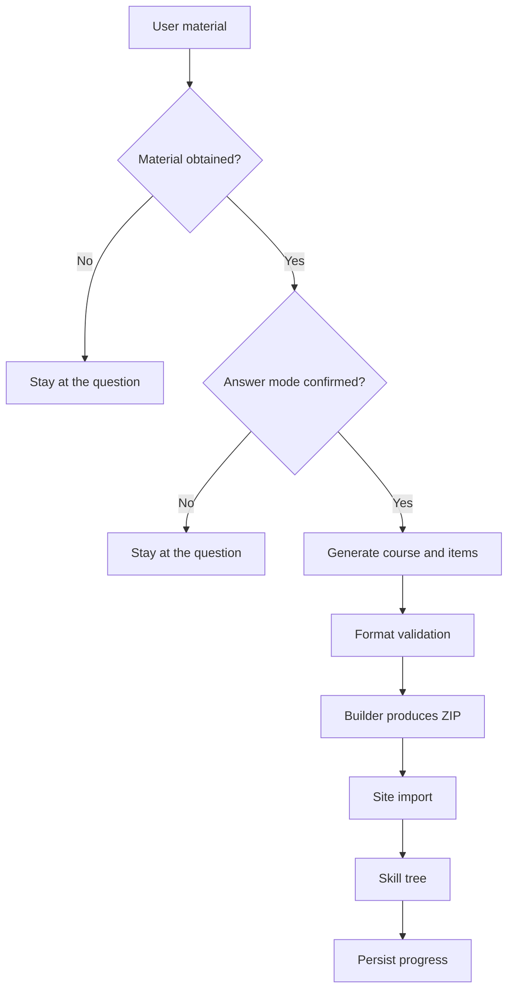

<a id="top"></a>

# Architecture · 技術架構

> **One line**: upload one piece of material, grow one skill tree — progress you can see, achievement you can feel.
> **How to use**: [User guide, How to Use](../README.en.md#how-to-use) · [Mandatory AI prompts](../AGENTS.md) · [Pack format](../PACK_FORMAT.en.md) · [Live demo](https://bronya-0914.github.io/Skill-Tree/)
> **Live demo**: <https://bronya-0914.github.io/Skill-Tree/> · **Repository**: <https://github.com/Bronya-0914/Skill-Tree>
> **繁體中文**: [ARCHITECTURE.md](ARCHITECTURE.md)

---

## 1. System outline



**Division of labour**: material and preferences are decided by the user, generation happens in the AI, and the site only validates, renders, grades and persists. The site assumes no built-in course; all content arrives through import.

---

## 2. Layers

| Layer | Responsibility | Check when changing |
|---|---|---|
| Presentation | `index.html`, CSS, SVG edges, node cards, lesson panel, drawer | DOM IDs, themes, mobile layout |
| Interaction | Click to open/close, drag and resize, theme/language, Fit and zoom | Event conflicts, keyboard and touch |
| State | Start, available, completed, unlock rules, answer threshold | Whether progress still reads back |
| Data | Pack parsing and validation, ZIP reading, version comparison | `schemaVersion`, migration path |
| Persistence | `localStorage` keys, backup export/import | Overwrite semantics, backward compatibility |

Visual changes must not alter unlock rules; format changes require a version and a migration note.

---

## 3. Module responsibilities

| Module | Responsibility |
|---|---|
| Main state machine | Start, node selection, unlock, answer threshold, submit and grading, reset |
| Tree geometry | Node coordinates, bounds, centring and zoom, edge routing |
| Learning packs | ZIP reading, format validation, version replacement, topological ordering, rejection |
| Workspace | Draggable/resizable answer panel, double-click reset, handwritten scratchpad |
| Backup | Progress JSON export/import, structural validation, overwrite confirmation |
| Personalisation | Dark/light theme, custom glow colour, language switching |
| Lighting effects | Glow animation for completed nodes and edges |
| Translation catalogue | Mapping for interface strings and new course strings |
| Builder | Rebuilds catalogue and ZIPs from source material |

---

## 4. State machine



"Completed" is the only transition that triggers lighting — the visible source of achievement.

---

## 5. Answer flow

| Stage | Rule |
|---|---|
| Answering | Submit stays disabled (grey) until every item is answered |
| Ready | Turns active with a glow once complete |
| Grading | Per-item red/green feedback with explanations |
| Item types | Multiple choice / numeric input / multipart; all sub-questions must be correct |
| Unlock | Lighting and successor unlock only when correct answers reach `passCount` |
| Preference | Recorded at stage 2 of [`AGENTS.md`](../AGENTS.md), applied to wording and explanation structure |

The site currently supports three item types: **multiple choice** (2–6 options), **numeric input** (integers, decimals, fractions, or expressions such as `sqrt(2)` and `pi`, with optional tolerance), and **multipart questions** (2–8 sub-questions; all must be correct for the item to count). A handwritten scratchpad is also available.

Choose the item type that matches the user's preference. Only for modes outside these three (for example spoken answers or grading uploaded handwriting) should the AI disclose the gap first, then apply the preference to wording and explanations. Never claim an unimplemented feature or invent fields that do not exist.

---

## 6. Data flow



The first two decisions are the blocking, mandatory questions defined by [`AGENTS.md`](../AGENTS.md); the architecture does not allow skipping them.

---

## 7. Persistence

| Category | Detail |
|---|---|
| Progress | Completed nodes, lit state, scores |
| Preferences | Theme, glow colour, language, side-panel position and size |
| Working state | Selected node, active tab, unsubmitted answers, scratchpad strokes |

Entries are versioned and validated on read. Missing nodes or out-of-range answer indexes are ignored so stale data cannot break newer material. Backups are plain JSON, **imported by overwrite and not encrypted**. See [`SECURITY.en.md`](SECURITY.en.md) and [`../MULTIUSER-ARCH.md`](../MULTIUSER-ARCH.md).

---

## 8. Validation and versioning

| Mechanism | Meaning |
|---|---|
| `schemaVersion` | Format version; mismatch is rejected |
| `version` | Content version; only a higher value counts as newer |
| Validation | Rejects missing fields, prerequisite cycles, contradictory counts, duplicate IDs, malformed ZIPs |
| Topological ordering | Determines unlock order and drawn edges |
| Node IDs | Stable; changing them breaks existing progress |

---

## 9. Build pipeline

```bash
node scripts/build-learning-packs.cjs   # rebuild catalogue and ZIP from sources
node --test tests/*.test.cjs             # tests
node --check app.js                      # syntax check
```

`catalog.js` and the ZIPs are **generated artefacts**: never hand-edit them. The order is fixed: edit sources → rebuild → test → verify on site.

---

## 10. Deliberately absent

Backend, accounts, database, cloud SDK, server-side grading, tracking, external APIs, automatic translation, automatic conversion of arbitrary PDFs into courses. The last two matter most: content is generated by an AI from material, and bilingual output needs a separately maintained catalogue.

---

## 11. Risk register

| Risk | Mitigation |
|---|---|
| Generated content has no source | Blocking prompts in [`AGENTS.md`](../AGENTS.md), `sourceNote` field |
| Mode outside the three item types | Disclose the gap first, then apply to wording and explanations |
| Old progress no longer matches nodes | Keep node IDs stable; warn before changing them |
| Answers on the client | Not for secure examinations, see [`SECURITY.en.md`](SECURITY.en.md) |
| Generated files hand-edited | Documented as off-limits; edit sources and rebuild |
| Static root too broad | Exclude reference and handoff material before publishing |

---

## 12. Decision record

| Decision | Reason | Rejected alternative |
|---|---|---|
| Ship no built-in course | Swapping material swaps the subject; avoids locking the site to one discipline | Bundle a fixed course |
| Two mandatory questions before generation | Traceable source, items matched to the user's preference | Generate directly from a subject name |
| Pure static | No backend, no accounts, usable by opening a page | Add accounts and cloud sync |
| Lighting as the completion signal | Visible progress, tangible feedback | A plain score list |
| Generated artefacts produced by a builder | Avoids silent overwrites, keeps consistency | Edit the catalogue by hand |

---

**Related**: [AGENTS.md](../AGENTS.md) ｜ [User guide](../README.en.md) ｜ [Format](../PACK_FORMAT.en.md) ｜ [Design principles](../DESIGN-v2.md) ｜ [Security](SECURITY.en.md) ｜ [Docs index](README.md)

[↑ Back to top](#top)
