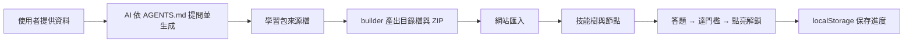
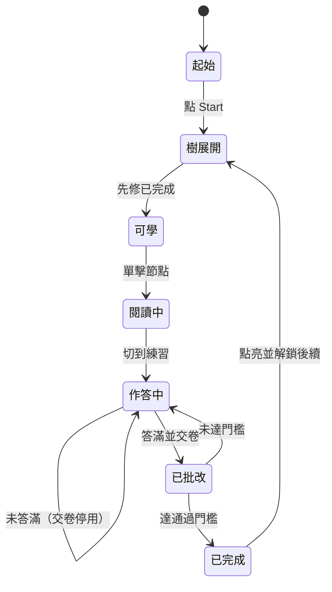
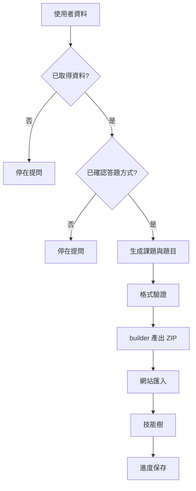

<a id="top"></a>

# 技術架構 · Architecture

> **一句話**：上傳一份資料，長出一棵技能樹 —— 讓進度看得見，讓每次完成都有成就感。
> **如何使用**：[主 README 如何使用](../README.md#how-to-use) · [AI 必問流程](../AGENTS.md) · [學習包格式](../PACK_FORMAT.md) · [線上展示](https://bronya-0914.github.io/Skill-Tree/)
> **線上展示**：<https://bronya-0914.github.io/Skill-Tree/> · **儲存庫**：<https://github.com/Bronya-0914/Skill-Tree>
> **English**: [ARCHITECTURE.en.md](ARCHITECTURE.en.md)

---

## 1. 系統輪廓



**分工**：資料與偏好在使用者端決定；生成在 AI 端；網站只負責驗證、呈現、批改與保存。網站不假設任何既定課題，全部內容來自匯入。

---

## 2. 分層

| 層 | 職責 | 變動時要檢查 |
|---|---|---|
| 呈現層 | `index.html`、CSS、SVG 連線、節點卡、學習區、抽屜 | DOM ID、深淺主題、手機版面 |
| 互動層 | 點擊開合、拖曳縮放、主題／語言切換、Fit 與縮放 | 事件衝突、鍵盤與觸控 |
| 狀態層 | 起始、可學、已完成、解鎖規則、答題門檻 | 進度是否仍能讀回 |
| 資料層 | 學習包讀取與驗證、ZIP 解析、版本比較 | `schemaVersion`、遷移路徑 |
| 保存層 | `localStorage` 鍵、備份匯出入 | 覆蓋語意、舊資料相容 |

視覺改動不應改動解鎖規則；資料格式改動必須有版本號與遷移說明。

---

## 3. 模組職責

| 模組 | 職責 |
|---|---|
| 主狀態機 | 起始、節點選擇、解鎖、答題門檻、交卷與批改、進度重設 |
| 樹幾何 | 節點座標、bounds、置中與縮放、連線走線 |
| 學習包 | ZIP 讀取、格式驗證、版本合併、拓撲排序、錯誤拒絕 |
| 工作區 | 答題框拖曳與縮放、雙擊還原、手寫草稿紙 |
| 備份 | 匯出／匯入進度 JSON、結構驗證、覆蓋前確認 |
| 個人化 | 深淺主題、自訂光效色、語言切換 |
| 點亮特效 | 完成節點與連線的發光動畫 |
| 翻譯目錄 | 介面字串與新教材字串的對應 |
| builder | 由來源教材重建目錄檔與 ZIP |

---

## 4. 狀態機



「已完成」是唯一會觸發點亮的轉移，也是成就感的可視來源。

---

## 5. 答題流程

| 階段 | 規則 |
|---|---|
| 作答 | 未答滿時交卷鈕停用（灰） |
| 可交 | 答滿後轉為可點並帶光效 |
| 批改 | 逐題紅／綠回饋與解析 |
| 題型 | 選擇題／數值輸入題／分步長題，長題需全部小問正確 |
| 解鎖 | 答對數達 `passCount` 才點亮並開後續節點 |
| 偏好 | 由 [`AGENTS.md`](../AGENTS.md) 階段 2 記錄，落在題目措辭與解析結構 |

網站目前支援三種題型：**選擇題**（2–6 個選項）、**數值輸入題**（可輸入整數、小數、分數或 `sqrt(2)`、`pi` 等數值式，可設容差）、**分步長題**（一題含 2–8 個小問，全部小問正確才算通過該題），並提供手寫草稿紙。

AI 應依使用者偏好選用對應題型；若想要的是這三種之外的方式（例如口述回答、上傳手寫照片批改），先說明落差，再把偏好落實在題目措辭與解析寫法。不得宣稱網站已具備該功能，也不得虛構不存在的欄位。

---

## 6. 資料流



前兩道判斷是 [`AGENTS.md`](../AGENTS.md) 訂下的阻塞式必問，架構上不允許跳過。

---

## 7. 儲存

| 類別 | 說明 |
|---|---|
| 進度 | 已完成節點、點亮狀態、分數 |
| 偏好 | 主題、光效色、語言、側板位置與尺寸 |
| 工作階段 | 選課、分頁、未送出作答、草稿筆跡 |

各項以帶版本號的結構存放，讀回時校驗；節點消失或答案索引越界時忽略該筆，避免舊資料破壞新教材。備份為純 JSON、**覆蓋式匯入、不加密**。詳見 [`SECURITY.md`](SECURITY.md) 與 [`../MULTIUSER-ARCH.md`](../MULTIUSER-ARCH.md)。

---

## 8. 驗證與版本

| 機制 | 說明 |
|---|---|
| `schemaVersion` | 格式版本，不相容時拒絕 |
| `version` | 內容版本，遞增才會被認定為較新 |
| 驗證 | 缺欄位、先修循環、題數與門檻矛盾、ID 重複、ZIP 異常皆拒絕 |
| 拓撲排序 | 決定解鎖順序與連線 |
| 節點 ID | 穩定不變，否則既有進度對不上 |

---

## 9. 建置流程

```bash
node scripts/build-learning-packs.cjs   # 由來源重建目錄檔與 ZIP
node --test tests/*.test.cjs             # 測試
node --check app.js                      # 語法檢查
```

`catalog.js` 與 ZIP 是**生成檔**，不可手改。改來源 → 重建 → 測試 → 網站實測，順序固定。

---

## 10. 明確不包含

後端、帳號、資料庫、雲端 SDK、伺服端批改、追蹤、外部 API、自動翻譯、自動把任意 PDF 轉成課題。最後兩項尤其重要：教材內容由 AI 依資料生成，雙語需另外維護翻譯目錄。

---

## 11. 風險登錄

| 風險 | 因應 |
|---|---|
| 生成內容無來源 | [`AGENTS.md`](../AGENTS.md) 阻塞式提問、`sourceNote` 標明 |
| 用了三種題型之外的方式 | 先說明落差，再以題目措辭與解析落地 |
| 舊進度對不上新節點 | 節點 ID 保持穩定；改 ID 前先提醒 |
| 答案在前端 | 不用於保密考試，見 [`SECURITY.md`](SECURITY.md) |
| 生成檔被手改 | 文件明列不可手改，改來源後重建 |
| 靜態根目錄過寬 | 發布前排除參考資料與交接文件 |

---

## 12. 決策紀錄

| 決策 | 理由 | 被否決的選項 |
|---|---|---|
| 不內建教材 | 換資料就能換課題，避免把網站綁死在單一學科 | 隨站附一套固定課程 |
| 生成前必問兩題 | 來源可追溯、題目符合使用者偏好 | 直接依主題名稱生成 |
| 純靜態 | 零後端、零帳號、任何人開網頁即可用 | 加帳號與雲端同步 |
| 點亮作為完成訊號 | 讓進度可視、完成有回饋 | 只給分數列表 |
| 生成檔由 builder 產出 | 避免手改被覆蓋、保證一致 | 直接編輯目錄檔 |

---

**相關文件**：[AGENTS.md](../AGENTS.md) ｜ [使用指南](../README.md) ｜ [格式](../PACK_FORMAT.md) ｜ [設計原則](../DESIGN-v2.md) ｜ [安全](SECURITY.md) ｜ [文件總覽](README.md)

[↑ 回到頂部 · Back to top](#top)
