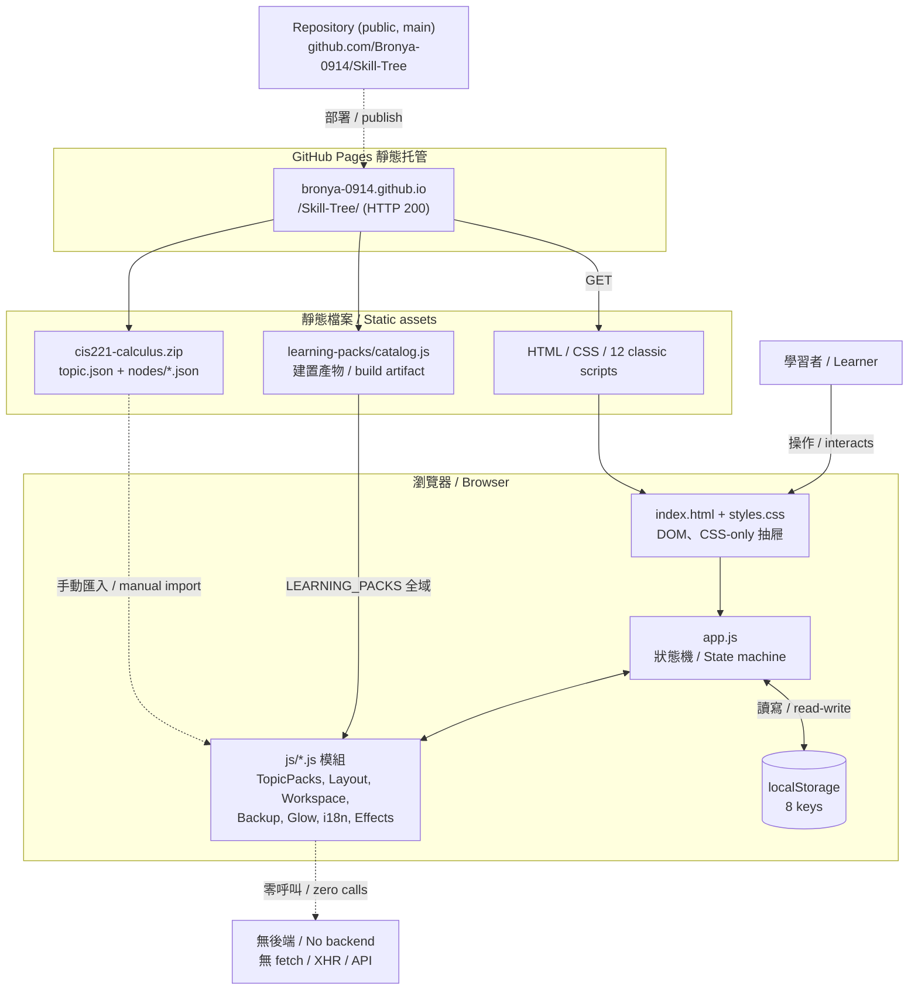
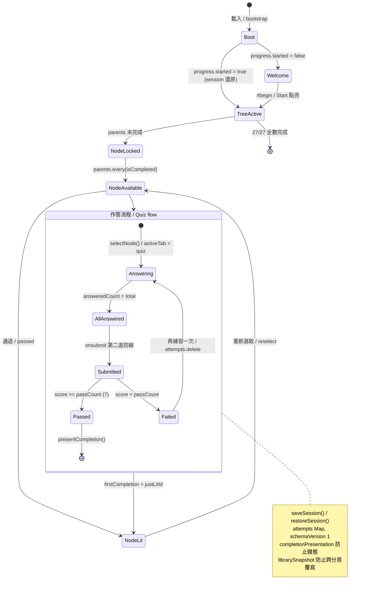
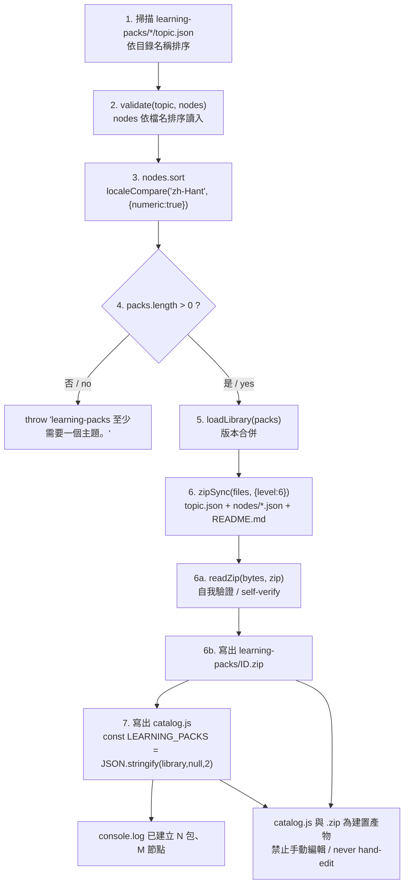

<a id="top"></a>

# 微積分漫遊 · Calculus Skill Tree — 技術架構文件

**Technical Architecture Document · 繁體中文版**

**語言切換 / Language:** [繁體中文](./ARCHITECTURE.md) · [English](./ARCHITECTURE.en.md)

**線上展示 / Live demo:** <https://bronya-0914.github.io/Skill-Tree/>

**原始碼庫 / Repository:** <https://github.com/Bronya-0914/Skill-Tree>

---

<a id="s01"></a>

## 1. 文件資訊、狀態與目錄 (Document Information, Status & Table of Contents)

### 1.1 文件狀態 (Document Status)

> **STATUS: `Current against local HEAD 8d7b4cb`**

本文件以本機工作樹的 `HEAD` 提交 `8d7b4cb Checkpoint current site: i18n, tree layout, unlock effects, workspace and docs` 為唯一事實來源撰寫，並輔以唯讀勘查報告與專案內原始檔逐項查證。所有數值（行數、位元組、數量、常數、幾何邊界）皆為該提交之實測值，非設計稿轉述。

四項必須牢記的狀態差異：

| 項目 (Item) | 本機 (Local HEAD `8d7b4cb`) | 線上 GitHub Pages (Deployed) |
|---|---|---|
| 教材版本 (Curriculum `version`) | **version 5** | **version 1**（較舊 / older） |
| 節點開合互動 (Open/close gesture) | **單擊開合 / single-click** | **雙擊開合 / double-click** |
| `app.js` 行數 | 435 行 | 459 行 |
| `catalog.js` 首節點內容 | 11 個 `content` 區塊、書本改寫版 | 6 個 `content` 區塊、`intro` 為「掌握函數代入、輸入限制和可能輸出…」 |
| `app.js`／`styles.css`／`catalog.js` SHA-256 | 本機值 | 與本機**皆不同** |
| Git remote / push | **無 remote、無 push／fetch 紀錄** | 託管於公開儲存庫（`main`） |

補充狀態說明：

- 線上站臺 `https://bronya-0914.github.io/Skill-Tree/` 可正常回應 **HTTP 200**，標題為「微積分漫遊 · Calculus Skill Tree」，代表**已部署且對外可存取**；但內容落後於本機 HEAD。多份既有 MD 文件寫「未發布、未部署、未對外分享」，該記載**已過時**，應以本節為準。
- 本機 Git：`git remote -v` 為空、`git config --list` 無任何 `remote.*`、`git branch --show-current` = `main`、`git status --short` 於文件基準快照時乾淨（文件整併後有未提交變更）、無 `packed-refs`、無 `FETCH_HEAD`，reflog 僅見本機 commit（作者 `Sites <sites@users.noreply.openai.com>`），**沒有任何 push／fetch 紀錄**。
- `git ls-files | wc -l` = **105**，等於不含 `.git/` 的全部檔案數，代表 `references/` 的 48 個 TXT **全數已被 Git 追蹤**（見 §4、§17、§18）。
- 本文件之「線上網址」與「repo 網址」由需求提供；專案內（含 `.git/`）查無任何字串記載該 Pages URL。相關查證方式見 §17。

### 1.2 文件中繼資料 (Document Metadata)

| 欄位 (Field) | 值 (Value) |
|---|---|
| 專案名稱 (Project) | 微積分漫遊 · Calculus Skill Tree |
| 文件組 (Document set) | `docs/ARCHITECTURE.md`（繁體中文）／`docs/ARCHITECTURE.en.md`（English） |
| 狀態標記 (Status) | `Current against local HEAD 8d7b4cb` |
| 本機根目錄 (Local root) | `<repo-root>` |
| 站台類型 (Site type) | 純靜態、零框架、無後端 (pure static, framework-free, backendless) |
| 分支 (Branch) | `main`（公開 / public） |
| 授權 (License) | **無 LICENSE 檔**（僅第三方 `fflate-LICENSE.txt`，MIT） |
| 部署設定 (Deploy config) | `js/hosting.json` → `static.directory = "."` |
| 檔案總數 (Files) | 105（不含 `.git/`） |
| 測試 (Tests) | **20/20**（`node --test tests/*.test.cjs`） |
| 語法檢查 (Syntax) | `node --check` 15 檔全數通過 |
| 適用讀者 (Audience) | 維護者、接手 AI、審查者、部署人員 |

### 1.3 語言與書寫約定 (Language & Writing Conventions)

- 本文件使用**書面繁體中文**；技術術語採**中英對照**，首次出現時附英文（例：「狀態機 (State Machine)」）。
- 英文版 `ARCHITECTURE.en.md` 章節編號、表格、數值、圖表與本文件**逐一對應**，兩者互為對照（bilingual pair）。
- 全文不使用表情符號；程式碼、常數、路徑、識別字保留原文。
- 所有路徑相對於專案根目錄；`docs/` 內的相對連結以 `../` 指向根目錄檔案。
- **中英章節對照表 (Bilingual section index)**：

| # | 繁體中文 | English |
|---|---|---|
| 1 | 文件資訊、狀態與目錄 | Document Information, Status & Table of Contents |
| 2 | 系統脈絡 | System Context |
| 3 | 技術堆疊與設計原則 | Technology Stack & Design Principles |
| 4 | 完整目錄樹與職責 | Complete Directory Tree & Responsibilities |
| 5 | 啟動與載入順序 | Bootstrap & Load Order |
| 6 | 模組責任表 | Module Responsibility Matrix |
| 7 | 狀態機 | State Machine |
| 8 | 技能樹幾何 | Skill-Tree Geometry |
| 9 | 置中與縮放 | Centering & Zooming |
| 10 | 教材資料模型 | Learning-Pack Data Model |
| 11 | 建置管線 | Build Pipeline |
| 12 | 驗證規則總表 | Validation Rules |
| 13 | `localStorage` 完整表 | `localStorage` Keys |
| 14 | i18n 引擎 | i18n Engine |
| 15 | 視覺系統 | Visual System |
| 16 | 測試與品質 | Tests & Quality |
| 17 | 部署與版本一致性 | Deployment & Version Consistency |
| 18 | 已知限制與風險登錄 | Known Limitations & Risk Register |
| 19 | 決策紀錄 | Decision Records |
| 20 | 附錄 | Appendix |

### 1.4 目錄 (Table of Contents)

<details>
<summary><strong>展開目錄 / Expand Table of Contents</strong></summary>

1. [文件資訊、狀態與目錄](#s01)
2. [系統脈絡](#s02)
3. [技術堆疊與設計原則](#s03)
4. [完整目錄樹與職責](#s04)
5. [啟動與載入順序](#s05)
6. [模組責任表](#s06)
7. [狀態機](#s07)
8. [技能樹幾何](#s08)
9. [置中與縮放](#s09)
10. [教材資料模型](#s10)
11. [建置管線](#s11)
12. [驗證規則總表](#s12)
13. [`localStorage` 完整表](#s13)
14. [i18n 引擎](#s14)
15. [視覺系統](#s15)
16. [測試與品質](#s16)
17. [部署與版本一致性](#s17)
18. [已知限制與風險登錄](#s18)
19. [決策紀錄](#s19)
20. [附錄](#s20)

</details>

### 1.5 與其他文件的關係 (Relationship to Other Documents)

本文件定位為**現況技術總覽 (current-state technical reference)**，與既有 8 份 MD 的關係：`README.md`（入門）、`PACK_FORMAT.md`（格式 v1）、`DESIGN-v2.md`（驗收歷史，**部分數值已過時**）、`MULTIUSER-ARCH.md`（多使用者評估，未實作）、`BOOK-REFERENCE.md`（書目與改寫進度）、`I18N.md`（語言維護）、`AI_TEACHING_GUIDE.md`（教材製作指南）、`learning-packs/cis221-calculus/README.md`（27 課清單）。凡既有文件與本文件衝突者，**以本文件（對齊 HEAD `8d7b4cb`）為準**；衝突逐項列於 §8.6、§16.4、§17.6、§18。

[↑ 回到頂端 / Back to top](#top)

---

<a id="s02"></a>

## 2. 系統脈絡 (System Context)

### 2.1 C4 層級文字說明 (C4-style Narrative)

以 C4 Model 的 System Context 層次描述，本系統邊界極小：

- **人員 (Person) — 學習者 (Learner)**：透過瀏覽器操作技能樹、閱讀教材、作答、調整主題與光效、匯出／匯入備份。學習者是唯一的使用者角色；系統中**沒有管理員、沒有帳號、沒有伺服端身分**。
- **軟體系統 (Software System) — 微積分漫遊**：一個純靜態網站。所有商業邏輯（解鎖判定、批改、進度、幾何、翻譯、備份）都在瀏覽器內執行，以 `app.js` 的狀態機為核心，搭配 `js/*.js` 模組。
- **外部系統 (External Systems)**：
  - **GitHub Pages**：靜態檔案託管，對外提供 `https://bronya-0914.github.io/Skill-Tree/`（HTTP 200）。
  - **GitHub Repository**：`https://github.com/Bronya-0914/Skill-Tree`（`main`，public），存放原始碼。
  - **`localStorage`**：瀏覽器同源持久化層，8 個鍵（§13），是唯一的狀態保存處。
- **資料資產 (Data assets)**：`learning-packs/catalog.js`（建置產物，內含完整教材與 270 個 `answer`）、`learning-packs/cis221-calculus.zip`（可匯入教材包）、`topic.json` + `nodes/*.json`（唯一教材來源）。
- **明確不存在的元件 (Explicitly absent)**：**無後端 (no backend)**。全專案搜尋 `fetch(`、`XMLHttpRequest`、`/api/`、`firebase`、`supabase`、`cloudservice` **零命中**；沒有伺服端批改、沒有資料庫、沒有帳號同步、沒有 API 呼叫。

### 2.2 系統脈絡圖 (System Context Diagram)



> 圖例說明：實線為載入或資料流，虛線為選擇性／概念性關係。`localStorage` 以圓柱表示持久化；`catalog.js` 與 ZIP 皆為靜態檔，瀏覽器不透過網路動態索取 JSON。

### 2.3 關鍵脈絡事實 (Key Context Facts)

| 事實 (Fact) | 證據 (Evidence) |
|---|---|
| 13 個靜態資源之路徑，線上與本機逐項相同 | 線上 `index.html` 比對 |
| 教材由 `catalog.js` 以全域常數注入，非 `fetch` JSON | `index.html:35`、`catalog.js` 首行 |
| 所有狀態僅存於 `localStorage` | §13；`app.js:3,6,47` |
| 換網域／瀏覽器／裝置即資料不相通 | 同源政策 (same-origin policy) |
| `references/` OCR 全文未公開（線上 404） | §17 之 HTTP 查證 |
| 本機無 remote，部署並非由本機 push 產生 | §1.1、§17 |

[↑ 回到頂端 / Back to top](#top)

---

<a id="s03"></a>

## 3. 技術堆疊與設計原則 (Technology Stack & Design Principles)

### 3.1 技術堆疊總表 (Stack)

| 層 (Layer) | 技術 (Technology) | 說明 (Notes) |
|---|---|---|
| 標記 (Markup) | HTML5，單一 `index.html`（155 行／14,524 B） | `lang="zh-Hant"`、inline favicon、inline theme script、CSS-only checkbox 抽屜 |
| 樣式 (Styling) | 原生 CSS，`styles.css`（690 行／44,404 B） | CSS 變數、玻璃質感、三層網格背景、Mermaid 無關之純 CSS 動畫 |
| 邏輯 (Logic) | 原生 JavaScript（ES2018+，IIFE／全域常數），12 個 classic `<script>` | 無框架、無 bundler、無 `type="module"` |
| 資料 (Data) | JSON（`topic.json`、`nodes/*.json`）+ `catalog.js` 建置產物 | 270 題、270 個 `answer` |
| 壓縮 (ZIP) | `js/vendor/fflate.js`（UMD minified，33,044 B，單行） | 瀏覽器 `window.fflate`；Node `require()` |
| 建置 (Build) | Node.js CommonJS `scripts/build-learning-packs.cjs`（37 行／2,053 B） | 唯一建置指令；**本次文件作業未執行** |
| 測試 (Tests) | Node 內建 `node:test`（`node --test`） | 3 檔、20 測試 |
| 持久化 (Persistence) | `localStorage`（8 鍵） | 無 IndexedDB、無 Cookie、無伺服端 |
| 託管 (Hosting) | GitHub Pages（靜態） | `js/hosting.json` 之 `static.directory="."` |
| 版本控制 (VCS) | Git（`main`，無 remote） | 105 追蹤檔 |

### 3.2 為何零框架 (Why Framework-Free)

1. **部署目標是靜態檔**：GitHub Pages 只提供靜態檔案；不需要編譯產物、不需要 Node 執行期、不需要 hydration。
2. **互動規模小**：核心是「一棵 28 節點的圖 + 一個答題表單 + 一個縮放視埠」。以 `document.querySelector`、`innerHTML` 模板與事件委派即可表達，引入 React／Vue 的虛擬 DOM 反而增加載入成本。
3. **12 支腳本以 `defer` 依序執行**：HTML 已保證順序，模組間以明確的全域命名空間（`TopicPacks`、`SkillTreeLayout`、`LessonWorkspace`、`SkillTreeBackup`、`SkillTreeI18n`、`SkillTreeEffects`、`SkillTreeEnglish`、`LEARNING_PACKS`、`fflate`）溝通，無需模組系統。
4. **可審查性**：`app.js` 435 行、`js/*.js` 皆為可直接閱讀的純函式／IIFE，`node --check` 可逐檔驗證；`js/topic-packs.js` 與 `js/tree-layout.js` 同時 `module.exports`，讓 Node 測試能直接 `require()` 而不需要 jsdom。
5. **無依賴供應鏈**：除 `fflate` 外無第三方套件；無 `package.json`、無 lockfile、無 npm install 步驟。

### 3.3 為何 `file://` 可用 (Why It Works Over `file://`)

此結論可由已驗證的程式事實推出，而非推測：

- **沒有 ES Module**：`index.html` 的 12 支 `<script src=...>` 皆為 classic script 且帶 `defer`，**沒有** `type="module"`。ES Module 在 `file://` 下會被 CORS 阻擋，classic script 不會。
- **沒有動態抓取本端資源**：全專案 `fetch(`／`XMLHttpRequest` 零命中。教材不是以「`fetch('topic.json')`」讀入，而是由 `learning-packs/catalog.js` 直接指派全域常數 `const LEARNING_PACKS = [...]`（`index.html:35`），因此 avoids `file://` 下最典型的 `fetch` 失敗。
- **所有路徑皆相對**：`styles.css`、`js/...`、`learning-packs/catalog.js`、`PACK_FORMAT.md`、ZIP 下載皆為相對路徑，不依賴伺服端路由或 rewrite。
- **無伺服端需求**：無 API、無 SSR、無 `CNAME`／`404.html` 路由規則；`dialog.showModal()`、`ResizeObserver`、`MutationObserver`、`matchMedia` 皆為瀏覽器原生 API。

需要保留的但書：即便上述設計讓 `index.html` 可直接雙擊開啟，`localStorage` 在 `file://` origin 的行為仍由瀏覽器實作決定（部分瀏覽器將每個檔案視為獨立 origin 或限制寫入）。因此**正式使用情境仍是透過 HTTP(S) 託管**；`saveProgress()` 以 `try/catch` 將失敗降級為 `storageAvailable = false` 並提示「瀏覽器儲存不可用，本次進度僅暫存」，正是為此類環境準備的優雅降級。

### 3.4 為何 `catalog.js` 是建置產物 (Why `catalog.js` Is a Build Artifact)

- **單一來源 (Single source of truth)**：真正需要人工編輯的只有 `learning-packs/<id>/topic.json` 與 `learning-packs/<id>/nodes/*.json`。`scripts/build-learning-packs.cjs` 由這些 JSON 同時產生「網站載入檔 `catalog.js`」與「可上傳 ZIP」，避免維護兩套教材（腳本第 3–4 行註解即明言此意）。
- **格式差異的必要轉換**：瀏覽器需要一個可直接 `<script>` 載入的 JS 全域常數；匯入功能需要一個符合 `PACK_FORMAT.md` 的 ZIP（`topic.json` + `nodes/*.json` + `README.md`）。兩者內容必須一致，故由同一支腳本一次產生。
- **一致性由測試保證**：`tests/topic-packs.test.cjs` 逐檔比對 `catalog.js`、ZIP 與 27 個來源 JSON 完全一致（含 270 個 `answer` 欄位）。
- **禁止手改**：`catalog.js` 首行即為 `// 此檔由 scripts/build-learning-packs.cjs 產生，請編輯各主題的 JSON。`；`cis221-calculus.zip` 同樣為產物。任何手動編輯都會在下一次建置被覆寫，並破壞測試。

### 3.5 漸進增強與 `prefers-reduced-motion` (Progressive Enhancement & Reduced Motion)

| 原則 | 實作 |
|---|---|
| 基礎內容在 HTML | 標題、進度、功能介紹、光效色盤、對話框骨架皆寫死於 `index.html`，無 JS 亦可見。 |
| CSS-only 開合 | 兩個 `<input type="checkbox" class="overlay-toggle">`（`#nav-toggle`、`#lesson-toggle`）搭配 `#nav-toggle:checked ~ .drawer`、`#lesson-toggle:checked ~ .lesson-card`，不綁任何 JS。 |
| JS 僅為增強 | `app.js` 才注入 `#begin`、分頁、`#quiz-form` 等動態 ID；`workspace.js` 才注入草稿紙 canvas。 |
| 優雅降級 | `localStorage` 讀寫全面 `try/catch`；`isDesktop()` 以 `matchMedia('(min-width:761px)')` 切換；`.overlay-toggle` 有 `tabindex="-1" aria-hidden="true"`。 |
| 觸控效能 | `@media (hover:none) and (pointer:coarse)`（`styles.css:643–645`）關閉所有 `backdrop-filter`，避免掉幀。 |
| 無障礙 | `skip link`、`aria-label`、`aria-pressed`、`role="status"`、`aria-live="polite"`、`inert`（`syncCollapseDirection()`）、鍵盤色盤步進 `.01`／Shift `.1`。 |
| 減少動態 | `@media (prefers-reduced-motion:reduce)`（`styles.css:688–690`）關閉全部動畫／轉場；`js/unlock-effects.js` 的 `play()` 在 `prefers-reduced-motion` 時直接移除 `just-lit` 並返回，不產生任何粒子。 |

### 3.6 其他設計原則 (Other Principles)

- **呈現層與解鎖層分離**：`js/tree-layout.js` 註解明言 `The original parents remain the authority for unlocking.`；`primary`／`additional`／`children` 只決定「怎麼畫線」，`isAvailable()` 仍以原始 `parents` 判定「能不能學」。
- **防線重疊**：交卷按鈕 `disabled` 是第一道防線，`#quiz-form.onsubmit` 的 `answeredCount` 檢查是第二道防線（§7）。
- **競態防護**：`completionPresentation` 計數器保護 `presentCompletion()`；`importSequence` 保護非同步匯入；`librarySnapshot` 防止跨分頁覆寫。
- **版本化持久化**：5 個鍵帶 `schemaVersion:1`，便於日後遷移（§13）。

[↑ 回到頂端 / Back to top](#top)

---

<a id="s04"></a>

## 4. 完整目錄樹與職責 (Complete Directory Tree & Responsibilities)

### 4.1 檔案統計 (File Census)

專案共 **105 個檔案**（不含 `.git/`），分布如下；根目錄除 `.git/` 外**無任何隱藏檔（沒有 `.gitignore`）**：

| 類型 | 數量 | 說明 |
|---|---|---|
| `.md` | **8** | 7 份根目錄文件 + `learning-packs/cis221-calculus/README.md` |
| `.js` | **12** | `app.js` + `js/` 9 支 + `js/vendor/fflate.js` + `learning-packs/catalog.js` |
| `.json` | **30** | `js/hosting.json` + `topic.json` + 27 個 node JSON + `references/.../chapters.json` |
| `.txt` | **48** | `fflate-LICENSE.txt` + `book-full.txt` + 46 個章節 txt |
| `.cjs` | **4** | 1 支建置腳本 + 3 個測試檔 |
| `.zip` | **1** | `learning-packs/cis221-calculus.zip` |
| `.html` | **1** | `index.html` |
| `.css` | **1** | `styles.css` |
| **合計** | **105** | `git ls-files | wc -l` 亦為 105 |

### 4.2 目錄樹 (Directory Tree)

```
<repo-root>/
├── .git\                                    本機 Git 儲存庫（branch main、無 remote、無 push）
├── index.html                               網站唯一入口（14,524 B / 155 行）
├── app.js                                   狀態機、DOM 模板、縮放平移（26,875 B / 435 行）
├── styles.css                               視覺層（44,404 B / 690 行）
├── js\
│   ├── hosting.json                         唯一部署設定（103 B）
│   ├── topic-packs.js                       教材資料層／驗證／ZIP 讀寫（15,338 B / 256 行）
│   ├── pack-ui.js                           學習包匯入預覽 UI（6,976 B / 123 行）
│   ├── workspace.js                         可拖曳縮放答題框 + 手寫草稿紙（14,381 B / 317 行）
│   ├── backup-ui.js                         資料備份匯出／匯入（5,405 B / 114 行）
│   ├── glow-settings.js                     光效換色 + HSV 色盤（8,433 B / 195 行）
│   ├── i18n.js                              語言切換引擎（9,179 B / 152 行）
│   ├── i18n-messages.js                     英文訊息目錄（270,208 B / 1,848 行 / 1,831 key）
│   ├── tree-layout.js                       連線幾何與固定 preview 座標（5,293 B / 104 行）
│   ├── unlock-effects.js                    點亮粒子特效（3,877 B / 91 行）
│   └── vendor\
│       ├── fflate.js                        UMD 壓縮版 ZIP 函式庫（33,044 B，單行 minified）
│       └── fflate-LICENSE.txt               MIT（Copyright (c) 2026 Arjun Barrett）
├── learning-packs\
│   ├── catalog.js                           建置產物（169,996 B / 4,515 行）
│   ├── cis221-calculus.zip                  建置產物，29 個項目（58,184 B）
│   └── cis221-calculus\                     唯一教材來源目錄
│       ├── topic.json                       主題設定（306 B）
│       ├── README.md                        27 課清單（2,579 B）
│       └── nodes\                           27 個節點 JSON（4,682–6,668 B／檔）
│           └── cis221-calculus.functions.json … cis221-calculus.newton-optimization.json
├── references\                              OCR 書籍全文（已被 Git 追蹤、不得公開）
│   └── 3000-solved-problems\
│       ├── book-full.txt                    892 KB 全文
│       ├── chapters.json                    章節索引（source 指向本機 PDF 路徑）
│       └── chapters\                        46 個 ch01…ch46 章節 txt
├── scripts\
│   └── build-learning-packs.cjs             產生 catalog.js 與 ZIP（2,053 B / 37 行）
├── tests\
│   ├── topic-packs.test.cjs                 14 個測試（7,641 B）
│   ├── tree-layout.test.cjs                 3 個測試（4,255 B）
│   └── i18n.test.cjs                        3 個測試（2,282 B）
├── README.md                                使用入門（3,047 B）
├── AI_TEACHING_GUIDE.md                     給 AI 的教材製作指南（7,805 B）
├── BOOK-REFERENCE.md                        書籍來源／改寫進度（17,629 B）
├── DESIGN-v2.md                             設計與驗收歷史（55,023 B / 721 行，部分過時）
├── I18N.md                                  語言維護（1,035 B，全英文）
├── MULTIUSER-ARCH.md                        多使用者架構評估（20,470 B，未實作）
├── PACK_FORMAT.md                           學習包格式 v1（5,536 B）
└── docs\
    ├── ARCHITECTURE.md                      本文件（繁體中文）
    └── ARCHITECTURE.en.md                   對照文件（English）
```

> 註：`docs/` 兩份文件為本次新增；上方 105 檔統計**不含**這兩份新文件（勘查報告之 105 為既有檔案數）。

### 4.3 `references/` 特別標記 (Important: `references/`)

- **內容**：Schaum's／McGraw-Hill《3000 Solved Problems in Calculus》(1988) 之 OCR 全文，`book-full.txt` 892 KB、46 個章節 txt、`chapters.json`。
- **用途**：**本機 OCR 參考**，供 `BOOK-REFERENCE.md` 改寫教材時對照章節。
- **不得公開**：`BOOK-REFERENCE.md` 開頭載明版權；線上書籍全文相關路徑回應 **404**，代表目前線上版本已排除。
- **風險**：`references/` 的 48 個 TXT **已被 Git 追蹤**（`git ls-files` = 105），且 `static.directory="."`、無 `.gitignore`。任何 push 或以整個根目錄打包發布，都可能外洩（見 §18 R01）。

### 4.4 `cis221-calculus.zip` 內容 (ZIP Manifest)

29 個項目、未壓縮總和 **145,337 B**：`topic.json`、`README.md`，以及 `nodes/` 下 27 個 JSON：

`functions, graphs, trigonometry, exp-log, rates, limits, power, product-quotient, elementary, chain, implicit, extrema, optimization, surfaces, partials, higher-implicit, multi-chain, antiderivatives, elementary-integrals, definite, integral-properties, substitution, integral-applications, linearization, taylor, newton-roots, newton-optimization`（前綴皆為 `cis221-calculus.`）。

### 4.5 職責分群 (Responsibility Grouping)

| 群 (Group) | 檔案 | 職責 |
|---|---|---|
| 進入點 | `index.html` | 結構、53 個靜態 ID、13 個資源、inline theme script |
| 編排 | `app.js` | 狀態機、渲染、事件、縮放 |
| 呈現 | `styles.css`、`js/unlock-effects.js` | 視覺與點亮特效 |
| 教材 | `js/topic-packs.js`、`learning-packs/catalog.js`、`learning-packs/cis221-calculus/`、`scripts/build-learning-packs.cjs` | 資料、驗證、建置 |
| 幾何 | `js/tree-layout.js` | preview 座標、連線圖、bounds |
| 工作區 | `js/workspace.js` | 拖曳／resize／草稿紙 |
| 週邊功能 | `js/pack-ui.js`、`js/backup-ui.js`、`js/glow-settings.js` | 匯入、備份、光效 |
| 國際化 | `js/i18n.js`、`js/i18n-messages.js` | 就地翻譯 |
| 第三方 | `js/vendor/fflate.js`、`fflate-LICENSE.txt` | ZIP 壓解 |
| 品質 | `tests/*.test.cjs` | 20 個測試 |
| 文件 | 8 個 MD + `docs/` | 說明（本次新增兩份） |

### 4.6 可重現查證指令 (Verification Commands, Read-Only)

```bash
cd "<repo-root>"
find . -not -path './.git/*' -type f | wc -l        # 105
unzip -l learning-packs/cis221-calculus.zip          # 29 項
git ls-files | wc -l                                 # 105（references/ 亦全被追蹤）
```

[↑ 回到頂端 / Back to top](#top)

---

<a id="s05"></a>

## 5. 啟動與載入順序 (Bootstrap & Load Order)

### 5.1 `index.html` 的 13 個靜態資源 (13 Static Resources)

全部位於 `<head>`，樣式以 `<link>` 載入，其餘 12 支 JS 全部帶 `defer`，**嚴格依文件順序執行**：

| # | 資源 (Resource) | 行 | 類型 | 作用 |
|---|---|---|---|---|
| 1 | `styles.css` | 10 | CSS | 全部視覺、主題變數、動畫 |
| 2 | `learning-packs/catalog.js` | 35 | JS | 定義全域 `const LEARNING_PACKS` |
| 3 | `js/vendor/fflate.js` | 36 | JS | 定義 `window.fflate` |
| 4 | `js/topic-packs.js` | 37 | JS | 定義 `TopicPacks` |
| 5 | `js/workspace.js` | 38 | JS | 定義 `window.LessonWorkspace` |
| 6 | `js/tree-layout.js` | 39 | JS | 定義 `SkillTreeLayout` |
| 7 | `js/unlock-effects.js` | 40 | JS | 定義 `window.SkillTreeEffects` |
| 8 | `app.js` | 41 | JS | 狀態機核心；依賴 2–7 已就緒 |
| 9 | `js/backup-ui.js` | 42 | JS | 依賴 `window.SkillTreeBackupKeys`（由 8 設定） |
| 10 | `js/pack-ui.js` | 43 | JS | 依賴 `TopicPacks` 與 `app.js` 全域 |
| 11 | `js/glow-settings.js` | 44 | JS | 掛 CSS 變數 |
| 12 | `js/i18n-messages.js` | 45 | JS | 定義 `window.SkillTreeEnglish` |
| 13 | `js/i18n.js` | 46 | JS | 依賴 12 的訊息目錄；最後執行翻譯 |

順序的依賴理由：`catalog.js` 必須早於 `app.js`（後者第 7 行即 `TopicPacks.loadLibrary(LEARNING_PACKS)`）；`i18n-messages.js` 必須早於 `i18n.js`；`backup-ui.js` 必須晚於 `app.js`（讀取 `window.SkillTreeBackupKeys`）；`app.js` 初始化最後一行（`app.js:434`）為 `renderTree(); renderLesson(); fitTree();`。

另有兩個 `<a href>`（非 `<script>`／`<link>`）：`learning-packs/cis221-calculus.zip`（`download`）與 `PACK_FORMAT.md`（`target="_blank"`），以及 inline `data:image/svg+xml` favicon（`index.html:9`）。

### 5.2 inline theme script 為何不 `defer` (Why the Inline Theme Script Is Not Deferred)

`index.html:11–34` 的 inline script **刻意不帶 `defer`**，且置於 `<head>` 最前面（樣式之後、12 支 defer 腳本之前）：

```js
(function(){
  var KEY='skill-tree-theme';
  function paint(dark){
    document.documentElement.classList.toggle('dark',dark);
    var meta=document.querySelector('meta[name="theme-color"]');
    if(meta)meta.setAttribute('content',dark?'#0a0a0b':'#f3f3f5');
  }
  var dark=true;
  try{var saved=localStorage.getItem(KEY);dark=saved!=='light';}catch(_){}
  paint(dark);
  document.addEventListener('DOMContentLoaded',function(){ /* 綁 #theme-toggle */ });
})();
```

理由：

1. **避免載入閃白 (FOUC / flash of wrong theme)**：若等到 `defer` 腳本或 `DOMContentLoaded` 才套用 `.dark`，瀏覽器可能先以淺色繪製一幀再切深色。同步執行可在 `<body>` 繪製前就設好 `document.documentElement` 的 class 與 `<meta name="theme-color">`（深色 `#0a0a0b`／淺色 `#f3f3f5`）。
2. **預設深色**：`var dark=true`；僅當 `localStorage['skill-tree-theme'] === 'light'` 才轉淺色。
3. **容錯**：`localStorage` 讀取包在 `try/catch`，不可用時仍以深色運作。
4. **職責切分**：inline script 只做「首幀上色」；按鈕事件綁定延後到 `DOMContentLoaded`，因為 `#theme-toggle` 此刻尚未存在於 DOM。

### 5.3 53 個靜態 DOM ID (53 Static DOM IDs)

`index.html` 含 **53 個唯一靜態 ID**（`grep -oE 'id="[^"]+"' index.html | sort -u | wc -l` = 53）。分類如下（給總數與重點，不逐字全列）：

| 分類 (Category) | 數量 | 代表 ID |
|---|---|---|
| 覆蓋層開關 (Overlay toggles) | 2 | `nav-toggle`, `lesson-toggle` |
| 畫布 (Stage / map) | 5 | `map`, `world`, `connections`, `nodes`, `map-empty` |
| 縮放工具 (Map tools) | 5 | `zoom-out`, `zoom-label`, `zoom-in`, `fit`, `theme-toggle` |
| 抽屜導覽與進度 (Drawer) | 9 | `reset`, `topic-jump`, `manage-packs`, `pack-count`, `catalog-warning`, `progress`, `progress-text`, `progress-caption`, `storage-note` |
| 資料備份 (Backup) | 3 | `backup-export`, `backup-file`, `backup-status` |
| 光效設定 (Glow) | 12 | `glow-swatches`, `glow-spectrum`, `glow-cursor`, `glow-hue`, `glow-hue-value`, `glow-spectrum-value`, `glow-chip`, `glow-color`, `glow-value`, `glow-preview`, `glow-reset`, `glow-sample` |
| 課程側板 (Lesson) | 2 | `lesson`, `lesson-content` |
| 提示 (Toast) | 1 | `toast` |
| 對話框 (Dialogs) | 14 | `reset-dialog`, `cancel-reset`, `confirm-reset`, `pack-dialog`, `pack-dialog-title`, `close-packs`, `pack-drop`, `pack-file`, `pack-status`, `pack-preview`, `pack-confirm-actions`, `cancel-import`, `confirm-import`, `pack-library` |
| **合計** | **53** | |

重點結構：

- 全螢幕畫布 `<section class="stage map" id="map">` 內含 `#world` > `<svg id="connections" viewBox="0 0 760 950">` + `#nodes`；`app.js` 會把 viewBox 改寫為 `0 0 3069 1998`（§8）。
- 兩組語言切換 `.language-switch[data-language-control]`（右上 `.topright-ctl` 與抽屜內各一），按鈕帶 `data-language="zh-Hant"|"en"`。
- 光效設定含 8 個 `.glow-swatch[data-color]`：`#ffffff, #f2d9a8, #e8b264, #e0655f, #a58bd6, #7aa2e3, #4fc3b8, #8a8a92`。
- 課程側板 `.lesson-card` 含 `.lesson-frame-bar` 拖曳把手與 8 個 `.frame-resize[data-resize="n|e|s|w|ne|nw|se|sw"]`；**「草稿區」不是靜態 DOM**。
- `<dialog id="reset-dialog">` 與 `<dialog id="pack-dialog">` 皆以 `showModal()` 開啟。

### 5.4 JS 動態產生的 ID (Dynamically Generated IDs)

| 來源 | 動態 ID |
|---|---|
| `app.js` | `begin`, `learn-tab`, `quiz-tab`, `lesson-body`, `to-quiz`, `quiz-content`, `quiz-scratch`, `quiz-form`, `quiz-submit`, `quiz-progress`, `next-lesson`, `tree-arrow`（12 個） |
| `js/workspace.js` | `scratch-canvas`, `scratch-size`（2 個） |

`app.js` 於 `activeTab==='quiz'` 時產生 `<aside id="quiz-scratch">`，再由 `workspace.js` 的 `mountScratchpad()` 注入 `.scratch` + `<canvas id="scratch-canvas">`。

### 5.5 啟動序列 (Bootstrap Sequence)

1. 瀏覽器解析 `<head>`：載入 `styles.css`；**同步**執行 inline theme script（上色）。
2. 依序 `defer` 執行 12 支 JS，建立各全域命名空間。
3. `app.js` 頂層（`app.js:7–81`）：`loadLibrary(LEARNING_PACKS)` → 讀 `PACKS_KEY`（要求 `schemaVersion===1 && Array.isArray(packs)`）→ `buildLessons()` → 讀 `STORAGE_KEY` → `attempts = new Map()` → `restoreSession()`。
4. `backup-ui.js`、`pack-ui.js`、`glow-settings.js`、`i18n.js` 各自讀取所屬鍵並註冊 `storage` 事件。
5. `app.js:434`：`renderTree(); renderLesson(); fitTree();`。
6. `new ResizeObserver(focusTree).observe(map)` 監看視埠變化。

[↑ 回到頂端 / Back to top](#top)

---

<a id="s06"></a>

## 6. 模組責任表 (Module Responsibility Matrix)

以下逐一列出 12 個必要模組的**公開 API、常數、副作用**；另附補充表。

### 6.1 `app.js`（狀態機核心，435 行 / 26,875 B）

| 面向 | 內容 |
|---|---|
| 公開 API | 無 `module.exports`；對外暴露 `window.SkillTreeBackupKeys`，以及供 `pack-ui.js` 使用的全域詞法綁定：`library`, `lessons`, `allNodes`, `startNode`, `progress`, `selectedId`, `activeTab`, `attempts`, `viewport`, `map`, `selectNode`, `renderTree`, `renderLesson`, `fitTree`, `applyTransform`, `notify`, `PACKS_KEY`, `librarySnapshot`, `catalogError` |
| 常數 | `STORAGE_KEY='calculus-tree-progress-v1'`；`PACKS_KEY='calculus-tree-packs-v1'`；`SESSION_KEY='calculus-tree-session-v1'`；`BACKUP_KEYS`（8 鍵）；`startNode={id:'start',title:'Start',en:'從這裡開始',icon:'✧',x:590,y:65,parents:[]}`；`$=(s)=>document.querySelector(s)` |
| 狀態 | `progress={started:false,completed:[],scores:{}}`；`allNodes=[startNode,...lessons]`（28）；`attempts=new Map()`；`viewport={x:0,y:0,scale:1}`；`justLitId`, `completionPresentation`, `storageAvailable`, `treeLayout`, `layoutNodes` |
| 副作用 | 寫入 `STORAGE_KEY`／`SESSION_KEY`；重繪 `#nodes`／`#connections`／`#lesson-content`；註冊大量事件、`ResizeObserver`；讀取 `PACKS_KEY`；`notify()` 操作 `#toast` |

### 6.2 `js/topic-packs.js`（純資料層，256 行 / 15,338 B）

| 面向 | 內容 |
|---|---|
| 公開 API | `TopicPacks = {validate, prepare, buildLessons, loadLibrary, ordered, readZip, writeZip, escape}`；`if (typeof module !== 'undefined') module.exports = TopicPacks` |
| 常數 | `MAX_FILE=512*1024`、`MAX_TOTAL=4*1024*1024`、`idPattern=/^[a-z][a-z0-9-]*(?:\.[a-z0-9-]+)*$/`；ZIP `bytes.length∈[22,5*1024*1024]`、項目 `1..128`、EOCD `0x06054b50`、中央目錄 `0x02014b50`、local header `0x04034b50`、CRC32 多項式 `0xedb88320`、只允 method `0`／`8`；`buildLessons` 上限 30 主題／300 節點；幾何 `left=65`、層距 `115`、欄距 `210`、每段 `+60` |
| 副作用 | **無 DOM、無 `localStorage`**；純函式庫。`readZip`／`writeZip` 由呼叫端注入 `fflate` 實例；同時供瀏覽器與 Node 使用 |

### 6.3 `js/pack-ui.js`（學習包匯入 UI，123 行 / 6,976 B）

| 面向 | 內容 |
|---|---|
| 公開 API | 無模組匯出；直接使用全域（見 §6.1）與 `TopicPacks.escape` |
| 常數 | `pendingPack`、`importSequence`（防止非同步競態）、`file.size > 5*1024*1024` 拒絕、寫入 `JSON.stringify({schemaVersion:1,packs:pendingPack.packs})`、匯出檔名 `` `${topic.id}-v${topic.version}.zip` `` |
| 副作用 | 寫入 `PACKS_KEY`；以 `localStorage.getItem(PACKS_KEY) !== librarySnapshot` 防止其他分頁覆寫；重新指派 `library/lessons/allNodes` 並觸發 `renderTree()/renderLesson()/fitTree()`；註冊 `storage` 事件 |

### 6.4 `js/workspace.js`（答題框與草稿紙，317 行 / 14,381 B）

| 面向 | 內容 |
|---|---|
| 公開 API | `window.LessonWorkspace = {mountScratchpad, unmountScratchpad, setQuizMode, setOpen, isOpen, resetFrame}` |
| 常數 | `FRAME_KEY='calculus-tree-lesson-frame-v1'`、`SCRATCH_KEY='calculus-tree-scratch-v1'`、`SCHEMA=1`、`VW=1000`、`VH=700`、`MAX_STROKES=300`、`MAX_POINTS=30000`；`isDesktop()=matchMedia('(min-width:761px)')`；最小寬 `min(340,innerWidth-16)`、最小高 `min(300,innerHeight-16)`；首次 quiz 自動放大至 `max(900,w)×max(600,h)`；`setOpen()` 為 async，等待 `animation.finished` |
| 副作用 | 寫入 `FRAME_KEY`／`SCRATCH_KEY`；注入 `#quiz-scratch` 內的 `.scratch` + `<canvas id="scratch-canvas">`；`syncCollapseDirection()` 依桌機／手機反轉 checkbox 語意並設 `card.inert`；註冊 pointer／canvas 事件 |

### 6.5 `js/backup-ui.js`（備份，114 行 / 5,405 B）

| 面向 | 內容 |
|---|---|
| 公開 API | `window.SkillTreeBackup = {exportPayload, importPayload, validate, keys:KEYS, schemaVersion:SCHEMA}` |
| 常數 | `APP='calculus-skill-tree'`、`SCHEMA=1`、`MAX_FILE=5*1024*1024`；`KEYS = window.SkillTreeBackupKeys`（8 鍵）或 `FALLBACK_KEYS`；payload `{app, schemaVersion, exportedAt, keys:{key:原始字串｜null}}`；檔名 `skill-tree-backup-YYYY-MM-DD.json` |
| 副作用 | `window.confirm(SkillTreeI18n.t(...))`；逐鍵寫回、`null/undefined` → `removeItem`；失敗以 `before` 回滾；成功後 500ms `location.reload()` |

### 6.6 `js/glow-settings.js`（光效，195 行 / 8,433 B）

| 面向 | 內容 |
|---|---|
| 公開 API | 無匯出；掛 CSS 變數與事件 |
| 常數 | `KEY='calculus-tree-glow-v1'`、`SCHEMA=1`、`DEFAULT='#ffffff'`、`HEX=/^#([0-9a-f]{3}|[0-9a-f]{6})$/i`；寫入 `--glow-rgb`、`--glow-bright-rgb`（tint `.42`）、`--glow-core-rgb`（tint `.68`）、`--lit`、`--lit-soft`(`rgba(...,0.16)`)、`--lit-ink`（亮度 `>.179` → `#181a20`，否則 `#ffffff`）、`--picker-hue`；`endGlow` 只認 `ignite-node`／`ignite-line`；鍵盤步進 `.01`／Shift `.1` |
| 副作用 | 於 `document.documentElement` 設 CSS 自訂屬性；寫入 `KEY`；註冊 `storage` 事件 |

### 6.7 `js/i18n.js`（翻譯引擎，152 行 / 9,179 B）

| 面向 | 內容 |
|---|---|
| 公開 API | `window.SkillTreeI18n = {t, english, setLanguage, get language}` |
| 常數 | `KEY='skill-tree-language'`；`messages=window.SkillTreeEnglish`；**46** 個參數化 templates（`{0}`…）；`english(text,depth)` 上限 `depth>6`、僅對含 `\p{Script=Han}` 生效；`attributes=['aria-label','title','placeholder','content']`（4 種）；`ignored='script,style,noscript,textarea,[data-language-control]'`；分隔符 `」與「`、`，`、`、` |
| 副作用 | **就地改寫**文字節點與顯示屬性（不重建 DOM）；設 `html[lang]`；寫入 `KEY`；`WeakMap` 保存原文；`MutationObserver` 監看後續變動；註冊 `storage` 事件 |

### 6.8 `js/i18n-messages.js`（英文訊息目錄，1,848 行 / 270,208 B）

| 面向 | 內容 |
|---|---|
| 公開 API | `window.SkillTreeEnglish` |
| 常數 | **1,831 個 key**（文件記載 1,830，已過時）；含 3 段 `Object.assign(window.SkillTreeEnglish, {...})`（第 1147、1201、1288 行） |
| 副作用 | 僅定義全域物件；無 DOM、無事件 |

### 6.9 `js/tree-layout.js`（幾何，104 行 / 5,293 B）

| 面向 | 內容 |
|---|---|
| 公開 API | `SkillTreeLayout = {build}`；`module.exports`（供 Node 測試） |
| 常數 | `nodeWidth=282`、`nodeHeight=74`、`layerStep=168`、`columnStep=350`、`prefix='cis221-calculus.'`；`preview` 為 **28 列** `[id,x,y,parents,preferredParent]`（含 `start`）；`matchesPreview` 條件為 `nodes.length===28` 且每列 `parents` 完全匹配；`bounds.minX=min(x)-nodeWidth/2-24`、`maxX=max(x+(additional?267:nodeWidth/2))+24`、`maxY=max(y)+nodeHeight/2+24` |
| 副作用 | **就地改寫傳入節點的 `x`/`y`**（命中 preview 時寫回固定座標；否則以 fallback `node.x=180+column++*350` 或子樹中點、`node.y=65+depth*168` 配置）。回傳 `{byId, primary, additional, children, bounds, nodeWidth, nodeHeight}` |

### 6.10 `js/unlock-effects.js`（點亮特效，91 行 / 3,877 B）

| 面向 | 內容 |
|---|---|
| 公開 API | `window.SkillTreeEffects = {play(element,{compact})}` |
| 常數 | `WeakMap active`；`prefers-reduced-motion` 時直接移除 `just-lit` 並返回；compact：`10` inward／`16` shard／`22` mote／spread `70`／radius `55`；一般：`18`／`26`／`46`／`160`／`125`；清理 timeout `1600ms` |
| 副作用 | 產生 `.unlock-burst/.unlock-charge/.unlock-inward/.unlock-ring/.unlock-shard/.unlock-mote` 與 `--charge-*`／`--shard-*`／`--mote-*` CSS 變數；設 timeout 清理 |

### 6.11 `js/vendor/fflate.js`（第三方 ZIP，33,044 B 單行）

| 面向 | 內容 |
|---|---|
| 公開 API | Node 下 `require()` 匯出 `deflate, inflate, zipSync, unzipSync, Inflate, strToU8, strFromU8…`；瀏覽器下 `window.fflate` |
| 常數 | UMD minified、單行無換行；**檔案內查不到版本字串**，`PACK_FORMAT.md` 記為 `fflate 0.8.3`（無法由檔案核對）；授權見 `fflate-LICENSE.txt`（MIT，Copyright (c) 2026 Arjun Barrett） |
| 副作用 | 僅定義全域／匯出 |

### 6.12 `scripts/build-learning-packs.cjs`（建置，37 行 / 2,053 B）

| 面向 | 內容 |
|---|---|
| 公開 API | CLI 指令（非模組）；`require('../js/topic-packs.js')` 與 `require('../js/vendor/fflate.js')` |
| 常數 | `root=path.resolve(__dirname,'..','learning-packs')`；`zipSync(files,{level:6})`；`'learning-packs 至少需要一個主題。'`；`localeCompare('zh-Hant',{numeric:true})` |
| 副作用 | **寫出** `learning-packs/<id>.zip` 與 `learning-packs/catalog.js`；寫出前以 `api.readZip(bytes,zip)` 自我驗證。**本次文件作業未執行此指令**（見邊界限制） |

### 6.13 補充模組表 (Supplementary)

| 檔案 | 職責 | 公開 API／常數 | 副作用 |
|---|---|---|---|
| `js/hosting.json` | 唯一部署設定 | `{"project_id":"appgprj_6af1852c8bc88191999e930daeb549ac","static":{"directory":"."}}` | 無 |
| `learning-packs/catalog.js` | 建置產物，網站載入的教材 | `const LEARNING_PACKS = [...]`（4,515 行） | 定義全域常數 |
| `styles.css` | 視覺層 | CSS 變數／`@keyframes` | 樣式繪製 |
| `index.html` | 進入點 | 53 靜態 ID、13 資源 | inline theme script |
| `tests/*.test.cjs` | 品質 | `node:test` | 唯讀驗證 |

[↑ 回到頂端 / Back to top](#top)

---

<a id="s07"></a>

## 7. 狀態機 (State Machine)

### 7.1 頂層狀態 (Top-Level State)

```js
let progress = {started:false, completed:[], scores:{}};
let selectedId = 'start', activeTab = 'learn';
const attempts = new Map();
const viewport = {x:0, y:0, scale:1};
let justLitId = null, completionPresentation = 0, storageAvailable = true;
```

### 7.2 Start 與節點三態 (Start & the Three Node States)

- **Start**：`isCompleted('start')` 等價於 `progress.started`。未開始時 `renderTree()` 的 `visible = [startNode]`，只畫 Start，`#map-empty.hidden = progress.started`。
- **點亮 Start**：`renderWelcome()` 綁 `#begin.onclick`：`firstStart = !progress.started` → `progress.started = true` → `justLitId='start'` → `saveProgress()` → `selectNode(next.id)`（找第一個未完成且 `isAvailable` 的節點，否則 `lessons[0]`）→ `focusTree()` → `notify('Start 已點亮！…')`。
- **節點狀態**：

```js
const state = completed ? 'lit' : available ? 'available' : 'locked';
```

| 狀態 | 判定 | 呈現 |
|---|---|---|
| `lit` | `progress.completed.includes(id)` | `.lit`（`--lit-soft` 底、`--lit` 框） |
| `available` | `isAvailable(node)` = `isCompleted(node.id) || node.parents.every(isCompleted)` | `.available` |
| `locked` | 其餘 | `.locked`（`--node-locked`） |

`parents` 為空陣列時，`lessonFromNode()` 補成 `[topic.attachTo]`（目前為 `start`）。節點卡 class 另含 `node.kind`（`base|derivative|integral|start`）、`selected`、`just-lit`。只有「未被其他先修蘊含」的 direct parents 才畫線；額外先修以 `.prerequisite-label[data-prerequisite]` 呈現。

### 7.3 `progress` 與 `scores` (Progress & Scores)

- `progress.started:boolean`、`progress.completed:string[]`、`progress.scores:{[id]:number}`。
- 啟動還原（`app.js:24–37`）：只接受 `started` 為 boolean、`completed` 為陣列；**只保留目前仍存在的節點 ID**；`scores` 必須是 `0…lesson.quiz.length` 的整數。
- 進度顯示（§`renderTree()` 156–159 行）：`#progress.max = lessons.length`（27）、`#progress.value = progress.completed.length`、`#progress-text = "N / 27"`，`#progress-caption` 依完成／已開始／未開始三種文案切換。

### 7.4 `attempts` Map 與 Session 還原 (Attempts & Session Restore)

`attempts` 為 `Map<id, {answers:{[index]:number}, submitted:boolean}>`。

- `saveSession()` 寫入 `SESSION_KEY = {schemaVersion:1, selectedId, activeTab, attempts:{id:{answers,submitted}}}`，掛在 `renderLesson()` 開頭與 `#quiz-form.onchange`。
- `restoreSession()`（`app.js:58–80`，第 81 行立即執行）校驗：
  - `state.schemaVersion===1`；
  - `selectedId` 節點存在且 `isAvailable()`；
  - `activeTab ∈ learn|quiz|scratch`（`scratch` 正規化為 `quiz`）；
  - `answers` 的 key 必須是 `0 ≤ index < lesson.quiz.length` 的整數，value 必須是 `0 ≤ v < lesson.quiz[index][1].length` 的整數；
  - `submitted===true` 才為 `true`。
- `#confirm-reset` 會 `localStorage.removeItem(SESSION_KEY)`、`attempts.clear()`、`progress={started:false,completed:[],scores:{}}`、`selectedId='start'`、`activeTab='learn'`。

### 7.5 答題與第二道防線 (Quiz & the Second Guard)

`lesson.quiz` 每題為四元陣列 `[題幹, 選項陣列, 答案索引, 解析]`（由 `lessonFromNode()` 產生）。

- 計分：`score = lesson.quiz.filter((q,i) => attempt.answers[i] === q[2]).length`；`passed = score >= lesson.passCount`（目前 27 課皆 `passCount:7`、`quiz.length:10`，門檻取 `lesson.passCount`，不寫死）。
- **第一道防線** `updateQuizSubmit()`：`done = answeredCount(attempt,total)`（統計 `attempt.answers[index]` 為整數的題數）；未答滿時 `#quiz-submit.disabled=true`、class `quiz-pending`，並更新 `#quiz-progress`「已作答 d / t 題…」；答滿後 `quiz-ready`。
- `#quiz-form.onchange`：寫入 `attempt.answers[...]` → `saveSession()` → `updateQuizSubmit()`。
- **第二道防線** `#quiz-form.onsubmit`：

```js
if (attempt.submitted || answeredCount(attempt, lesson.quiz.length) < lesson.quiz.length) return;
attempt.submitted = true;
progress.scores[id] = Math.max(progress.scores[id] || 0, correct);
const firstCompletion = passed && !isCompleted(id);
if (passed) progress.completed.push(id);
saveProgress(); renderTree(); renderLesson(); presentCompletion(lesson, firstCompletion);
```

即「按鈕 `disabled`」不足以保證，表單送出時再次檢查已繳卷與答題數，防止繞過 UI 直接觸發 `submit`。

- 已批改時 `#quiz-submit`（「再練習一次 ↺」）→ `attempts.delete(id); renderLesson()`；通過後另有 `#next-lesson` → 找下一個未完成且可學節點。
- 回饋：正確 `.option.correct`／`.feedback.correct`（綠），錯誤 `.option.incorrect`／`.feedback.incorrect`（紅），解析包在 `.feedback-detail`。

### 7.6 `presentCompletion()` 競態防護 (Race Guard)

`presentCompletion(lesson, firstCompletion)` 為 `async`：`#nav-toggle.checked=false` → `await setOpen(false)` → 以 `completionPresentation` 計數器防止競態（每次 `selectNode()` 會 `completionPresentation++`，若等待期間計數已變則放棄本次呈現）→ `viewport.y = map.clientHeight*.45 - lesson.y*scale` → `justLitId=lesson.id` + `renderTree()` 觸發特效 → 聚焦節點並 `notify()`。

### 7.7 狀態圖 (State Diagram)



### 7.8 事件總表 (Event Inventory)

`#theme-toggle` click（inline script）、`#begin`、分頁鈕、`#quiz-form` change／submit、`#quiz-submit`、`#next-lesson`、`#nodes` click、`#map` click／pointerdown／pointermove／wheel、`window` pointerup／pointercancel、`#zoom-in/#zoom-out/#fit/#reset`、dialog 按鈕、`new ResizeObserver(focusTree).observe(map)`、`window.storage`（`pack-ui.js`／`glow-settings.js`／`i18n.js`）。

[↑ 回到頂端 / Back to top](#top)

---

<a id="s08"></a>

## 8. 技能樹幾何 (Skill-Tree Geometry)

### 8.1 `startNode` 與 `build()` (startNode & build)

```js
const startNode = {id:'start',title:'Start',en:'從這裡開始',icon:'✧',x:590,y:65,parents:[]};
let allNodes = [startNode, ...lessons];   // 28 個
```

`SkillTreeLayout.build(allNodes)` 由 `updateTreeLayout()` 呼叫（以 `layoutNodes === allNodes` 快取），回傳 `{byId, primary, additional, children, bounds, nodeWidth, nodeHeight}`，並把 `#world` 寬高與 `#connections` 的 `viewBox` 設為 `0 0 3069 1998`。

**關鍵副作用**：命中 preview 時，`startNode.x` 會被**就地覆寫為 `x=1572, y=65`**（實測），`buildLessons()` 算出的所有 `x/y` 也同樣被 preview 覆寫；只有「教材不符 preview」時才使用 fallback 幾何。

### 8.2 preview 固定座標與 `matchesPreview` (Fixed Preview Coordinates)

`js/tree-layout.js:11–40` 定義 **28 列** preview（含 `start`），每列格式 `[id, x, y, parents, preferredParent]`：

```
["start", 1572, 65, [], null]
["functions", 1572, 233, ["start"], "start"]
...
["newton-optimization", 1494, 1913, ["newton-roots","optimization","taylor"], "newton-roots"]
```

`matchesPreview` 條件（`tree-layout.js:63–66`）：

```js
const matchesPreview = nodes.length === preview.length &&
  preview.every(([id, x, y, parents]) => {
    const node = byId.get(fullId(id));
    return node && node.parents.length === parents.length &&
           parents.every(parent => node.parents.includes(fullId(parent)));
  });
```

即 **`nodes.length===28` 且每一列的 `parents` 集合完全匹配**。命中時 `preferredParent` 決定 `primary`（顯示用父節點），並直接 `Object.assign(node, {x, y})` 寫回固定座標。

### 8.3 fallback 幾何 (Fallback Geometry)

未命中 preview（匯入或改過的教材）時，以「不重疊子樹」配置：

```js
node.x = branch.length ? (branch[0].x + branch[last].x)/2 : 180 + column++*columnStep;
node.y = 65 + depth.get(node.id) * layerStep;
```

`ancestors`／`depth` 由 `visit()` 以 DFS 計算；`direct` parents 為「未被其他先修蘊含」者：

```js
const direct = node.parents.filter(p => !node.parents.some(o => o !== p && ancestors.get(o).has(p)));
```

### 8.4 幾何常數與 bounds (Constants & Bounds)

| 常數 | 值 |
|---|---|
| `nodeWidth` | **282** |
| `nodeHeight` | **74** |
| `layerStep` | **168** |
| `columnStep` | **350** |
| `prefix` | `cis221-calculus.` |
| `bounds.minX` | **40** |
| `bounds.maxX` | **3045** |
| `bounds.maxY` | **1974** |
| world / viewBox | **3069 × 1998**（`maxX+24` × `maxY+24`） |

推導：`minX = min(x) - 282/2 - 24`（`min(x)=205` → 40）；`maxX = max(x + (additional ? 267 : 282/2)) + 24`（`integral-applications` x=2754 且帶 additional → 2754+267+24 = 3045）；`maxY = max(y) + 74/2 + 24`（`newton-optimization` y=1913 → 1974）。

### 8.5 現行連線：母線＋分支 (Current Wiring: Bus + Branch)

`renderTree()`（`app.js:132–154`）對每個有 `children` 的 parent 畫一條水平母線，再對每個子節點畫一條垂直進線：

```js
const busY = parent.y + halfHeight + 25;
parts.push(`<path class="connection ${done} ${lit}" d="M ${parent.x} ${parent.y+halfHeight} V ${busY} M ${Math.min(...xs)} ${busY} H ${Math.max(...xs)}"/>`);
if (children.length > 1) parts.push(`<circle class="tree-junction ${done}" cx="${parent.x}" cy="${busY}" r="3"/>`);
for (const node of children)
  parts.push(`<path class="connection ..." data-edge="${parent.id}>${node.id}" d="M ${node.x} ${busY} V ${node.y-halfHeight}" marker-end="url(#tree-arrow)"/>`);
```

`<defs>` 定義 `marker#tree-arrow`（`fill="context-stroke"`）。對有 `additional` 先修的節點另輸出 `.prerequisite-join` path + `.prerequisite-dot` circle，並產生 `.prerequisite-label` 標籤。

**實測現行數量**：

| 元素 | 數量 |
|---|---|
| `.connection` path | **43**（16 條母線 + 27 條進線） |
| `.tree-junction` | **8** |
| `.prerequisite-join` | **8** |
| `.prerequisite-dot` | **8** |
| 額外先修標籤 `.prerequisite-label` | **10**（分布於 8 個節點） |
| 中繼接點 `.relay` | **0** |

### 8.6 明確記載：歷史數值已過時 (Explicitly Outdated Historical Figures)

> **明確聲明：`DESIGN-v2.md` 第 10–13 節的「117 段／31 中繼接點」已過時，不得引用為現況。**

`DESIGN-v2.md` 自身第 717 行（§16 限制）已承認「工作樹中連線已被該批重構為母線式 43 條 path、0 中繼接點，第 10–13 節的 117 段／31 接點紀錄已過時」；`BOOK-REFERENCE.md` 第 224 行（§9.4）同樣記載「已無 `connectionSegments()`／`buildLaneMap()`／`.relay`，實測目前是 43 條 path、0 個中繼接點」。

程式面查證：`app.js` 現為「母線 + 每卡一條進線」，類別為 `.connection`、`.tree-junction`、`.prerequisite-join`、`.prerequisite-dot`；全專案搜尋 `relay|connectionSegments|buildLaneMap|nearestLane|relay-halo` **只剩文件文字，程式內零命中**。

應視為歷史值、不得引用為現況的記載：

- `DESIGN-v2.md` §10.2「連線 43 條」、§11.4「43 條／234 段／最長垂直 115px／最長水平 630px」、§12.4「首邊 `M 590 101 V 122.5 H 590 V 144`」、§13.5「117 段／43 條邊／31 個接點／總水平段 7,213px」、§13.7「13 條跨層先修、中繼接點是呈現層」，以及 §14.4（第 610 行）、§14.5（第 619 行）、§15.4（第 683 行）、§16（第 715 行）重複引用的「117 段／31 接點」。
- `MULTIUSER-ARCH.md` §9.6 第 301 行「117 段連線全數還原」。
- §13.4／§13.5 提到的 `resize:both`、`雙擊標題列還原`、`課程分頁新增第三個「草稿紙」`：現行 `workspace.js` 用 8 個自訂 `.frame-resize` 把手（無 `resize:both`）、只暴露 `resetFrame()` 但未綁 dblclick、`renderLesson()` 只有兩個分頁，草稿紙掛在練習分頁的 `#quiz-scratch` 側欄。

[↑ 回到頂端 / Back to top](#top)

---

<a id="s09"></a>

## 9. 置中與縮放 (Centering & Zooming)

### 9.1 `usableCenterX()` (Usable Center)

```js
function usableCenterX(mapElement) {
  const rect = $('#lesson').getBoundingClientRect();   // 扣除右側課程側板
  // rect.width<300、rect.left>=width-20、rect.right<=20
  // 或兩側空間皆 <140 時回傳 width/2
}
```

目的：把技能樹對齊到「未被課程側板遮蔽」的可視區中心，而非整個視窗中心。

### 9.2 `fitTree()` 公式 (Fit-to-Viewport Formula)

```js
// app.js:315–317
viewport.scale = Math.min(1,
  Math.max(100, usableWidth - 64) / (maxX - minX),
  Math.max(100, map.clientHeight - 180) / maxY);
viewport.x = centerX - (maxX + minX) / 2 * viewport.scale;
viewport.y = 110 + (map.clientHeight - 180 - maxY * viewport.scale) / 2;
```

現行 `(maxX - minX) = 3005`、`maxY = 1974`；`Math.min(1, …)` 保證不會放大超過 100%。既有文件的 `Fit scale=0.596` 屬舊公式，已過時。

### 9.3 `focusTree()` 公式 (Focus Formula)

```js
// app.js:321
scale = map.clientWidth < 500 ? .85 : 1;
x = usableCenterX - node.x * scale;
y = Math.max(20, height * .35) - node.y * scale;
```

供 `selectNode()` 與 `ResizeObserver` 呼叫，讓選取節點落在可視區偏上位置。

### 9.4 `zoomAt()` 與邊界 (Zoom Anchor & Clamp)

```js
function zoomAt(scale, x, y) { /* 夾到 [.03, 2.2]，以 (x,y) 為錨點保持不動 */ }
```

- **縮放邊界 `[0.03, 2.2]`**（`zoomAt` 夾取）。
- `zoom-in`／`zoom-out` 為 `×1.2`／`÷1.2`，錨點 `(usableCenterX, height/2)`。
- `applyTransform()`：`#world` 套 `translate(x,y) scale(scale)`，`#zoom-label` 顯示百分比。

### 9.5 滾輪、雙指、拖曳 (Wheel, Pinch, Drag)

| 輸入 | 行為 |
|---|---|
| 滾輪 | `map.addEventListener('wheel', …, {passive:false})`，`Math.exp(-event.deltaY*.002)` 並 `preventDefault()`；在 `.prerequisite-label` 上不處理 |
| 雙指 | `pointerdown/pointermove` 維護 `pointers` Map，以 `gesture.distance` 計算縮放 |
| 拖曳 | 閾值 **`Math.hypot(dx,dy) > 5`** 才 `setPointerCapture` 並加 `.dragging`（5px 內視為點擊） |
| 結束 | `endPointer(event)`、`window` 的 `pointerup`／`pointercancel` |

### 9.6 單擊開合與背景判斷 (Single-Click Open/Close & Background Detection)

```js
function isMapBackground(target) {
  return target === map ||
    (位於 #world 內且不是 button, a, input, select, textarea, [role=button]);
}
```

- `map` 的 click（capture）：當 `event.detail!==0 && !suppressClick && isMapBackground(target)` 時 `window.LessonWorkspace?.setOpen(false)`（**單擊背景即收合**）。
- `#nodes` 的 click：忽略 `event.detail>1`（連擊只處理第一下）；`[data-prerequisite]` 可跳轉先修；`[data-id]` 呼叫 `selectNode()` 開啟。
- **版本差異**：本機 HEAD 為**單擊開合**；線上舊版 `app.js`（459 行）為**雙擊開合**（`selectNode(id,{open})`、`dblclick`、`backgroundDoubleClick`）。此差異是判定「線上為舊版」的關鍵證據之一。

[↑ 回到頂端 / Back to top](#top)

---

<a id="s10"></a>

## 10. 教材資料模型 (Learning-Pack Data Model)

### 10.1 `topic.json` 完整範例 (Complete Example)

`learning-packs/cis221-calculus/topic.json`（306 B，逐字）：

```json
{
  "schemaVersion": 1,
  "id": "cis221-calculus",
  "title": "CIS221 微積分完整學習路線",
  "version": 5,
  "description": "27 個循序漸進的學習節點，涵蓋代數、微分、多變量、積分及數值方法。每節點 10 題，附教學、例題與解析。",
  "attachTo": "start"
}
```

重點：`id=cis221-calculus`、`version=5`、`attachTo=start`、`schemaVersion=1`。

### 10.2 node JSON 完整欄位 (Complete Node Fields)

節點鍵（10 個）：`schemaVersion, id, title, intro, kind, minutes, parents, content, questions, passCount`。

| 欄位 | 型別 | 說明 |
|---|---|---|
| `schemaVersion` | number | 必須為 `1` |
| `id` | string | 必須以 `<topic.id>.` 開頭、不可重複 |
| `title` | string | ≤60 字；`01 · 函數、定義域與值域` 形式供 `courseLabel()` 取編號 |
| `intro` | string | ≤2,000 字 |
| `kind` | string | `base|derivative|integral`（預設 `base`） |
| `minutes` | number | 1–120（目前全為 `15`） |
| `parents` | string[] | ≤10、不可重複、不可缺漏、不可循環；空陣列時補 `[topic.attachTo]` |
| `content` | array | 1–60 段 `{type, text}` |
| `questions` | array | 1–20 題 `{prompt, options[], answer, explanation}` |
| `passCount` | number | `1…questions.length`（目前全為 `7`） |

`content[].type ∈ heading|paragraph|formula|example|tip`（**五種**）；`text` 內 `\n` 由 `lessonFromNode()` 轉成 `<br>` 並做 HTML escape（`TopicPacks.escape`）。`questions[].answer` 為 0 起始索引。

以下為 `cis221-calculus.functions.json` 之完整節錄（保留原文資料字串；所有欄位型別與 `\n` 用法皆如實呈現）：

```json
{
  "schemaVersion": 1,
  "id": "cis221-calculus.functions",
  "title": "01 · 函數、定義域與值域",
  "intro": "從函數的對應關係出發，判別定義域與值域，並用垂直線測試、對稱性與一對一性質辨認圖形；例題取自《3000 Solved Problems in Calculus》第 5 章。",
  "kind": "base",
  "minutes": 15,
  "parents": [],
  "content": [
    { "type": "heading",   "text": "先用白話理解" },
    { "type": "paragraph", "text": "• 函數：輸入一個合法的 x，只能得到一個答案。\n• 定義域：哪些 x 可以放進去？先查分母、根號和對數的限制。\n• 值域：哪些 y 真的能得到？留意最高、最低和能否取到端點。" },
    { "type": "heading",   "text": "進一步理解" },
    { "type": "formula",   "text": "定義域 → 值域\n4 − x²：ℝ → y ≤ 4\n√(4 − x²)：[−2, 2] → [0, 2]\n−2√x：x ≥ 0 → y ≤ 0\n√(x² − 4)：|x| ≥ 2 → y ≥ 0" },
    { "type": "example",   "text": "求 H(x) = √(4 − x²) 的定義域與值域（原書 5.3）。\n① 根號內要求 4 − x² ≥ 0，即 x² ≤ 4，得 −2 ≤ x ≤ 2。\n② H(x) ≥ 0；由 y = √(4 − x²) 反解 x² = 4 − y² ≥ 0，得 0 ≤ y ≤ 2。\n③ 定義域 [−2, 2]，值域 [0, 2]；圖形是圓 x² + y² = 4 的上半部。" },
    { "type": "tip",       "text": "先解定義域，再求值域；端點能否代入要看不等號是 ≤ 還是 <。反解 y 時，別忘了根號或平方自帶的非負限制。" }
  ],
  "questions": [
    {
      "prompt": "函數 H(x) = √(4 − x²) 的實數定義域是？",
      "options": ["(−2, 2)", "x ≤ −2 或 x ≥ 2", "[−2, 2]", "所有實數"],
      "answer": 2,
      "explanation": "根號內要求 4 − x² ≥ 0，即 x² ≤ 4，得 −2 ≤ x ≤ 2；等號成立時根號內為 0，端點可以代入。"
    },
    {
      "prompt": "h(x) = 4 − x² 的值域是？",
      "options": ["y < 4", "y ≤ 4", "y ≥ 4", "所有實數"],
      "answer": 1,
      "explanation": "x² ≥ 0，故 4 − x² ≤ 4；而 x = 0 時恰取 4，所以上界包含在內，答案為 y ≤ 4。"
    }
  ],
  "passCount": 7
}
```

> 說明：上例為結構完整之節錄；實際檔案含 **11 個 `content` 區塊**（heading／paragraph／formula／example／tip 五種皆備）與 **10 題** `questions`。資料字串保持來源繁體中文原樣，執行期由 `js/i18n-messages.js` + `js/i18n.js` 就地翻譯為英文（§14）。

### 10.3 `lessonFromNode()` 與 quiz 四元陣列 (Lesson Transformation)

```js
lesson = {
  id, title, intro, kind, topicId, topicTitle, icon, minutes, parents,
  body, passCount, quiz
};
// quiz[i] = [prompt, options, answer, explanation]   ← 四元陣列
// icon = '∫'（integral）或 '◇'
// parents 空陣列時補 [topic.attachTo]
```

`renderQuiz()` 直接比對 `lesson.quiz[i][2]` 批改；`content` 的 `text` 先 HTML escape 再把 `\n` 轉 `<br>`，公式區塊搭配 `.formula{white-space:nowrap}` 保留逐行置中（§15）。

### 10.4 目前統計 (Current Statistics, `node -e` 實算)

| 項目 | 值 |
|---|---|
| 主題版本 | **5** |
| 節點數 | **27** |
| 題目數 | **270**（每節點 10 題、4 選項） |
| `passCount` | 全為 **7** |
| `minutes` | 全為 **15** |
| `kind` 分布 | `base 6`、`derivative 15`、`integral 6` |
| `parents` 數量分布 | `0 → 1`、`1 → 12`、`2 → 12`、`3 → 2`（最多 3） |
| `content` 區塊 | **271**：`heading 81`、`paragraph 81`、`formula 27`、`example 55`、`tip 27` |
| `\n` 換行數 | `formula 116`、`example 169`、`paragraph 54`、`tip 26`（合計 **365**） |
| `catalog.js` 的 `"answer"` 欄位 | **270**（與 27 個來源 JSON、ZIP 內容一致） |

### 10.5 可重現查證指令 (Verification Commands)

```bash
node --test tests/*.test.cjs
# 統計：node -e "const fs=require('fs'); const p='learning-packs/cis221-calculus/nodes'; ..."
```

[↑ 回到頂端 / Back to top](#top)

---

<a id="s11"></a>

## 11. 建置管線 (Build Pipeline)

### 11.1 七個步驟 (Seven Steps of `scripts/build-learning-packs.cjs`)

1. **掃描**：讀取 `learning-packs/` 下**含 `topic.json` 的子目錄**，以 `a.name.localeCompare(b.name)` 依目錄名稱排序；逐一呼叫 `api.validate({topic, nodes})`，其中 `nodes` 為 `nodes/` 下 `.json` 檔**依檔名排序**後讀入。
2. **節點排序**：`pack.nodes.sort((a,b) => a.title.localeCompare(b.title,'zh-Hant',{numeric:true}))`。`{numeric:true}` 讓 `01 · …`、`02 · …`、`10 · …` 依數值而非字典序排列，避免 `10` 排在 `2` 前面。
3. **空集合防護**：`if (!packs.length) throw new Error('learning-packs 至少需要一個主題。');`。
4. **合併**：`const library = api.loadLibrary(packs.map(item => item.pack))`（版本合併見 §12）。
5. **產生 ZIP 並自我驗證**：對每包建立 `files` = `topic.json` + `nodes/<id>.json` +（若存在）`README.md`，以 `zip.zipSync(files,{level:6})` 壓縮；**接著立刻 `api.readZip(bytes,zip)` 自我驗證**，通過後才 `fs.writeFileSync(learning-packs/<id>.zip, bytes)`。
6. **寫出 `catalog.js`**：

```js
fs.writeFileSync(path.join(root,'catalog.js'),
  '// 此檔由 scripts/build-learning-packs.cjs 產生，請編輯各主題的 JSON。\n' +
  'const LEARNING_PACKS = ' + JSON.stringify(library,null,2) + ';\n', 'utf8');
```

7. **輸出摘要**：`console.log(\`已建立 ${library.length} 個 Learning Pack、${節點總數} 個節點。\`)`。

### 11.2 `localeCompare('zh-Hant', {numeric:true})` 排序 (Sorting)

- 比較基準為 `node.title`（例：`01 · 函數、定義域與值域`）。
- `'zh-Hant'` 指定繁體中文定序；`{numeric:true}` 啟用數值定序，確保編號 `1..27` 正確遞增。
- 目錄名稱排序（步驟 1）另用單純 `localeCompare`，兩者目的不同：前者決定教材順序，後者決定掃描順序。

### 11.3 ZIP 內容規格 (ZIP Manifest)

- 必備：`topic.json`、`nodes/<id>.json`（27 個）。
- 選配：`README.md`（若來源目錄存在）。
- 共 **29 個項目**；`level:6` Deflate。
- 產生後立即以 `api.readZip(bytes,zip)` 反讀驗證（EOCD、CRC32、項目數、路徑安全等，見 §12）。

### 11.4 不可手改 (Never Hand-Edit)

> `catalog.js` 與 `cis221-calculus.zip` **皆為建置產物，禁止手動編輯**。唯一來源是 `learning-packs/<id>/topic.json` 與 `nodes/*.json`（以及 `README.md`）。手改會被下一次建置覆寫，並使 `tests/topic-packs.test.cjs` 的一致性比對失敗。

本次技術文件作業**未執行** `node scripts/build-learning-packs.cjs`（該指令會重寫上述兩項產物）。

### 11.5 建置流程圖 (Build Flowchart)



[↑ 回到頂端 / Back to top](#top)

---

<a id="s12"></a>

## 12. 驗證規則總表 (Validation Rules)

### 12.1 `validate()` — topic (Topic)

| 對象 | 規則 |
|---|---|
| topic / node | `schemaVersion === 1`（其餘拒絕） |
| topic `id` | ≤100 字且符合 `idPattern=/^[a-z][a-z0-9-]*(?:\.[a-z0-9-]+)*$/` |
| topic `title` | 1–60 字 |
| topic `version` | 整數 `1…1,000,000` |
| topic `description` | ≤2,000 字 |
| topic `attachTo` | 預設 `'start'` |

### 12.2 `validate()` — node (Node)

| 對象 | 規則 |
|---|---|
| `id` | 必須以 `<topic.id>.` 開頭、不可重複 |
| `title` | ≤60 字 |
| `intro` | ≤2,000 字 |
| `kind` | `base|derivative|integral`（預設 `base`） |
| `minutes` | `1…120`（預設 `8`） |
| `parents` | ≤10、不可重複、不可缺漏、不可循環（`ordered()` 拓樸排序） |
| `content` | `1…60` 段，每段 `text` ≤6,000 字，`type ∈ heading|paragraph|formula|example|tip` |
| `questions` | `1…20` 題；每題 `2…6` 個選項（各 ≤500 字、不可重複）；`prompt` ≤1,000；`answer ∈ [0, options.length-1]`；`explanation` ≤2,000 |
| `passCount` | `1…questions.length` |

### 12.3 `validate()` — pack 與 `buildLessons()` 上限 (Pack & Global Limits)

| 對象 | 規則 |
|---|---|
| pack `nodes.length` | `1…100` |
| `buildLessons()` | 最多 **30 主題**／合計 **300 匯入節點** |

### 12.4 `readZip()` — ZIP / CRC32 / EOCD / 路徑穿越 / 加密 (ZIP Security)

| 對象 | 規則 |
|---|---|
| 檔案大小 | `bytes.length ∈ [22, 5*1024*1024]`（**5 MB** 上限） |
| 項目數 | `1…128`（**128 項目**） |
| 簽章 | EOCD `0x06054b50`、中央目錄 `0x02014b50`、local header `0x04034b50` |
| CRC32 | 多項式 `0xedb88320`，逐項校驗 |
| 壓縮法 | 只允 method `0`（Store）／`8`（Deflate） |
| 加密／分卷 | **禁止加密、禁止分卷** |
| 檔名 | 不可 `/` 開頭、不可含 `\`、`:`、NULL、`..`、`.`；不可重複 |
| 忽略檔 | `.md`／`.txt` 忽略 |
| 其餘檔 | 必須是 `topic.json` 或 `nodes/*.json` |
| 主題檔 | **恰好一份** `topic.json` |
| 目錄 | 可包一層資料夾（single wrapper folder） |
| 路徑穿越 | **拒絕**（path traversal） |
| 單檔解壓 | ≤ **512 KB**（`MAX_FILE=512*1024`） |
| 總解壓 | ≤ **4 MB**（`MAX_TOTAL=4*1024*1024`） |

### 12.5 `ordered()` 拓樸排序 (Topological Order)

`ordered()` 以 `parents` 建圖做拓樸排序；測試 `tree-layout.test.cjs`／`topic-packs.test.cjs` 驗證「不依賴檔名順序」「缺先修／循環／重複 ID 皆拒絕」「跨主題先修與循環檢查」。

### 12.6 `loadLibrary()` 版本合併 (Version Merge)

| 情境 | 行為 |
|---|---|
| 使用者版本 `>=` 內建版本 | **取代** |
| 使用者版本 `<` 內建版本 | 更新同 ID 節點，**保留使用者額外節點** |
| 同 ID | 不重複 |

### 12.7 `prepare()` 的 `changes/retained/changed` (Prepare Semantics)

| 欄位 | 語意 |
|---|---|
| 舊版（低於現存版本） | **拒絕** |
| `changes` | 逐節點標記 `新增`／`更新`／`相同`；topic 不同亦計為變更 |
| `changed` | 有內容變更卻**未提高 `version`** → **拒絕**（且不改原集合） |
| `retained` | 新包未列出的舊節點**保留**（冪等測試 `retained === 26`） |

### 12.8 上限數字快速對照 (Numeric Limits Cheat Sheet)

`5 MB`（ZIP 檔）· `128`（項目）· `512 KB`（單檔解壓）· `4 MB`（總解壓）· `30`（主題）· `300`（節點）· `100`（單包節點）· `60`（content 段）· `6,000`（text 字數）· `20`（題數）· `6`（選項）· `10`（parents）· `1,000,000`（version 上限）。

[↑ 回到頂端 / Back to top](#top)

---

<a id="s13"></a>

## 13. `localStorage` 完整表 (`localStorage` Keys)

### 13.1 八個鍵 (Eight Keys)

`app.js:48–50` 的 `BACKUP_KEYS` 共 **8 個**，`js/backup-ui.js` 的 `FALLBACK_KEYS` 相同；`window.SkillTreeBackupKeys` 供備份模組取用。

| # | 鍵 | 值格式／`schemaVersion` | 寫入時機 | 讀取時機 | 進備份 |
|---|---|---|---|---|---|
| 1 | `calculus-tree-progress-v1` | `{started:boolean, completed:string[], scores:{[id]:number}}`；**無 schemaVersion** | `saveProgress()`：`#begin`、quiz `onsubmit`、`#confirm-reset` | `app.js:25` 啟動時 | 是 |
| 2 | `calculus-tree-packs-v1` | `{schemaVersion:1, packs:[...]}`（完整合併後的 library，含內建包） | `pack-ui.js` `#confirm-import` | `app.js:12`；`pack-ui.js` 並行檢查 | 是 |
| 3 | `calculus-tree-session-v1` | `{schemaVersion:1, selectedId, activeTab, attempts:{[id]:{answers,submitted}}}` | `saveSession()`：`renderLesson()` 開頭、`#quiz-form.onchange` | `restoreSession()`（第 81 行） | 是 |
| 4 | `skill-tree-theme` | 原始字串 `'dark' \| 'light'`；**無 schemaVersion** | `index.html` inline script 第 29 行 | inline script 第 21 行 | 是 |
| 5 | `calculus-tree-glow-v1` | `{schemaVersion:1, color:"#rrggbb"}` | `glow-settings.js` `write()`（每次 `choose()`） | `read()` 啟動時、`storage` 事件 | 是 |
| 6 | `calculus-tree-lesson-frame-v1` | `{schemaVersion:1, left, top, width, height, quizInitialized}` | `workspace.js` `rememberFrame()` | `readJson()` 啟動時 | 是 |
| 7 | `calculus-tree-scratch-v1` | `{schemaVersion:1, strokes:[{tool:'pen'\|'eraser',size,points:[[x,y],…]}]}` | `saveStrokes()`（每筆結束、undo、clear） | `readJson()` 啟動時 | 是 |
| 8 | `skill-tree-language` | 原始字串 `'zh-Hant' \| 'en'`；**無 schemaVersion** | `i18n.js setLanguage(next, persist=true)` | `i18n.js` 第 82 行、`storage` 事件 | 是 |

- 具 `schemaVersion:1` 的鍵共 **5 個**（packs、session、glow、frame、scratch）；進度鍵、主題鍵、語言鍵沒有。
- 備份 payload 另自帶 `schemaVersion:1`（`backup-ui.js`），**不存於 localStorage**。

### 13.2 `BACKUP_KEYS` 與 `FALLBACK_KEYS` 重複定義議題 (Duplicate Definition Issue)

`app.js` 定義 `BACKUP_KEYS` 並指派 `window.SkillTreeBackupKeys`；`backup-ui.js` 另定義一份內容相同的 `FALLBACK_KEYS` 作為後備。兩者**重複**，日後增删鍵時必須同步修改兩處，否則備份會漏鍵（見 §18 R08）。既有文件曾寫「七個鍵」，是 `skill-tree-language` 加入前的舊值。

### 13.3 備份 payload 格式 (Backup Payload)

```json
{
  "app": "calculus-skill-tree",
  "schemaVersion": 1,
  "exportedAt": "<ISO 8601>",
  "keys": { "<key>": "<原始字串 | null>" }
}
```

- **原始字串**保存；值為 `null` 表示該鍵不存在。
- `validate()` 只檢查 `app==='calculus-skill-tree'`、`schemaVersion===1`、`keys` 為物件、值為 `null` 或字串，並額外解析 `PROGRESS_KEY`（須有 `started:boolean` + `completed:array`）。
- **覆蓋式匯入**：`importPayload()` 逐鍵寫回，遇 `null/undefined` 則 `removeItem`；寫入失敗以 `before` **回滾**；成功後 500ms `location.reload()`。
- **5 MB 上限**（`MAX_FILE=5*1024*1024`）；檔名 `skill-tree-backup-YYYY-MM-DD.json`；匯入前 `window.confirm(SkillTreeI18n.t(...))`。
- **備份不含** `learning-packs/cis221-calculus.zip` 檔案本身；但使用者匯入過的教材內容會落在 `PACKS_KEY` 內而被備份。內建預設教材（`catalog.js`）不進 localStorage。
- 主題學習包的「匯出 ZIP」由 `pack-ui.js` 產生，**只含教材、不含個人進度**。

[↑ 回到頂端 / Back to top](#top)

---

<a id="s14"></a>

## 14. i18n 引擎 (i18n Engine)

### 14.1 訊息目錄 (Message Catalog)

`window.SkillTreeEnglish`（`js/i18n-messages.js`）：**1,831 個 key**、1,848 行、270,208 B，含 3 段 `Object.assign(window.SkillTreeEnglish, {...})`（第 1147、1201、1288 行）。`I18N.md`／`BOOK-REFERENCE.md` 記載的「1,830 個 key」為舊值。

### 14.2 `english(text, depth)` (Translation Function)

- **46 個參數化 templates**（`{0}`…`{45}`），處理如「已作答 {0} / {1} 題…」「課名嵌入」「飽和度 {0}% · 亮度 {1}%」等動態字串。
- **Han 偵測**：僅對含 `\p{Script=Han}` 的文字生效；純數學式（如 `√(4 − x²)`、`f(x) = 2/x³`）**不翻譯**。
- **深度上限 `depth ≤ 6`**：`english(text, depth)` 在 `depth > 6` 時停止遞迴，避免無限展開。
- 分隔符：`」與「`、`，`、`、` 用於切分複合字串後逐段查表。

### 14.3 就地翻譯機制 (In-Place Translation)

| 項目 | 內容 |
|---|---|
| `attributes` | **4 種**：`aria-label`、`title`、`placeholder`、`content` |
| `ignored` | `script,style,noscript,textarea,[data-language-control]` |
| `WeakMap` | 保存每個文字節點的**原文**，切回中文時可還原 |
| `MutationObserver` | 監看 DOM 後續變動，對動態產生的節點（`#begin`、`#quiz-form` 等）即時翻譯 |
| 設計 | **不重建 DOM**，只改寫文字節點與顯示屬性 |
| `html[lang=en]` | 節點卡標題改兩行 `-webkit-line-clamp:2`（`styles.css:312–316`） |
| `KEY` | `skill-tree-language`（`'zh-Hant'|'en'`，無 `schemaVersion`） |

### 14.4 公開 API (Public API)

```js
window.SkillTreeI18n = { t, english, setLanguage, get language };
// setLanguage(next, persist=true) 寫入 skill-tree-language
// storage 事件跨分頁同步
```

### 14.5 `i18n.test.cjs` 檢查項目 (Test Coverage)

以 `vm` 載入 `i18n-messages.js` + `i18n.js`：

1. 掃描 `catalog.js` 所有字串，逐行確認 `english()` 後**無漢字殘留**（27 課／270 題）。
2. 動態標籤翻譯：作答進度、課名嵌入、飽和度、前後空白、**純數學式不變**。
3. 未知匯入內容與 HTML **保持原樣**、錯誤訊息模板翻譯。

可透過環境變數 `I18N_TEST_ROOT`／`I18N_CATALOG_ROOT` 指定測試根目錄與 catalog 位置。

### 14.6 維護注意 (Maintenance Notes)

`i18n-messages.js` 需**精確中文字串 key**；教材改寫若變動任一原文，必須同步新增對應英文 key，否則該字串會維持中文（未知內容保留原語言之設計）。此為已知耦合（§18）。

[↑ 回到頂端 / Back to top](#top)

---

<a id="s15"></a>

## 15. 視覺系統 (Visual System)

`styles.css`（690 行／44,404 B）。

### 15.1 主題變數、深淺與玻璃 (Theme Variables, Light/Dark, Glass)

- `:root`（第 6–85 行）：`--safe-t/--safe-b`（`env(safe-area-inset-*)`）、`--grad-light`／`--grad-dark`（兩層 `radial-gradient` + `linear-gradient`，由 `body::before/::after` 交叉淡入 0.5s）、玻璃 `--panel/--glass-bg/--glass-border/--glass-shadow/--blur:14px`、文字 `--text:#24242a/--muted/--faint`、`--accent:#8a8a92`、`--lit:#3FA7A0`（淺）／`#4fc3b8`（深）、`--deriv`、`--integral`、`--danger`、`--correct:#2e9e63`（深 `#4fc98a`）、`--grid-line/--grid-dot`、`--node-bg/--node-locked`、`--glow-rgb:255,255,255`。
- `html.dark` 覆寫一組，並把 `--ignite-a-core:.55→.95`、halo `.20→.42`、flash `.30→.85`——即「**深色只提高亮度、不改使用者選色**」。
- 玻璃 `backdrop-filter:blur(...)`（含 `-webkit-`）用於 `.site-card`、`.drawer`、`.lesson-card`、`.topright-ctl`、`.map-tools button`、`dialog`、`dialog::backdrop`、`.toast`、`.node`；`@media (hover:none) and (pointer:coarse)`（第 643–645 行）全部關掉以避免觸控裝置掉幀。

### 15.2 全螢幕網格畫布 (Full-Screen Canvas & Grid)

`.map`（第 112–129 行）`position:fixed;inset:0;touch-action:none;cursor:grab`，三層 `background-image`（40px 網格線 + 20px 點陣）；`html.dark .map` 另覆寫偏藍色系（`--line:#8495ac`、`background-color:#0c1017`、32px 網格）；`.tree-world{transform-origin:0 0}`。

### 15.3 節點卡 (Node Cards)

`.node`（第 154–182 行）固定 **282×74**、`border-radius:13px`、`backdrop-filter:blur(10px)`；狀態 `.locked`（`--node-locked`）、`.lit`（`--lit-soft` 底、`--lit` 框）、`.available`、`.selected`（`box-shadow:0 0 0 4px var(--accent-soft)`）；`.derivative/.integral` 左側 4px 色條；`.start`（`--accent` 底、白字、點亮後 `background:var(--lit)` + `--lit-ink`）；`html[lang="en"]` 標題改兩行 `-webkit-line-clamp:2`（第 312–316 行）。

### 15.4 連線 (Connections)

`.connection{fill:none;stroke:var(--line);stroke-width:2}`（第 133–151 行）；`.done` 用 `--lit`；`.just-lit` 跑 `ignite-line`（`--ignite-speed:.9s`，延遲 `--unlock-charge-time:320ms`）；`.tree-junction`、`prerequisite-join`（`#5786b6`）、`.prerequisite-dot`（`#78a9d9`）、`.prerequisite-label`（淺 `#e3eefb`／深 `#15263a`，`white-space:nowrap;overflow-x:auto`）。

### 15.5 光效 CSS 變數 (Glow Variables)

由 `js/glow-settings.js` 寫入 `--glow-rgb`、`--glow-bright-rgb`（tint `.42`）、`--glow-core-rgb`（tint `.68`），連同 `--lit`、`--lit-soft`、`--lit-ink`、`--picker-hue`。`.node.just-lit` 跑 `ignite-node`；`::after` 跑 `ignite-flash`（`--glow-bright-rgb`）；`.unlock-*` 一系列由 `unlock-effects.js` 動態注入元素與 `@keyframes unlock-charge/unlock-inward/unlock-ring/unlock-shard/unlock-mote`。

### 15.6 紅綠回饋 (Red/Green Feedback)

第 543–554 行：`.option.correct`／`.feedback.correct`／`.result` 用 `--correct` 綠；`.option.incorrect`／`.feedback.incorrect`／`.result.retry` 用 `--danger` 紅；`.option.correct:has(input:checked)` 壓過勾選態灰底。交卷鈕 `.primary.quiz-pending`（灰、`opacity:.5`、`grayscale(1)`、`cursor:not-allowed`）→ `.primary.quiz-ready`（`--correct` 綠底 + `rgba(var(--glow-rgb),.55/.40)` 光暈）。

### 15.7 答題框 8 方向 resize (8-Direction Resize)

第 458–490 行：`.lesson-card` 桌機 `top:78px;right:82px;bottom:96px;width:374px;min-width:min(340px,100vw-16px);min-height:min(300px,100vh-16px)`；`.lesson-frame-bar{cursor:grab;touch-action:none}`；8 個 `.frame-resize[data-resize=n|e|s|w|ne|nw|se|sw]` 設定對應 `cursor`；拖曳中 `body.frame-interacting{user-select:none}` 且 `.lesson-card.frame-interacting{transition:none}`；`se` 把手另有 `::after` 畫角標；`@media(min-width:1550px)` 寬度改 400px。

### 15.8 手機 bottom sheet (Mobile Bottom Sheet)

第 647–682 行（`max-width:760px`）：`.lesson-card` 改 `top:auto;left:0;right:0;bottom:0;height:58vh`、`border-radius:18px 18px 0 0`、`transform:translateY(calc(100% - 46px))`（只露 46px 把手）；`.quiz-mode` 時 `height:86vh`；`.frame-resize,.lesson-frame-hint{display:none}`；`#lesson-toggle:checked ~ .lesson-card{transform:translateY(0)}`；`.map-tools` 改 2 欄 grid；`dialog#pack-dialog` 改滿版。

### 15.9 公式換行與 reduced motion (Formula Wrapping & Reduced Motion)

- `.formula`（第 524–531 行）`font-family:Georgia,…;font-size:18px;text-align:center;white-space:nowrap;overflow-x:auto;scrollbar-width:thin`——明確 `\n`→`<br>` 保留逐行置中、**禁止自動折行**；手機 `@media(max-width:760px)` 改 `15px`。`.example`／`.tip`／`.lesson-body p`／`.option` 用 `overflow-wrap:anywhere;word-break:break-word;min-width:0`。
- `@media(prefers-reduced-motion:reduce)`（第 688–690 行）關掉全部動畫／轉場；`unlock-effects.js` 亦直接返回（§3.5）。
- 其他：`progress` 外觀（第 356–359 行）、`dialog::backdrop` 淺色遮罩（第 599 行）、`.glow-spectrum` 三層 gradient HSV 色盤（第 419 行）、`.scratch-frame` 22px 方格底 + `canvas{touch-action:none}`。

[↑ 回到頂端 / Back to top](#top)

---

<a id="s16"></a>

## 16. 測試與品質 (Tests & Quality)

### 16.1 測試檔職責 (Test Files)

| 檔案 | 測試數 | 檢查內容 |
|---|---|---|
| `tests/topic-packs.test.cjs` | **14** | `catalog.js` 與 ZIP／27 個來源 JSON 完全一致、27 課／270 題、無 `lessons.js`／`examples`；`loadLibrary` 同 ID 不重複與版本優先；預設包升級保留額外節點；`readZip(writeZip())` 往返；單一外層資料夾 + Store(level 0)；拓樸排序不依賴檔名、`passCount===7`；`prepare()` 冪等／`retained===26`／舊版拒絕；內容變更未升版拒絕且不改原集合；缺先修／循環／重複 ID；無效答案、`passCount=30`、命名空間、`schemaVersion=2`；HTML 轉義（`<script>`）；ZIP 截斷／壞 JSON／路徑穿越／缺 topic.json；解壓過大與 CRC 損壞；跨主題先修與循環檢查 |
| `tests/tree-layout.test.cjs` | **3** | `verifyGraph()`：不修改 `parents`、`primary.size === nodes.length-1`、座標有限、父節點 y 小於子節點、顯示圖祖先集合與原始祖先集合相同、兩兩節點不重疊、母線與進線不穿過其他卡片；approved tree 的 `additional` 攤平後 **10** 個、`children` 每組 ≤3、`elementary` 的 primary 為 `product-quotient`、additional 為 `[trigonometry, exp-log]`、`functions.x === start.x`；修改／匯入包與 300 節點寬／深壓力測試 |
| `tests/i18n.test.cjs` | **3** | `vm` 載入 `i18n-messages.js` + `i18n.js`；掃描 `catalog.js` 所有字串確認 `english()` 後無漢字殘留（27 課／270 題）；動態標籤翻譯（作答進度、課名嵌入、飽和度、前後空白、純數學式不變）；未知匯入內容與 HTML 保持原樣、錯誤訊息模板翻譯 |
| **合計** | **20** | **20/20** |

### 16.2 實際執行結果 (Actual Run)

```
# tests 20
# suites 0
# pass 20
# fail 0
# cancelled 0
# skipped 0
# todo 0
# duration_ms 234.7205
```

### 16.3 `node --check` 15 檔 (Syntax Check)

`node --check` 對以下 **15 個檔案**全數通過：`app.js`（1）、`js/*.js`（9：`backup-ui.js`、`glow-settings.js`、`i18n-messages.js`、`i18n.js`、`pack-ui.js`、`topic-packs.js`、`tree-layout.js`、`unlock-effects.js`、`workspace.js`）、`learning-packs/catalog.js`（1）、`scripts/build-learning-packs.cjs`（1）、`tests/*.test.cjs`（3）。

### 16.4 可重現指令與過時記載 (Reproducible Commands & Outdated "14/14")

```bash
cd "<repo-root>"
node --test tests/*.test.cjs                                    # 20/20
for f in app.js js/*.js learning-packs/catalog.js scripts/*.cjs tests/*.cjs; do node --check "$f"; done
node -e "console.log(Object.keys(require('./js/topic-packs.js')))"   # 8 個 API
git status --porcelain                                         # 應為空
```

> **舊文件「14/14」已過時**：那是只有 `topic-packs.test.cjs` 時期的數字。加入 `tree-layout.test.cjs`（3）與 `i18n.test.cjs`（3）後，現行為 **20/20**。`DESIGN-v2.md` 各 R5 表的 `11/11`、`12/12`、`13/13` 資源、`14/14` 測試、`Fit scale=0.596` 等皆為歷史值。

[↑ 回到頂端 / Back to top](#top)

---

<a id="s17"></a>

## 17. 部署與版本一致性 (Deployment & Version Consistency)

### 17.1 託管設定 (Hosting Configuration)

`js/hosting.json` 是專案內**唯一**的部署設定：

```json
{
  "project_id": "appgprj_6af1852c8bc88191999e930daeb549ac",
  "static": { "directory": "." }
}
```

查無 `package.json`、`CNAME`、`404.html`、`.nojekyll`、`_config.yml`、`.github/workflows`、`.gitignore`。`static.directory = "."` 代表**以整個專案根目錄為靜態根**，多份 MD 已警告這會把設計稿、測試、來源教材與 `references/` 一併公開（`DESIGN-v2.md` §10.4、`MULTIUSER-ARCH.md` F4、`BOOK-REFERENCE.md` §8）。該設定亦未曾於真實託管平臺驗證（`DESIGN-v2.md` §10.4 自行列為限制）。

### 17.2 線上查證 (Live Verification, Read-Only HTTP GET)

- `GET https://bronya-0914.github.io/Skill-Tree/` → **200**，標題「微積分漫遊 · Calculus Skill Tree」，可正常取得內容。
- 線上 `index.html` 的 **13 個資源路徑與本機逐項相同**。
- 線上 `README.md`、`js/hosting.json` → **200**。
- 線上 `DESIGN-v2.md`、`BOOK-REFERENCE.md`、`references/3000-solved-problems/*` → **404**（**書籍全文未公開**，與文件要求相符）。
- Pages URL 在專案內（含 `.git/`）**查不到任何字串記載**；URL 由需求提供。

### 17.3 線上較舊：版本與互動差異 (Deployed Version Is Older)

| 維度 | 線上 GitHub Pages | 本機 HEAD `8d7b4cb` |
|---|---|---|
| `topic.json` `version` | **1** | **5** |
| `catalog.js` 首節點 `content` | 6 個區塊 | **11 個區塊** |
| 首節點 `intro` | 「掌握函數代入、輸入限制和可能輸出…」 | 書本改寫版（第 5 章） |
| `app.js` 行數 | **459** | **435** |
| 節點開合 | **雙擊開合**（`selectNode(id,{open})`、`dblclick`、`backgroundDoubleClick`） | **單擊開合** |
| `app.js`／`styles.css`／`catalog.js` SHA-256 | 與本機**皆不同** | 本機值 |

結論：線上為**較舊版本**（version 1、雙擊開合），本機為 **version 5、單擊開合**。既有文件「未發布、未部署、未對外分享」之記載已過時，應修正為「已上線但版本落後」。

### 17.4 本機 Git 狀態 (Local Git State)

| 項目 | 值 |
|---|---|
| `git remote -v` | **空**（無任何 remote） |
| `git config --list` | 無 `remote.*` |
| `git branch --show-current` | `main` |
| `HEAD` | `8d7b4cb Checkpoint current site: i18n, tree layout, unlock effects, workspace and docs` |
| `git status --short` | 文件基準快照時乾淨；文件整併後有未提交變更 |
| `git ls-files \| wc -l` | **105** |
| `packed-refs`／`FETCH_HEAD` | 無 |
| reflog | 僅本機 commit（作者 `Sites <sites@users.noreply.openai.com>`），**無 push／fetch 紀錄** |
| LICENSE | **無** |

補充：`credentials.helper=manager`、`core.autocrlf=true`、`filter.lfs` 等為全域設定。

### 17.5 發布前排除清單 (Pre-Publish Exclusion List)

發布前**必須排除**：`references/`（48 個 OCR TXT、版權）、設計稿（`DESIGN-v2.md`、`MULTIUSER-ARCH.md`、`BOOK-REFERENCE.md`、`AI_TEACHING_GUIDE.md`）、`tests/`、`scripts/`、`learning-packs/cis221-calculus/` 來源 JSON、`docs/`（可選）。`js/hosting.json` 的 `static.directory="."` 目前**未做到**此排除。

> **風險**：`references/` 已被 Git 追蹤（`git ls-files` = 105），且無 `.gitignore`；一旦 push 或以根目錄打包，極易外洩。目前線上 404 屬「已排除」，但本機設定並未保證（§18 R01）。

### 17.6 其他過時／不一致記載 (Other Outdated Statements)

| 位置 | 舊記載 | 現況 |
|---|---|---|
| `DESIGN-v2.md` §2.1 | `index.html 8 KB`、`styles.css 23 KB`、`app.js 16 KB`、`catalog.js 131 KB` | 14.5 / 44.4 / 26.9 / 170 KB |
| `DESIGN-v2.md` §2.3 | 34 個 DOM ID、`760×950` viewBox、localStorage 三鍵、5 檔 script | 53 ID；`3069×1998`；8 鍵；13 資源／12 支 JS |
| `DESIGN-v2.md` §10.2 第 304 行 | 「現 44 個含 ID 元素」 | 53 |
| `DESIGN-v2.md` §10.2／§12.4／R5 表 | `Fit scale=0.596`、`11/11`～`14/14` | 公式與 bounds 已變；13 資源、**20/20** |
| `DESIGN-v2.md` §10.4 等 | 「未發布、未部署、未對外分享」 | GitHub Pages 已 200（版本較舊） |
| `DESIGN-v2.md` §14.3／§14.4／§15.3 | 「七個鍵」 | `BACKUP_KEYS` 為 **8 鍵** |
| `MULTIUSER-ARCH.md` §1／§4.3／§9.4／§9.6 | 「六個鍵」「三個 schemaVersion 鍵」「匯出七個鍵」「117 段」 | 8 鍵／5 個帶 `schemaVersion:1`／8 鍵／43 path、0 relay |
| `BOOK-REFERENCE.md` §7 | 「後續動工流程（尚未執行）」、`version` 1→2 | 已於 2026-11-15 完成，`version=5` |
| `BOOK-REFERENCE.md` §9.1／§9.3／§9.4 | 「1,830 key」「14/14」「未提交改動」「117 段」 | **1,831 key**、**20/20**、HEAD 已提交、基準快照 status 乾淨、43 path |
| `PACK_FORMAT.md` 第 113 行 | 「fflate 0.8.3」 | `js/vendor/fflate.js` 內**查不到版本字串**，無法由檔案核對 |
| `README.md` | 大致正確（10 題、答對 7 題通過） | 缺部署／技術架構／限制說明 |

### 17.7 可重現查證指令 (Verification Commands)

```bash
git remote -v ; git status --short ; git branch --show-current ; git log --oneline -5 ; git ls-files | wc -l
curl -sS -o /dev/null -w "%{http_code}\n" https://bronya-0914.github.io/Skill-Tree/
curl -sS https://bronya-0914.github.io/Skill-Tree/learning-packs/cis221-calculus/topic.json
```

[↑ 回到頂端 / Back to top](#top)

---

<a id="s18"></a>

## 18. 已知限制與風險登錄 (Known Limitations & Risk Register)

每項標記優先級：**「必須先解決」**（發布／合規前阻斷）或 **「可延後」**（架構債，可排程）。

| ID | 風險 (Risk) | 現況／證據 | 影響 | 處置建議 | 優先級 |
|---|---|---|---|---|---|
| R01 | `references/` 已被 Git 追蹤 + `static.directory="."` + 無 `.gitignore` | `git ls-files` = 105；書籍 OCR 48 TXT 含版權；線上 404 但目前靠人工排除 | 版權外洩、法律風險 | 新增 `.gitignore`、`git rm --cached references/`、收窄靜態根、發布前排除清單 | **必須先解決** |
| R02 | 無 LICENSE 檔 | 僅 `fflate-LICENSE.txt`（MIT）；專案本身無授權條款 | 公開散布之授權不明 | 補上授權條款並於 README 宣告 | **必須先解決** |
| R03 | 線上與本機版本不一致 | 線上 v1／雙擊、本機 v5／單擊；SHA-256 皆不同 | 使用者看到舊內容、文件誤導 | 對齊部署版本、更新「已部署但落後」說明、標註量測 commit | **必須先解決** |
| R04 | 靜態根過寬 (`static.directory="."`) | 設計稿／測試／來源教材／`references/` 皆可經 HTTP 取得 | 資訊洩漏 | 改為專用發布目錄或加入排除規則 | **必須先解決** |
| R05 | 答案在前端、無伺服端批改 | `catalog.js` 270 個 `answer`；`renderQuiz()` 直接比對 `quiz[i][2]`；`fetch`／XHR 零命中 | 答案可檢視，不適合作為正式計分評量 | 若僅為自學工具則文件明示；若需保密須改伺服端批改 | **可延後**（作為正式評量時升級為必須先解決） |
| R06 | 跨 origin 資料不相通 | 8 鍵全在 `localStorage`，同源限制 | 換網域／瀏覽器／裝置／無痕／清除資料即重來 | 已提供「資料備份」手動匯出匯入；文件明示 | **可延後** |
| R07 | 不加密備份、覆蓋式匯入 | payload 為原始字串；`importPayload()` 覆蓋寫回；含草稿筆跡 | 備份檔若外流可讀；誤匯入覆蓋現況 | 已有 `confirm` 與失敗回滾；敏感情境另加加密 | **可延後** |
| R08 | `BACKUP_KEYS` 與 `FALLBACK_KEYS` 重複定義 | `app.js:48` 與 `backup-ui.js` 各一份 | 增刪鍵時易漏鍵、備份不完整 | 改為單一來源（由 `window.SkillTreeBackupKeys` 供應） | **可延後** |
| R09 | 全域耦合 | `app.js` 與 `pack-ui.js` 共用 `map`、`viewport` 等全域詞法綁定 | 重構風險、測試需模擬全域 | 逐步改為顯式 namespace／參數注入 | **可延後** |
| R10 | `SkillTreeLayout.build()` 就地改寫 `x/y` | `tree-layout.js:83,91–92` 直接 `Object.assign(node,{x,y})` | 呼叫端狀態被隱性變更 | 改為回傳新座標物件或明確文件化 | **可延後** |
| R11 | `fflate` 版本查無字串 | `js/vendor/fflate.js` 單行 minified，無版本；`PACK_FORMAT.md` 寫 0.8.3 | 供應鏈可追溯性不足 | 補上版本註記／SBOM／雜湊清單 | **可延後** |
| R12 | i18n 需精確中文字串 key | 1,831 key 與教材原文一對一 | 教材改寫未同步 key 會留下未翻譯字串 | 建立 key 一致性檢查或改以穩定 id 索引 | **可延後** |
| R13 | 無 `package.json`／CI workflow／`.nojekyll` | 專案查無 | 無自動化測試與部署管線 | 視需求補上（不影響純靜態本質） | **可延後** |

### 18.1 補充說明 (Notes)

- R05 明確為**歷史決策，非安全設計**（見 §19 ADR-05）；`MULTIUSER-ARCH.md` §0 明言「純前端＋雲端資料庫做不到答案保密」。
- R01／R02／R03／R04 為**發布前阻斷項**；其餘為可排程之架構債。
- R06 之「只能靠備份搬移」與 §13 的 8 鍵、覆蓋式匯入互為一體。

[↑ 回到頂端 / Back to top](#top)

---

<a id="s19"></a>

## 19. 決策紀錄 (Decision Records)

以下以 ADR 形式（Context / Decision / Rationale / Consequences / Status）記錄六項關鍵決策。

### ADR-01 為何選純靜態 (Why a Pure Static Site)

- **Context**：目標是「一棵可互動的技能樹 + 教材練習」，部署環境為 GitHub Pages，無伺服端預算與維運人力。
- **Decision**：單一 `index.html` + 原生 CSS/JS + `localStorage`，零框架、零後端、零bundler。
- **Rationale**：靜態檔可直接託管、可直接 `file://` 開啟（§3.3）、可逐檔 `node --check`、無依賴供應鏈。
- **Consequences**：所有狀態限於瀏覽器（R06）、答案在前端（R05）、無帳號同步（ADR-06）。
- **Status**：Accepted（HEAD `8d7b4cb`）。

### ADR-02 為何用 `catalog.js` (Why `catalog.js`)

- **Context**：網站需要一份可直接載入的教材；匯入功能需要一個可上傳的 ZIP；兩者內容必須一致。
- **Decision**：以 `topic.json` + `nodes/*.json` 為唯一來源，由 `scripts/build-learning-packs.cjs` 同時產生 `catalog.js`（`const LEARNING_PACKS = ...`）與 ZIP。
- **Rationale**：避免維護兩套教材；`catalog.js` 為 classic script 全域常數，避開 `file://` 下的 `fetch` 限制；測試逐檔比對三者一致。
- **Consequences**：`catalog.js`／ZIP 為建置產物、禁止手改；每次改教材須重跑建置（本次文件作業未執行）。
- **Status**：Accepted。

### ADR-03 為何 preview 固定座標 (Why Fixed Preview Coordinates)

- **Context**：27 個節點的 approved tree 需要穩定、經人工校閱、不重疊且連線不穿卡的版面；`buildLessons()` 的通用幾何（`left=65`、層距 `115`、欄距 `210`）無法保證此品質。
- **Decision**：`js/tree-layout.js` 內建 **28 列 preview**（`[id,x,y,parents,preferredParent]`）；`matchesPreview`（`nodes.length===28` 且 parents 全匹配）時直接寫回固定 `x/y`。
- **Rationale**：讓已驗收的版面可重現，並由 `tree-layout.test.cjs` 的 `verifyGraph()` 保證不重疊、祖先集合一致、母線與進線不穿卡。
- **Consequences**：任何教材變動使 `matchesPreview` 為假時，改走 fallback 幾何（版面不再等同 approved tree）；`build()` 會就地改寫傳入節點的 `x/y`（R10）。
- **Status**：Accepted。

### ADR-04 為何母線＋分支 (Why Bus + Branch Wiring)

- **Context**：早期設計（`DESIGN-v2.md` §10–13）曾規劃「117 段／31 中繼接點／relay」的複雜連線。
- **Decision**：改為「每個 parent 一條水平母線 + 每個 child 一條垂直進線 + junction／prerequisite-join／dot／label」，**0 個 relay**。
- **Rationale**：大幅簡化呈現層、降低繪製與維護成本；`DESIGN-v2.md` §16 與 `BOOK-REFERENCE.md` §9.4 皆已承認舊紀錄過時。
- **Consequences**：現行實測 43 path（16 母線 + 27 進線）、8 junction、8 join、8 dot、10 label；歷史數值不得再引用（§8.6）。
- **Status**：Accepted（取代舊設計）。

### ADR-05 為何答案放前端（歷史決策，非安全設計） (Why Answers Live Client-Side — Historical, Not a Security Design)

- **Context**：純靜態、無後端（ADR-01），教材需自帶題目與解析以供自學。
- **Decision**：`answer` 索引直接存於 `nodes/*.json`／`catalog.js`／ZIP，`renderQuiz()` 於瀏覽器比對 `quiz[i][2]`。
- **Rationale**：**這是「無後端自學工具」的歷史便利決策，不是安全設計**；`MULTIUSER-ARCH.md` §0 已明言純前端做不到答案保密。
- **Consequences**：答案可檢視（R05）；全專案 `fetch`／XHR／API 零命中；若日後用於正式評量或計分，必須改為伺服端批改（屆時升級為「必須先解決」）。
- **Status**：Accepted with explicit caveat（文件必須明示此限制）。

### ADR-06 為何不做帳號同步 (Why No Account Sync)

- **Context**：`MULTIUSER-ARCH.md` 評估過 A／B／C 三方案與 R0–R2 設計，但皆未實作。
- **Decision**：不做帳號、不做雲端資料庫、不做伺服端同步；跨裝置僅提供「資料備份」JSON 手動匯出／匯入。
- **Rationale**：維持零後端、零維運、零隱私資料收集；8 鍵皆為本地狀態。
- **Consequences**：跨 origin／裝置不相通（R06）、備份為覆蓋式且不加密（R07）；`SESSION_KEY` 提供單一瀏覽器內的重開還原。
- **Status**：Accepted（未實作帳號同步）。

[↑ 回到頂端 / Back to top](#top)

---

<a id="s20"></a>

## 20. 附錄 (Appendix)

### 20.1 重要常數總表 (Master Constants Table)

| 常數 | 值 | 位置 |
|---|---|---|
| `STORAGE_KEY` | `calculus-tree-progress-v1` | `app.js:3` |
| `PACKS_KEY` | `calculus-tree-packs-v1` | `app.js:6` |
| `SESSION_KEY` | `calculus-tree-session-v1` | `app.js:47` |
| `BACKUP_KEYS` | 8 鍵 | `app.js:48–50` |
| `startNode` | `x=590,y=65`（preview 覆寫為 `1572,65`） | `app.js:5` |
| `allNodes` | 28（start + 27） | `app.js:21` |
| `nodeWidth` / `nodeHeight` | 282 / 74 | `tree-layout.js:5–6` |
| `layerStep` / `columnStep` | 168 / 350 | `tree-layout.js:7–8` |
| `preview` 列數 | 28 | `tree-layout.js:11–40` |
| `bounds` | `minX=40, maxX=3045, maxY=1974` | `tree-layout.js:96–99` |
| world / viewBox | 3069 × 1998 | `app.js:102–106` |
| 連線 | 43 path（16+27）、8 junction、8 join、8 dot、10 label、**0 relay** | `app.js:132–154` |
| scale clamp | `[0.03, 2.2]` | `zoomAt()` |
| zoom 倍率 | `×1.2` / `÷1.2` | `app.js` |
| wheel | `Math.exp(-deltaY*.002)` | `app.js` |
| drag 閾值 | 5 px | `app.js` |
| `topic.version` | 5 | `topic.json` |
| 節點 / 題目 | 27 / 270 | `catalog.js` |
| `passCount` / `minutes` | 7 / 15 | `nodes/*.json` |
| `MAX_FILE` / `MAX_TOTAL` | 512 KB / 4 MB | `topic-packs.js` |
| ZIP 上限 | 5 MB、128 項目 | `topic-packs.js` |
| CRC32 多項式 | `0xedb88320` | `topic-packs.js` |
| ZIP 簽章 | `0x06054b50` / `0x02014b50` / `0x04034b50` | `topic-packs.js` |
| 主題 / 節點上限 | 30 / 300 | `buildLessons()` |
| i18n keys / templates | 1,831 / 46 | `i18n-messages.js`, `i18n.js` |
| `MAX_STROKES` / `MAX_POINTS` | 300 / 30000 | `workspace.js` |
| `VW` / `VH` | 1000 / 700 | `workspace.js` |
| glow tint / 亮度門檻 | `.42` / `.68` / `.179` | `glow-settings.js` |
| 特效數（compact／一般） | `10/16/22/70/55`／`18/26/46/160/125`，清理 1600ms | `unlock-effects.js` |
| 備份上限 | 5 MB | `backup-ui.js` |
| 靜態資源 / DOM ID | 13 / 53 | `index.html` |
| 測試 / `node --check` | **20/20** / 15 檔 | `tests/` |
| HEAD | `8d7b4cb` | Git |

### 20.2 檔案 SHA 概念 (File SHA Concept)

- **概念**：對檔案內容計算 SHA-256 雜湊，可作為「版本指紋」。同一路徑若雜湊不同，即代表內容不同，無須逐行比對。
- **本專案的用途**：唯讀勘查以 SHA-256 比對線上與本機的 `app.js`、`styles.css`、`catalog.js`，結果**三者皆不同**，這是判定「線上為較舊版本」的關鍵證據之一（搭配 `topic.json` `version 1 vs 5`、行數 459 vs 435、雙擊 vs 單擊）。
- **現況**：專案內**沒有**任何 checksum manifest、SBOM 或版本清單；`fflate.js` 亦無版本字串（R11）。因此「檔案 SHA」目前是查證方法，而非專案內被追蹤的產物。
- **建議指令**：

```bash
sha256sum app.js styles.css learning-packs/catalog.js
# 與線上取得之檔案比較即可確認版本一致性
```

### 20.3 詞彙表（中英對照 / Bilingual Glossary）

| 繁體中文 | English |
|---|---|
| 技能樹 | Skill Tree |
| 學習包 | Learning Pack |
| 節點 | Node |
| 先修 | Prerequisite |
| 母線 | Bus (trunk line) |
| 進線 | Incoming / branch edge |
| 接點／中繼接點 | Junction / relay |
| 點亮 | Ignite / lit |
| 解鎖 | Unlock |
| 狀態機 | State Machine |
| 進度 | Progress |
| 作答卷 | Attempt |
| 門檻 | Pass threshold (`passCount`) |
| 工作區／答題框 | Workspace / Lesson frame |
| 草稿紙 | Scratchpad |
| 備份 | Backup |
| 覆蓋式匯入 | Overwriting import |
| 回滾 | Rollback |
| 競態防護 | Race guard |
| 第二道防線 | Second guard (defense in depth) |
| Session 還原 | Session restore |
| 拓樸排序 | Topological sort |
| 建置產物 | Build artifact |
| 單一來源 | Single source of truth |
| 自我驗證 | Self-verification |
| CRC32 校驗 | CRC32 checksum |
| 中央目錄 | Central directory (EOCD) |
| 路徑穿越 | Path traversal |
| 漸進增強 | Progressive enhancement |
| 優雅降級 | Graceful degradation |
| 減少動態 | `prefers-reduced-motion` |
| 同源政策 | Same-origin policy |
| 在地端開啟 | `file://` (local file) |
| 靜態托管 | Static hosting |
| 無後端 | Backendless |
| 玻璃質感 | Glassmorphism |
| 深淺主題 | Light / dark theme |
| 視埠 | Viewport |
| 邊界 | Bounds |
| 錨點 | Anchor |
| 就地翻譯 | In-place translation |
| 變動觀察器 | MutationObserver |
| 弱映射 | WeakMap |
| 國際化 | i18n / Internationalization |
| 底部抽屜 | Bottom sheet |
| 縮放把手 | Resize handle |
| 單擊／雙擊 | Single-click / Double-click |
| 決策紀錄 | Architecture Decision Record (ADR) |
| 風險登錄 | Risk register |
| 公開儲存庫 | Public repository |
| 追蹤檔 | Tracked file (`git ls-files`) |

### 20.4 進一步閱讀 (Further Reading)

以下為專案內相關文件（`docs/` 之相對連結；於 GitHub 上會解析至儲存庫根目錄）：

| 文件 | 主題 |
|---|---|
| [`../README.md`](../README.md) | 使用入門、5 步驟、備份資料、7 份文件入口 |
| [`../PACK_FORMAT.md`](../PACK_FORMAT.md) | 學習包格式 v1、`topic.json`／node 欄位、檔案限制 |
| [`../DESIGN-v2.md`](../DESIGN-v2.md) | 設計與 R4／R5 驗收歷史（**§10–16 數值多已過時**，見 §8.6／§17.6） |
| [`../MULTIUSER-ARCH.md`](../MULTIUSER-ARCH.md) | 多使用者 A／B／C 方案評估（未實作） |
| [`../BOOK-REFERENCE.md`](../BOOK-REFERENCE.md) | 書目與版權、46 章清單、27 節點對應、改寫進度 |
| [`../I18N.md`](../I18N.md) | 語言切換與訊息目錄維護（全英文） |
| [`../AI_TEACHING_GUIDE.md`](../AI_TEACHING_GUIDE.md) | 給接手 AI 的教材製作指南 |
| [`../learning-packs/cis221-calculus/README.md`](../learning-packs/cis221-calculus/README.md) | 27 課清單 |

線上資源：

- 展示站台：**<https://bronya-0914.github.io/Skill-Tree/>**（HTTP 200，線上為較舊 version 1）
- 原始碼庫：**<https://github.com/Bronya-0914/Skill-Tree>**（`main`，public，無 LICENSE）

### 20.5 查不到或不確定項目 (Unverifiable / Not Found Items)

依唯讀勘查，以下項目**查無資料，不予臆測**：

- 專案內沒有 `https://bronya-0914.github.io/Skill-Tree/` 的任何設定或連結字串（URL 由需求提供）。
- 本機 Git 沒有任何 remote／push／fetch 紀錄。
- 沒有 `LICENSE`、`.gitignore`、`package.json`、`CNAME`、`.nojekyll`、`404.html`、`_config.yml`、`.github/workflows` GitHub Actions workflow。
- `js/vendor/fflate.js` 內沒有版本字串，無法核對 `PACK_FORMAT.md` 所寫的 `0.8.3`。
- 沒有任何 `fetch`／`XMLHttpRequest`／`/api/` 呼叫、沒有伺服端批改、沒有雲端資料庫。
- 沒有內建的 checksum／SBOM manifest（§20.2 之 SHA 為查證方法，非專案產物）。

---

> **文件狀態 / Document status:** `Current against local HEAD 8d7b4cb` · 線上 GitHub Pages 為較舊版本（version 1、雙擊開合）；本機為 version 5、單擊開合；本機 Git 無 remote、無 push 紀錄。

**語言切換 / Language:** [繁體中文](./ARCHITECTURE.md) · [English](./ARCHITECTURE.en.md)

[↑ 回到頂端 / Back to top](#top)
